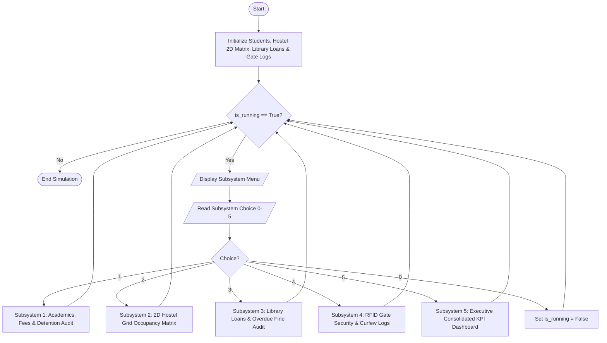

# Case Study 100: Comprehensive Smart Campus Management Simulation

## 1. Problem Statement
Modern technological university campuses integrate multiple interconnected administrative, academic, residential, and security workflows. Traditional monolithic software systems are complex; however, an integrated simulation engine can unify student academic records, hostel room allocation grids, automated library circulation penalty audits, and RFID gate security curfew monitoring. The objective is to design, develop, and benchmark a capstone terminal-based Smart Campus Management Simulation engine using a menu-driven control loop, nested data structures, and multi-tier executive Key Performance Indicator (KPI) dashboards.

---

## 2. Objectives
- Architect an interactive menu-driven simulation using a continuous `while` loop with clean state transitions.
- Model multi-faceted campus subsystems using foundational syllabus data structures:
  - Student academics & tuition fees using lists of tuples.
  - Multi-floor hostel accommodation using a 2D nested list (matrix).
  - Library book circulation and fine computation using tuple unpacking.
  - Security RFID access logs and late-night curfew breach auditing.
- Compile a consolidated cross-subsystem executive dashboard aggregating examination eligibility, financial fee realization, bed occupancy percentage, library overdue revenue, and security violations.
- Strictly adhere to 1st-year B.Tech syllabus limitations: loops, conditionals, strings, 2D nested lists, lists, tuples, and unpacking (strictly no functions, no classes/OOP, no dictionaries, no external libraries).

---

## 3. Assumptions
- Attendance policy: Students with attendance $< 75\%$ are automatically flagged as `[DETAINED]` from university semester examinations.
- Hostel layout: Modeled as a 2D matrix of $3 \text{ Floors} \times 4 \text{ Rooms/Floor}$ ($12$ total capacity). Vacant rooms are explicitly designated as `"[VACANT]"`.
- Library loan rules: Standard loan period is 14 days. Any overdue day attracts an automated penalty of $\text{Rs. } 5.00$ per day.
- Campus security curfew: Standard student campus entry curfew is 21:00 (9:00 PM). Any gate entry timestamp past 21:00 is flagged as an `[ALERT: LATE NIGHT CURFEW BREACH]`.
- System architecture supports both interactive human navigation and automated headless demonstration execution.

---

## 4. Algorithm
- **Step 1:** Initialize central campus database state variables:
  - `students`: List of `(roll_no, name, branch, semester, fee_paid, fee_due, attendance_pct)`.
  - `hostel_grid`: 2D list of dimensions $3 \times 4$ containing student roll numbers or `"[VACANT]"`.
  - `library_loans`: List of `(roll_no, book_title, days_held)`.
  - `gate_logs`: List of `(time_str, roll_no, gate_name, direction, is_breach)`.
- **Step 2:** Start main simulation loop (`while is_running == True`).
- **Step 3 (Menu Evaluation):**
  - **Choice 1 (Academic Subsystem):** Traverse `students`. Compute total tuition collected, total dues, and check if $attendance < 75.0$ to flag detention.
  - **Choice 2 (Hostel Subsystem):** Traverse 2D `hostel_grid`. Render formatted floor-by-floor matrix layout. Count occupied vs vacant rooms and calculate hostel occupancy rate.
  - **Choice 3 (Library Subsystem):** Traverse `library_loans`. If $days > 14$, calculate $fine = (days - 14) \times 5.0$. Tally overdue titles and library fine revenue.
  - **Choice 4 (Security Gate Subsystem):** Traverse `gate_logs`. Print transit timestamps, directions, and flag curfew infractions.
  - **Choice 5 (Executive KPI Dashboard):** Synthesize metrics across all four domains:
    - Examination eligibility rate percentage.
    - Total fees collected vs outstanding tuition receivables.
    - Hostel bed utilization percentage.
    - Overdue library book volume and pending fine balance.
    - Total security breaches.
  - **Choice 0:** Set `is_running = False` and terminate.
- **Step 4:** Output final session completion banner.

---

## 5. Flowchart


---

## 6. Pseudocode
```text
BEGIN SmartCampusManagementSimulation
    INITIALIZE students (tuples: roll, name, branch, sem, fee_paid, fee_due, attendance)
    INITIALIZE hostel_grid (3 x 4 matrix of rooms)
    INITIALIZE library_loans (tuples: roll, book, days)
    INITIALIZE gate_logs (tuples: time, roll, gate, dir, breach)

    is_running = TRUE
    WHILE is_running:
        DISPLAY menu
        READ choice

        IF choice == "1" THEN
            FOR EACH st IN students:
                IF st.attendance < 75.0 THEN
                    status = "[DETAINED]"
                ELSE
                    status = "[ELIGIBLE]"
                END IF
                PRINT student record
            END FOR

        ELSE IF choice == "2" THEN
            FOR fl FROM 0 TO 2:
                FOR rm FROM 0 TO 3:
                    PRINT hostel_grid[fl][rm]
                END FOR
            END FOR
            PRINT occupancy metrics

        ELSE IF choice == "3" THEN
            FOR EACH loan IN library_loans:
                IF loan.days > 14 THEN
                    fine = (loan.days - 14) * 5.0
                ELSE
                    fine = 0.0
                END IF
                PRINT loan and fine
            END FOR

        ELSE IF choice == "4" THEN
            FOR EACH log IN gate_logs:
                PRINT gate event and security status
            END FOR

        ELSE IF choice == "5" THEN
            COMPUTE aggregate cross-campus KPIs
            PRINT Executive Scorecard

        ELSE IF choice == "0" THEN
            is_running = FALSE
        END IF
    END WHILE
END
```

---

## 7. Python Source Code
*Strictly adhering to syllabus constraints: loops, conditionals, 2D nested lists, lists, tuples, and unpacking without functions or classes.*

```python
# Refer to solution.py in the same directory for complete executable script.
```

---

## 8. Test Cases

### Test Case 1: Academic Attendance Detention Rule
- **Condition:** Chirag Verma (`26CS03`) has $71.0\%$ attendance; Deepa Rao (`26IT04`) has $68.0\%$ attendance.
- **Expected Outcome:** Subsystem 1 flags both as `[DETAINED]` while candidates with $\ge 75\%$ are approved as `[ELIGIBLE]`.

### Test Case 2: Library Overdue Fine Computation
- **Condition:** `26CS03` held book for 21 days ($7$ days overdue); `26IT04` held book for 25 days ($11$ days overdue).
- **Expected Outcome:** Fines calculated at Rs. $5.00/\text{day} \rightarrow$ Rs. $35.00$ and Rs. $55.00$ respectively; on-time books incur Rs. $0.00$.

### Test Case 3: RFID Gate Curfew Infraction Audit
- **Condition:** Entries recorded at `21:40` and `22:15` (past the 21:00 curfew).
- **Expected Outcome:** Subsystem 4 flags both timestamps as `[ALERT: LATE NIGHT CURFEW BREACH]`.

---

## 9. Output & Execution Log
```text
================================================================================
     COMPREHENSIVE SMART CAMPUS MANAGEMENT SIMULATION (Case Study 100)
================================================================================
Enter '1' for Interactive Menu Mode or '0' for Automated Capstone Execution: 0
[AUTO-SIMULATION TRIGGER: Executing Subsystem Menu Option 1]

--------------------------------------------------------------------------------
SUBSYSTEM 1: STUDENT ROSTER, ACADEMICS & DETENTION AUDIT
--------------------------------------------------------------------------------
Roll No  Student Name     Branch   Sem   Fee Paid    Fee Due    Attendance   Status
--------------------------------------------------------------------------------
26CS01   Aarav Sharma     CSE      2     Rs.65000    Rs.0       88.5       % [ELIGIBLE]
26EC02   Bhavna Patel     ECE      2     Rs.65000    Rs.0       91.0       % [ELIGIBLE]
26CS03   Chirag Verma     CSE      2     Rs.45000    Rs.20000   71.0       % [DETAINED]
26IT04   Deepa Rao        IT       2     Rs.65000    Rs.0       68.0       % [DETAINED]
26ME05   Esha Reddy       MECH     2     Rs.50000    Rs.15000   82.0       % [ELIGIBLE]
--------------------------------------------------------------------------------
Total Cohort: 5 | Detained (Attendance < 75%): 2 | Total Fees Due: Rs. 35000.00

[AUTO-SIMULATION TRIGGER: Executing Subsystem Menu Option 2]

--------------------------------------------------------------------------------
SUBSYSTEM 2: SMART HOSTEL 2D MATRIX ROOM OCCUPANCY GRID
--------------------------------------------------------------------------------
        Room 1        Room 2        Room 3        Room 4        
        --------------------------------------------------------
Floor 0 | 26CS01        [VACANT]      26EC02        [VACANT]      
Floor 1 | 26CS03        [VACANT]      [VACANT]      26IT04        
Floor 2 | [VACANT]      26ME05        [VACANT]      [VACANT]      
--------------------------------------------------------------------------------
Total Rooms: 12 | Occupied: 5 | Vacant: 7 | Occupancy Rate: 41.67%

[AUTO-SIMULATION TRIGGER: Executing Subsystem Menu Option 3]

--------------------------------------------------------------------------------
SUBSYSTEM 3: CAMPUS LIBRARY LOANS, OVERDUE & FINE AUDIT
--------------------------------------------------------------------------------
Borrower   Book Title                   Days Out   Allowed    Overdue    Fine (Rs.)
--------------------------------------------------------------------------------
26CS01     Python Programming ABL       10         14         0          NIL
26CS03     Data Structures in C         21         14         7          Rs. 35.00
26EC02     Digital Electronics          14         14         0          NIL
26IT04     Computer Networks            25         14         11         Rs. 55.00
--------------------------------------------------------------------------------
Total Active Loans: 4 | Overdue Returns: 2 | Total Outstanding Fines: Rs. 90.00

[AUTO-SIMULATION TRIGGER: Executing Subsystem Menu Option 4]

--------------------------------------------------------------------------------
SUBSYSTEM 4: RFID SECURITY GATE TRANSIT & CURFEW BREACH AUDIT
--------------------------------------------------------------------------------
Time     Roll No    Gate Location    Transit    Security Compliance
--------------------------------------------------------------------------------
17:45    26CS01     Main Gate        EXIT       [AUTHORIZED TRANSIT]
19:30    26CS01     Main Gate        ENTRY      [AUTHORIZED TRANSIT]
21:40    26CS03     Hostel Gate      ENTRY      [ALERT: LATE NIGHT CURFEW BREACH]
22:15    26IT04     Main Gate        ENTRY      [ALERT: LATE NIGHT CURFEW BREACH]
--------------------------------------------------------------------------------
Total RFID Events: 4 | Curfew Security Breaches: 2

[AUTO-SIMULATION TRIGGER: Executing Subsystem Menu Option 5]

================================================================================
           CAMPUS-WIDE CONSOLIDATED EXECUTIVE KPI SCORECARD
================================================================================
Total Student Body Enrolled         : 5 Students
Examination Eligible Rate           : 60.0% (3 eligible, 2 detained)
Total Institutional Fees Collected : Rs. 290,000.00
Pending Outstanding Tuition Dues    : Rs. 35,000.00
Campus Hostel Occupancy Percentage  : 41.67% (5/12 rooms booked)
Active Library Circulation Overdue  : 2 titles (Pending Fines: Rs. 90.00)
Gate Curfew Security Violations     : 2 infractions logged
================================================================================
Overall Campus Operational Status   : [NOMINAL - REGULAR OPERATIONS ACTIVE]
================================================================================

================================================================================
CAPSTONE SIMULATION RUN COMPLETED SUCCESSFULLY
================================================================================
```

---

## 10. Conclusion
Case Study 100 acts as a capstone application integrating loops, conditionals, nested lists, tuples, and sequential state management. It demonstrates that complex enterprise-like management workflows can be structured cleanly without resorting to object-oriented programming or external frameworks, providing an educational foundation for 1st-year B.Tech engineering students.
