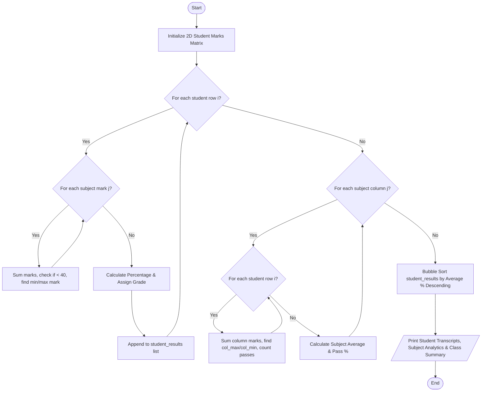

# Case Study 42: Student Marks Matrix Analysis

## 1. Problem Statement
In an academic semester, an engineering college evaluates students across multiple foundational subjects. The student examination data is maintained as a 2D matrix (nested list) where each row represents a student and each column represents marks scored in a specific subject. The objective is to design a Python program that performs row-wise student performance analysis (total marks, percentage, grade, pass/fail status, highest and lowest scoring subjects) and column-wise subject analysis (subject class average, highest score, lowest score, pass percentage, and subject difficulty classification), followed by class topper identification and overall grade distribution.

---

## 2. Objectives
- Represent student academic records using 2D nested lists (matrices).
- Perform row-wise traversal using loops to calculate individual student aggregates, percentages, and subject extrema.
- Apply conditional logic (`if-elif-else`) for institutional grading and pass/fail determination.
- Perform column-wise traversal of the matrix to evaluate subject-level statistics and identify the hardest and easiest subjects.
- Sort student results using an elementary nested loop comparison algorithm (Bubble Sort) to generate the class merit rank list.
- Strictly adhere to 1st-year B.Tech syllabus guidelines: no functions, no classes/OOP, no dictionaries, and no third-party libraries (such as pandas or numpy).

---

## 3. Assumptions
- The class comprises $N$ students evaluated across $M = 5$ subjects: Mathematics, Physics, Chemistry, Python Programming, and Data Structures.
- Marks for each subject range from 0 to 100.
- Passing criterion: A student must score at least 40 marks in every individual subject to pass. Scoring below 40 in even one subject results in an automatic grade of `'F'` (Fail).
- Grading scale for passing students:
  - Average $\ge 90\% \rightarrow$ Grade **O** (Outstanding)
  - Average $\ge 80\% \rightarrow$ Grade **A+** (Excellent)
  - Average $\ge 70\% \rightarrow$ Grade **A** (Very Good)
  - Average $\ge 60\% \rightarrow$ Grade **B+** (Good)
  - Average $\ge 50\% \rightarrow$ Grade **B** (Above Average)
  - Average $\ge 40\% \rightarrow$ Grade **C** (Pass)

---

## 4. Algorithm
- **Step 1:** Initialize the subject names list: `['Mathematics', 'Physics', 'Chemistry', 'Python Prog', 'Data Struct']`.
- **Step 2:** Populate the 2D student marks matrix where each row is `[student_id, student_name, mark1, mark2, mark3, mark4, mark5]`.
- **Step 3 (Row-Wise Traversal):** For each row $i$ from $0$ to $N - 1$:
  - Initialize `row_sum = 0`, `min_mark = mark1`, `max_mark = mark1`, and `has_failed = False`.
  - Loop through each subject column index $j$ from $0$ to $4$:
    - Add mark to `row_sum`.
    - If `mark < 40`, set `has_failed = True`.
    - Track maximum mark and minimum mark along with their subject indices.
  - Calculate $Percentage = row\_sum / 5.0$.
  - Assign grade based on conditional checks. If `has_failed == True`, assign `'F'`.
  - Store computed summary tuple in `student_results`.
- **Step 4 (Column-Wise Traversal):** For each subject column $j$ from $0$ to $4$:
  - Initialize `col_sum = 0`, `col_min = matrix[0][j]`, `col_max = matrix[0][j]`, and `col_passes = 0`.
  - Loop through each student row $i$ from $0$ to $N - 1$:
    - Add mark to `col_sum`.
    - Update `col_max` and `col_min`.
    - If `mark >= 40`, increment `col_passes`.
  - Calculate `col_avg = col_sum / N` and `pass_percentage = (col_passes / N) * 100`.
  - Identify subject with minimum average as **Hardest** and maximum average as **Easiest**.
- **Step 5 (Merit Ranking):** Sort `student_results` in descending order of average percentage using nested loop Bubble Sort.
- **Step 6:** Display formatted tables for student transcripts, subject metrics, and class summary statistics.

---

## 5. Flowchart


---

## 6. Pseudocode
```text
BEGIN StudentMarksMatrixAnalysis
    SET subjects = ["Mathematics", "Physics", "Chemistry", "Python Prog", "Data Struct"]
    READ student_matrix (N rows x 7 columns)

    student_results = []
    grade_letters = ["O", "A+", "A", "B+", "B", "C", "F"]
    grade_counts = [0, 0, 0, 0, 0, 0, 0]

    // Row-Wise Traversal
    FOR i FROM 0 TO N - 1:
        row = student_matrix[i]
        id = row[0], name = row[1]
        sum_marks = 0
        min_m = row[2], max_m = row[2]
        fail_flag = FALSE

        FOR j FROM 0 TO 4:
            m = row[2 + j]
            sum_marks = sum_marks + m
            IF m < 40 THEN fail_flag = TRUE
            IF m > max_m THEN max_m = m, best_idx = j
            IF m < min_m THEN min_m = m, worst_idx = j
        END FOR

        pct = sum_marks / 5.0
        IF fail_flag == TRUE THEN
            grade = "F", status = "FAIL"
        ELSE
            status = "PASS"
            IF pct >= 90 THEN grade = "O"
            ELSE IF pct >= 80 THEN grade = "A+"
            ELSE IF pct >= 70 THEN grade = "A"
            ELSE IF pct >= 60 THEN grade = "B+"
            ELSE IF pct >= 50 THEN grade = "B"
            ELSE grade = "C"
        END IF

        APPEND (id, name, sum_marks, pct, subjects[best_idx], subjects[worst_idx], grade, status) TO student_results
    END FOR

    // Column-Wise Traversal
    FOR j FROM 0 TO 4:
        col_sum = 0, col_max = student_matrix[0][2+j], col_min = student_matrix[0][2+j], passes = 0
        FOR i FROM 0 TO N - 1:
            val = student_matrix[i][2+j]
            col_sum = col_sum + val
            IF val > col_max THEN col_max = val
            IF val < col_min THEN col_min = val
            IF val >= 40 THEN passes = passes + 1
        END FOR
        avg = col_sum / N
        pass_pct = (passes / N) * 100
        RECORD subject metrics
    END FOR

    // Bubble Sort for merit rank list
    FOR i FROM 0 TO N - 2:
        FOR j FROM 0 TO N - i - 2:
            IF student_results[j].pct < student_results[j+1].pct THEN
                SWAP student_results[j], student_results[j+1]
            END IF
        END FOR
    END FOR

    PRINT tables and statistics
END
```

---

## 7. Python Source Code
*Strictly adhering to syllabus constraints: loops, conditionals, 2D nested lists, parallel lists, and tuples.*

```python
# Refer to solution.py in the same directory for complete executable script.
```

---

## 8. Test Cases

### Test Case 1: All Subjects Cleared with High Distinctions
- **Input Record:** `STU102` (Bhavna Joshi): Math: 94, Physics: 89, Chem: 91, Python: 96, DS: 90.
- **Expected Output:** Total = $460.0$, Average = $92.0\%$, Grade = **O**, Status = **PASS**, Class Rank #1.

### Test Case 2: Subject Backlog / Failing Threshold
- **Input Record:** `STU104` (Deepa Sharma): Math: 74, Physics: 36, Chem: 68, Python: 82, DS: 71.
- **Expected Output:** Despite average being $66.2\%$, scoring $36 < 40$ in Physics causes Grade = **F**, Status = **FAIL**.

### Test Case 3: Subject Difficulty Analysis
- **Inputs:** Class marks across all 6 students.
- **Expected Output:**
  - Physics lowest class average ($68.67$) $\rightarrow$ flagged as `[HARDEST]`.
  - Python Programming highest class average ($81.67$) $\rightarrow$ flagged as `[EASIEST]`.

---

## 9. Output & Execution Log
```text
===========================================================================
        ACADEMIC MARKS MATRIX ANALYTICS ENGINE (Case Study 42)
===========================================================================
Enter '1' for interactive entry or '0' for Automated Test Dataset: 0
[Loading Benchmark Academic Class Matrix (6 Students x 5 Subjects)...]

=====================================================================================
STAGE 1: STUDENT-WISE TRANSCRIPT & MERIT RANKING (ROW-WISE TRAVERSAL)
=====================================================================================
Rank  ID       Student Name     Total   Avg %   Grade  Status Strongest Subject   
-------------------------------------------------------------------------------------
1     STU102   Bhavna Joshi     460.0   92.00   O      PASS   Python Prog (96.0)  
2     STU105   Ehsaan Khan      443.0   88.60   A+     PASS   Python Prog (92.0)  
3     STU101   Aakash Gupta     438.0   87.60   A+     PASS   Python Prog (95.0)  
4     STU104   Deepa Sharma     331.0   66.20   F      FAIL   Python Prog (82.0)  
5     STU103   Chetan Reddy     309.0   61.80   B+     PASS   Python Prog (70.0)  
6     STU106   Fatima Zehra     240.0   48.00   C      PASS   Python Prog (55.0)  

=====================================================================================
STAGE 2: SUBJECT-WISE PERFORMANCE & DIFFICULTY METRICS (COLUMN-WISE TRAVERSAL)
=====================================================================================
Subject Name       Class Avg   Highest   Lowest    Pass Rate  Difficulty
-------------------------------------------------------------------------------------
Mathematics        74.50       94.0      42.0      100.0    % Normal
Physics            68.67       92.0      36.0      83.3     % [HARDEST]
Chemistry          71.67       91.0      50.0      100.0    % Normal
Python Prog        81.67       96.0      55.0      100.0    % [EASIEST]
Data Struct        73.67       90.0      45.0      100.0    % Normal

=====================================================================================
STAGE 3: CLASS-LEVEL OVERALL SUMMARY & GRADE DISTRIBUTION
=====================================================================================
Class Overall Average Score : 74.03%
Class Overall Pass Rate     : 83.33% (5/6 students)
Academic Batch Topper       : Bhavna Joshi (STU102) with 92.0% (Total: 460.0/500)
Most Demanding Subject      : Physics (Lowest Class Average: 68.67)
Highest Scoring Subject     : Python Prog (Highest Class Average: 81.67)

Grade Frequency Distribution:
  Grade O: 1  |  Grade A+: 2  |  Grade A: 0  |  Grade B+: 1  |  Grade B: 0  |  Grade C: 1  |  Grade F: 1  |  
=====================================================================================
```

---

## 10. Conclusion
Case Study 42 reinforces the concept of 2D matrix traversal. By treating students as rows and subjects as columns, both student-centric and subject-centric aggregate metrics are cleanly computed. This reflects foundational data processing principles taught in 1st-year B.Tech computer science coursework without requiring external data analysis packages.
