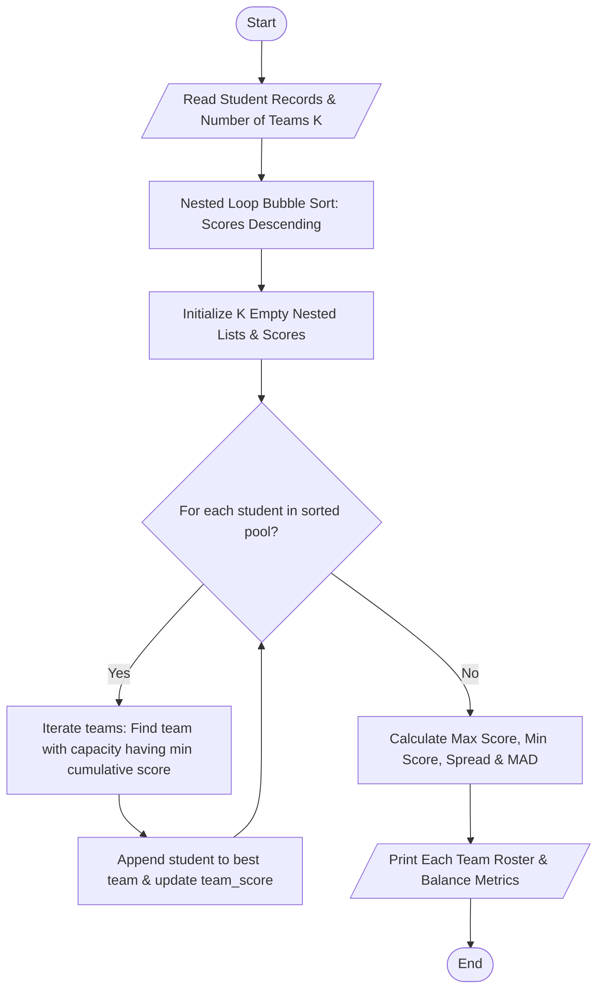

# Case Study 56: Student Group Formation with Score Balancing

## 1. Problem Statement
In engineering education, collaborative lab projects require forming $K$ student teams from a class of $N$ students. If groups are formed arbitrarily or through self-selection, significant skill imbalances emerge—leading to skewed outcomes. The goal is to design an automated group formation algorithm that sorts students by their academic assessment scores and distributes them across $K$ teams using a capacity-constrained greedy heuristic to balance the cumulative and average competency of each group, thereby minimizing inter-team score variance.

---

## 2. Objectives
- Represent student profiles as tuples containing `(roll_no, student_name, score)` stored within a list.
- Sort students in descending order of competence using an in-place Bubble Sort without built-in sorting libraries.
- Partition students into $K$ teams represented as 2D nested lists (`team_members`).
- Implement a greedy balancing heuristic that iteratively assigns the next highest-scoring student to the team with the lowest current aggregate score (subject to a maximum capacity constraint).
- Compute statistical evaluation metrics: total team score, average score, maximum inter-team disparity, and mean absolute deviation.
- Strictly adhere to 1st-year B.Tech syllabus limits: loops, conditionals, lists, nested lists, and tuples (no functions, no classes/OOP, no dictionaries).

---

## 3. Assumptions
- Total students $N$ is greater than or equal to the number of teams $K$.
- Maximum capacity per team is bounded by $\lceil N / K \rceil$.
- Individual assessment scores are non-negative real numbers between 0 and 100.
- A score disparity (spread between highest and lowest team totals) $\le 5.0$ indicates `[EXCELLENT]` balance quality.

---

## 4. Algorithm
- **Step 1:** Read number of teams $K$ and student records `(roll_no, name, score)`.
- **Step 2:** Sort the student list in descending order of score using a 2-pass nested loop (Bubble Sort).
- **Step 3:** Calculate maximum team capacity: `max_per_team = (N + K - 1) // K`.
- **Step 4:** Initialize nested lists: `team_members = [[] for _ in range(K)]` and `team_scores = [0.0 for _ in range(K)]`.
- **Step 5 (Greedy Allocation):** For each student in the sorted list:
  - Find the team index `best_team_idx` having $length < max\_per\_team$ that possesses the lowest current `team_scores[t]`.
  - Append the student tuple to `team_members[best_team_idx]`.
  - Add the student's score to `team_scores[best_team_idx]`.
- **Step 6 (Disparity & Metrics Computation):**
  - Compute total class score and $Ideal\_Target = Total\_Score / K$.
  - Find `min_team_score` and `max_team_score` across the teams.
  - Calculate $Score\_Spread = max\_team\_score - min\_team\_score$.
  - Calculate Mean Absolute Deviation (MAD) across all teams from the target.
- **Step 7:** Display the roster of each formed team and the final balance quality assessment.

---

## 5. Flowchart


---

## 6. Pseudocode
```text
BEGIN StudentGroupFormation
    READ students (list of tuples: roll, name, score)
    READ K (number of teams)
    N = LENGTH(students)

    // Bubble Sort Descending
    FOR i FROM 0 TO N - 2:
        FOR j FROM 0 TO N - i - 2:
            IF students[j].score < students[j+1].score THEN
                SWAP students[j], students[j+1]
            END IF
        END FOR
    END FOR

    max_per_team = (N + K - 1) // K
    INITIALIZE team_members AS list of K empty lists
    INITIALIZE team_scores AS list of K zeros

    FOR EACH student IN students:
        best_t = -1
        min_sc = INFINITY
        FOR t FROM 0 TO K - 1:
            IF LENGTH(team_members[t]) < max_per_team THEN
                IF team_scores[t] < min_sc THEN
                    min_sc = team_scores[t]
                    best_t = t
                END IF
            END IF
        END FOR
        APPEND student TO team_members[best_t]
        team_scores[best_t] = team_scores[best_t] + student.score
    END FOR

    COMPUTE ideal_score, max_score, min_score, disparity, and MAD
    PRINT team rosters and statistical summary
END
```

---

## 7. Python Source Code
*Strictly adhering to syllabus constraints: loops, conditionals, nested lists, tuples, and arithmetic accumulators.*

```python
# Refer to solution.py in the same directory for complete executable script.
```

---

## 8. Test Cases

### Test Case 1: 12-Student Cohort into 3 Teams
- **Inputs:** 12 students with scores ranging from $96.0$ down to $54.0$. $K = 3$ teams.
- **Allocated Totals:**
  - Team 1: $306.50$ (Avg: $76.62$, Members: 4)
  - Team 2: $306.50$ (Avg: $76.62$, Members: 4)
  - Team 3: $303.00$ (Avg: $75.75$, Members: 4)
- **Expected Outcome:** Score spread is only $3.5$ points ($\le 5.0$), yielding `[EXCELLENT]` balance quality.

### Test Case 2: Uneven Student Distribution
- **Inputs:** 7 students split into $K = 2$ teams (capacities 4 and 3).
- **Expected Outcome:** Algorithm respects the `max_per_team` cap while steering higher and lower scores into complementary groups.

---

## 9. Output & Execution Log
```text
===========================================================================
     STUDENT PROJECT GROUP FORMATION & SCORE BALANCING (Case Study 56)
===========================================================================
Enter '1' for interactive student entry or '0' for Automated Test Dataset: 0
[Loading Benchmark Class Dataset: 12 Students to be split into 3 Balanced Teams]

---------------------------------------------------------------------------
STAGE 1: SCORE SORTING VIA NESTED LOOP BUBBLE SORT
---------------------------------------------------------------------------
Sorted Student Pool (High to Low Scores):
  Rank  1: 26CS01 | Aditya Sharma    | Score: 96.0
  Rank  2: 26CS02 | Bhavya Sri       | Score: 92.5
  Rank  3: 26CS03 | Charan Teja      | Score: 89.0
  Rank  4: 26CS04 | Divya Vani       | Score: 85.0
  Rank  5: 26CS05 | Eswar Kumar      | Score: 82.0
  Rank  6: 26CS06 | Farhana Anjum    | Score: 78.5
  Rank  7: 26CS07 | Ganesh Vardhan   | Score: 75.0
  Rank  8: 26CS08 | Harika Devi      | Score: 71.5
  Rank  9: 26CS09 | Imran Pasha      | Score: 68.0
  Rank 10: 26CS10 | Jaswanth Sai     | Score: 64.0
  Rank 11: 26CS11 | Kavya Sree       | Score: 60.5
  Rank 12: 26CS12 | Lokesh Naidu     | Score: 54.0

===========================================================================
STAGE 2: FINAL ALLOCATED PROJECT TEAMS & COMPOSITION
===========================================================================

[TEAM 1] | Total Score: 306.50 | Average Score: 76.62 | Size: 4
  Roll No    Student Name       Individual Score
  ---------------------------------------------
  26CS01     Aditya Sharma      96.0            
  26CS06     Farhana Anjum      78.5            
  26CS08     Harika Devi        71.5            
  26CS11     Kavya Sree         60.5            

[TEAM 2] | Total Score: 306.50 | Average Score: 76.62 | Size: 4
  Roll No    Student Name       Individual Score
  ---------------------------------------------
  26CS02     Bhavya Sri         92.5            
  26CS05     Eswar Kumar        82.0            
  26CS09     Imran Pasha        68.0            
  26CS10     Jaswanth Sai       64.0            

[TEAM 3] | Total Score: 303.00 | Average Score: 75.75 | Size: 4
  Roll No    Student Name       Individual Score
  ---------------------------------------------
  26CS03     Charan Teja        89.0            
  26CS04     Divya Vani         85.0            
  26CS07     Ganesh Vardhan     75.0            
  26CS12     Lokesh Naidu       54.0            

===========================================================================
STAGE 3: BALANCE AUDIT & STATISTICAL METRICS
===========================================================================
Total Student Cohort Size  : 12
Configured Teams (K)       : 3
Ideal Aggregate per Team   : 305.33
Highest Team Aggregate     : 306.50
Lowest Team Aggregate      : 303.00
Score Spread / Disparity   : 3.5 points
Average Team Deviation     : 1.56 points from target
Balance Quality Assessment : [EXCELLENT] Uniformly balanced groups.
===========================================================================
```

---

## 10. Conclusion
Case Study 56 addresses the multi-way number partitioning problem using a greedy capacity-aware approach suitable for a 1st-year B.Tech engineering curriculum. By combining descending sort ordering with dynamic minimum-aggregate selection, it achieves an equitable balance across all teams.
