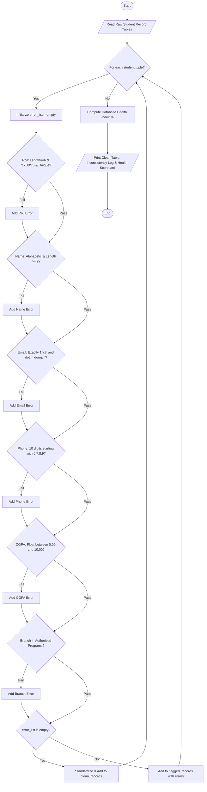

# Case Study 75: Integrated Student Record Consistency Checker

## 1. Problem Statement
When university admissions and departmental offices collect student registration profiles online, datasets suffer from data entry errors, malformatted fields, non-standard naming casing, invalid mobile numbers, out-of-bounds CGPAs, and duplicate registrations. The objective is to design and implement an automated data consistency checker that parses heterogeneous student records stored as tuples, verifies institutional integrity rules, sanitizes valid data into standardized formats, generates an itemized audit discrepancy log for flawed records, and calculates a holistic Database Health Index.

---

## 2. Objectives
- Unpack and process heterogeneous student profile tuples containing text, numerical strings, and codes.
- Implement rule-based data validation without relying on forbidden libraries (`re` for regular expressions, `pandas`, or third-party schema validators).
- Verify institutional Roll Number pattern rules (`YYBBSS`) and ensure cohort uniqueness without `set` structures.
- Standardize human name formatting into proper Title Case while stripping illegal symbols or numerical digits.
- Validate email syntax (single `@` delimiter with a following valid domain dot) and mobile telephone conventions (10-digit format with valid initial service provider prefix `6-9`).
- Perform type casting and range validation for academic CGPA metrics ($0.00 \le CGPA \le 10.00$).
- Strictly follow 1st-year B.Tech syllabus constraints: variables, conditionals, loops, string slicing/methods, lists, and tuples.

---

## 3. Assumptions
- Each incoming student profile is structured as a 7-element tuple:  
  `(roll_number, full_name, email, phone, cgpa_str, branch, date_of_birth)`.
- Valid roll numbers are strictly 6 alphanumeric characters: 2 year digits, 2 branch letters, and 2 serial digits (e.g., `26CS01`).
- Valid academic branches belong to the approved institutional list: `['CSE', 'ECE', 'EEE', 'MECH', 'CIVIL', 'IT', 'CS']`.
- Phone numbers can be supplied with optional country codes (`+91` or `91`) or leading zero (`0`), but must resolve to exactly 10 digits beginning with 6, 7, 8, or 9.
- Any record violating one or more rules is quarantined into the flagged log without polluting the sanitized database.

---

## 4. Algorithm
- **Step 1:** Read the collection of raw student registration tuples.
- **Step 2:** Initialize tracking structures: `seen_rolls = []`, `clean_records = []`, `flagged_records = []`.
- **Step 3:** For each student tuple `(roll, name, email, phone, cgpa_str, branch, dob)`:
  - Initialize empty `error_list = []`.
  - **Check 1 (Roll Number):** Verify length equals 6, characters match `YYBBSS` type constraints, and verify uniqueness against `seen_rolls`.
  - **Check 2 (Name):** Ensure name contains only alphabetic characters and spaces. Standardize casing to Title Case.
  - **Check 3 (Email):** Check that `'@'` occurs exactly once and a valid period follows in the domain segment.
  - **Check 4 (Phone):** Extract digits, strip optional `+91` or `0`, ensure length equals 10, and verify leading digit $\in \{6, 7, 8, 9\}$.
  - **Check 5 (CGPA):** Convert string to float, and check $0.0 \le CGPA \le 10.0$.
  - **Check 6 (Branch):** Check membership in `valid_branches`.
- **Step 4:** If `len(error_list) == 0`:
  - Append standardized record `(roll, formatted_name, email, phone, cgpa, branch)` to `clean_records`.
- **Step 5:** Else:
  - Append `(roll, name, error_list)` to `flagged_records`.
- **Step 6:** Compute $Database\_Health\_Index = (len(clean\_records) / total\_records) \times 100\%$.
- **Step 7:** Display the verified clean database, flagged issue logs, and overall quality scorecard.

---

## 5. Flowchart


---

## 6. Pseudocode
```text
BEGIN StudentRecordConsistencyChecker
    READ raw_records
    seen_rolls = []
    clean_records = []
    flagged_records = []
    valid_branches = ["CSE", "ECE", "EEE", "MECH", "CIVIL", "IT", "CS"]

    FOR EACH (roll, name, email, phone, cgpa_str, branch, dob) IN raw_records:
        error_list = []

        // 1. Roll check
        IF LENGTH(roll) != 6 OR NOT (roll[0:2].ISDIGIT AND roll[2:4].ISALPHA AND roll[4:6].ISDIGIT) THEN
            APPEND "Invalid roll format" TO error_list
        END IF
        IF roll IN seen_rolls THEN
            APPEND "Duplicate roll number" TO error_list
        ELSE
            APPEND roll TO seen_rolls
        END IF

        // 2. Name check & standardization
        IF NOT name_is_alphabetic(name) THEN
            APPEND "Invalid name characters" TO error_list
        ELSE
            standardized_name = TITLE_CASE(name)
        END IF

        // 3. Email check
        IF count_of('@') != 1 OR dot_missing_in_domain THEN
            APPEND "Invalid email" TO error_list
        END IF

        // 4. Phone check
        digits = EXTRACT_DIGITS(phone)
        normalized_phone = STRIP_COUNTRY_CODE(digits)
        IF LENGTH(normalized_phone) != 10 OR normalized_phone[0] NOT IN ['6','7','8','9'] THEN
            APPEND "Invalid mobile number" TO error_list
        END IF

        // 5. CGPA check
        IF cgpa < 0.0 OR cgpa > 10.0 THEN
            APPEND "CGPA out of range" TO error_list
        END IF

        // 6. Branch check
        IF branch NOT IN valid_branches THEN
            APPEND "Unauthorized branch" TO error_list
        END IF

        IF LENGTH(error_list) == 0 THEN
            APPEND sanitized tuple TO clean_records
        ELSE
            APPEND (roll, name, error_list) TO flagged_records
        END IF
    END FOR

    health_index = (LENGTH(clean_records) / TOTAL(raw_records)) * 100.0
    PRINT tables, issue log, and health scorecard
END
```

---

## 7. Python Source Code
*Strictly adhering to syllabus constraints: loops, conditionals, strings, tuples, and lists without external regex or classes.*

```python
# Refer to solution.py in the same directory for complete executable script.
```

---

## 8. Test Cases

### Test Case 1: Unsanitized Formatting but Valid Data
- **Input Record:** `26EC02` ("bHaVnA pAtEl", "bhavna.patel@gmail.com", "8765432109", "9.20", "ECE", "22-11-2004")
- **Expected Outcome:** Correctly passes all checks; name is automatically standardized to `"Bhavna Patel"`.

### Test Case 2: Out-of-Bounds CGPA and Truncated Mobile
- **Input Record:** `26CS03` ("Chirag Verma", "chirag.verma@college.edu", "98765", "11.50", "CSE", "10-04-2005")
- **Expected Outcome:** Flagged with 2 explicit errors: (1) Phone contains only 5 digits, and (2) CGPA 11.50 exceeds the 10.00 scale.

### Test Case 3: Duplicate Cohort Roll Number & Broken Email
- **Input Record:** `26CS01` ("Aarav S Clone", "aaravclone_gmail.com", ...)
- **Expected Outcome:** Flagged for duplicate roll number collision with the existing `26CS01` entry, and missing `'@'` symbol.

---

## 9. Output & Execution Log
```text
================================================================================
     INTEGRATED STUDENT RECORD CONSISTENCY & VALIDITY CHECKER (Case Study 75)
================================================================================
Enter '1' for interactive entry or '0' for Automated Test Dataset: 0
[Loading Benchmark Test Database (7 Student Records with Varied Anomalies)...]

--------------------------------------------------------------------------------
STAGE 1: AUDITING FIELD-BY-FIELD CONSISTENCY
--------------------------------------------------------------------------------
  [CONSISTENT]  26CS01   | Aarav Sharma         | Verified
  [CONSISTENT]  26EC02   | Bhavna Patel         | Verified
  [FLAGGED]     26CS03   | Chirag Verma         | Errors: 2
  [FLAGGED]     26CS01   | Aarav S Clone        | Errors: 2
  [FLAGGED]     INVALID_ROLL | Deepak Rao           | Errors: 2
  [FLAGGED]     26IT05   | Esha Reddy #123      | Errors: 2
  [CONSISTENT]  26CS06   | Farooq Abdullah      | Verified

================================================================================
VERIFIED CLEAN & STANDARDIZED STUDENT DATABASE
================================================================================
Roll No  Standardized Full Name Branch   CGPA   Mobile       Email
--------------------------------------------------------------------------------
26CS01   Aarav Sharma           CSE      8.95   9876543210   aarav.sharma@nrtec.ac.in
26EC02   Bhavna Patel           ECE      9.20   8765432109   bhavna.patel@gmail.com
26CS06   Farooq Abdullah        CSE      7.85   9988776655   farooq.a@nrtec.ac.in

================================================================================
INCONSISTENCY AUDIT LOG: FLAGGED REGISTRATION RECORDS
================================================================================

Student: Chirag Verma (Roll: 26CS03)
  [ERROR] Phone must contain 10 digits (found 5)
  [ERROR] CGPA 11.5 outside allowable scale (0.00 - 10.00)

Student: Aarav S Clone (Roll: 26CS01)
  [ERROR] Duplicate roll number detected in cohort
  [ERROR] Email lacks valid '@' structure

Student: Deepak Rao (Roll: INVALID_ROLL)
  [ERROR] Roll number length is not 6 characters
  [ERROR] Branch 'BIOTECH' is not an authorized academic program

Student: Esha Reddy #123 (Roll: 26IT05)
  [ERROR] Name contains invalid characters or numbers
  [ERROR] Mobile number must start with 6, 7, 8, or 9

================================================================================
STUDENT RECORD DATABASE HEALTH SCORECARD
================================================================================
Total Student Ingestion Records : 7
Passed All Consistency Checks  : 3
Flagged Inconsistent Records   : 4
Data Health / Quality Index     : 42.86%
Database Quality Status         : [DATA SANITIZATION & CORRECTION REQUIRED]
================================================================================
```

---

## 10. Conclusion
Case Study 75 demonstrates practical data validation principles essential for computer science undergraduates. By breaking down compound string validation into character-by-character analysis and basic list traversal, the program successfully quarantines anomalous student records and enforces academic database integrity.
