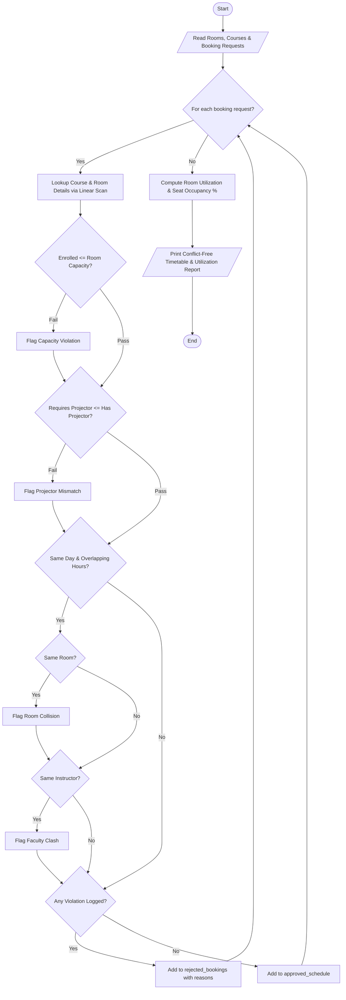

# Case Study 85: Smart Classroom Timetable Allocation

## 1. Problem Statement
Academic departments manage multiple shared physical resources such as lecture halls, computer laboratories, and smart classrooms equipped with multimedia projectors. When creating semester class timetables, administrative planners receive overlapping booking requests from various course instructors. A valid schedule must prevent physical double-bookings, ensure student enrollment does not exceed room seating capacity, guarantee that multimedia/projector requirements are satisfied, and ensure that faculty instructors are not scheduled to teach two separate classes concurrently. The objective is to design a timetable allocation and conflict detection engine to validate bookings and compute campus room utilization metrics.

---

## 2. Objectives
- Represent campus infrastructure (rooms), course curricula, and schedule requests using structured lists of tuples.
- Perform catalog lookups and verification using sequential loop traversal without dictionary lookups.
- Formally evaluate time-slot interval overlap mathematics ($\max(start_1, start_2) < \min(end_1, end_2)$) to identify room collisions and faculty scheduling conflicts.
- Audit room seating limits against student enrollment and verify hardware constraints (multimedia projector availability).
- Generate a conflict-free master timetable grid alongside detailed classroom utilization analytics.
- Strictly adhere to 1st-year B.Tech syllabus limitations: variables, conditionals, loops, lists, and tuples (no functions, no classes/OOP, no dictionaries).

---

## 3. Assumptions
- Room records: `(room_id, capacity, has_projector)`.
- Course records: `(course_code, title, enrolled_students, requires_projector, instructor_name)`.
- Booking requests: `(course_code, room_id, day_of_week, start_hour, duration_hours)`.
- Times are represented in 24-hour integer format (e.g., $9$ for 9:00 AM, $14$ for 2:00 PM).
- Two time intervals $[s_1, e_1)$ and $[s_2, e_2)$ conflict if and only if:  
  $$\max(s_1, s_2) < \min(e_1, e_2)$$
- Bookings are accepted chronologically; any request that causes a conflict with an already-approved booking is rejected with an itemized reason.

---

## 4. Algorithm
- **Step 1:** Read inventory of rooms, course catalog, and incoming booking requests.
- **Step 2:** Initialize `approved_schedule = []` and `rejected_bookings = []`.
- **Step 3 (Sequential Booking Audit):** For each booking request `(b_code, b_room, b_day, b_start, b_dur)`:
  - Compute `b_end = b_start + b_dur`.
  - Traverse `courses` to find `(b_code, c_title, c_enrolled, c_proj, c_inst)`.
  - Traverse `rooms` to find `(b_room, r_cap, r_proj)`.
  - Check **Capacity Constraint:** If $c\_enrolled > r\_cap$, flag capacity violation.
  - Check **Facility Constraint:** If $c\_proj == True$ and $r\_proj == False$, flag projector violation.
  - **Check Time Conflicts with Approved Schedule:** For each approved session on the same day:
    - If $\max(b\_start, a\_start) < \min(b\_end, a\_end)$:
      - If $b\_room == a\_room$, flag room collision.
      - If $c\_inst == a\_inst$, flag faculty clash.
  - If no violations exist, append booking to `approved_schedule`.
  - Else, record rejection details in `rejected_bookings`.
- **Step 4 (Utilization Analytics):** For each room in `rooms`:
  - Calculate total hours booked.
  - Calculate $Seat\_Utilization\_Percentage = (Total\_Student\_Hours\_Used / Possible\_Seat\_Hours) \times 100\%$.
- **Step 5:** Display the master timetable grid, utilization metrics, and allocation summary statistics.

---

## 5. Flowchart


---

## 6. Pseudocode
```text
BEGIN SmartClassroomTimetableAllocation
    READ rooms (list of tuples: id, cap, proj)
    READ courses (list of tuples: code, title, enrolled, req_proj, inst)
    READ bookings (list of tuples: code, room, day, start, dur)

    approved_schedule = []
    rejected_bookings = []

    FOR EACH req IN bookings:
        UNPACK (b_code, b_room, b_day, b_start, b_dur)
        b_end = b_start + b_dur

        // Linear Lookups
        LOOKUP course IN courses
        LOOKUP room IN rooms

        valid = TRUE
        reasons = []

        IF course.enrolled > room.cap THEN
            valid = FALSE
            APPEND "Capacity Exceeded" TO reasons
        END IF

        IF course.req_proj AND NOT room.proj THEN
            valid = FALSE
            APPEND "Projector Mismatch" TO reasons
        END IF

        FOR EACH app IN approved_schedule:
            IF app.day == b_day THEN
                IF MAX(b_start, app.start) < MIN(b_end, app.end) THEN
                    IF app.room == b_room THEN
                        valid = FALSE
                        APPEND "Room Collision" TO reasons
                    END IF
                    IF app.inst == course.inst THEN
                        valid = FALSE
                        APPEND "Faculty Clash" TO reasons
                    END IF
                END IF
            END IF
        END FOR

        IF valid THEN
            APPEND req details TO approved_schedule
        ELSE
            APPEND (req, reasons) TO rejected_bookings
        END IF
    END FOR

    PRINT master_timetable
    PRINT room_utilization_metrics
END
```

---

## 7. Python Source Code
*Strictly adhering to syllabus constraints: loops, conditionals, list/tuple traversals, and mathematical interval overlap logic.*

```python
# Refer to solution.py in the same directory for complete executable script.
```

---

## 8. Test Cases

### Test Case 1: Room Double-Booking Collision
- **Existing Booking:** `CS101` in `LH101` on Monday (09:00 - 11:00).
- **Incoming Request:** `MA104` in `LH101` on Monday (10:00 - 12:00).
- **Expected Outcome:** Overlap detected between 10:00 and 11:00; request rejected due to room collision.

### Test Case 2: Faculty Concurrent Teaching Clash
- **Existing Booking:** `CS101` with `Dr. Ramesh` on Monday (09:00 - 11:00) in `LH101`.
- **Incoming Request:** `CS103` with `Dr. Ramesh` on Monday (09:00 - 11:00) in `LAB201`.
- **Expected Outcome:** Even though `LAB201` is vacant, the booking is rejected because `Dr. Ramesh` is already committed to `CS101`.

### Test Case 3: Dual Capacity and Projector Violation
- **Incoming Request:** `HS105` (45 students, requires projector) in `LH102` (capacity 40, no projector).
- **Expected Outcome:** Rejected with two simultaneous infractions: capacity exceeded by 5 students and lack of multimedia projector.

---

## 9. Output & Execution Log
```text
================================================================================
       SMART CLASSROOM TIMETABLE ALLOCATION ENGINE (Case Study 85)
================================================================================
Enter '1' for interactive entry or '0' for Automated Test Dataset: 0
[Loading Standard Engineering Department Schedule Dataset...]

--------------------------------------------------------------------------------
STAGE 1: VERIFYING FACILITY & CAPACITY COMPLIANCE
--------------------------------------------------------------------------------
  [APPROVED] CS101  in LH101  on Monday   (09:00 - 11:00) | Dr. Ramesh
  [REJECTED] MA104  in LH101  on Monday   (10:00 - 12:00)
             [-] Room collision: LH101 already booked by CS101 (9:00-11:00)
  [APPROVED] EC102  in LH102  on Monday   (09:00 - 11:00) | Prof. Anitha
  [REJECTED] CS103  in LAB201 on Monday   (09:00 - 11:00)
             [-] Faculty clash: Dr. Ramesh already teaching CS101 at (9:00-11:00)
  [REJECTED] HS105  in LH102  on Tuesday  (14:00 - 16:00)
             [-] Capacity exceeded: 45 students enrolled, but LH102 capacity is 40
             [-] Facility mismatch: HS105 requires projector, but LH102 has no projector
  [APPROVED] CS101  in LH101  on Tuesday  (10:00 - 12:00) | Dr. Ramesh

================================================================================
STAGE 2: MASTER CONFLICT-FREE TIMETABLE SCHEDULE
================================================================================
Day        Time Slot       Room     Code    Course Title                 Instructor     
--------------------------------------------------------------------------------
Monday     09:00 - 11:00   LH101    CS101   Problem Solving with Python  Dr. Ramesh     
Monday     09:00 - 11:00   LH102    EC102   Digital Logic Design         Prof. Anitha   
Tuesday    10:00 - 12:00   LH101    CS101   Problem Solving with Python  Dr. Ramesh     

================================================================================
STAGE 3: CLASSROOM UTILIZATION & CAPACITY EFFICIENCY
================================================================================
Room ID    Capacity   Projector    Booked Hours   Seat Utilization
--------------------------------------------------------------------------------
LH101      60         YES          4              91.67%
LH102      40         NO           2              87.5%
LAB201     30         YES          0              0.0% (Idle)

================================================================================
ALLOCATION SUMMARY METRICS
================================================================================
Total Booking Requests Processed : 6
Approved Conflict-Free Classes  : 3
Rejected / Conflicting Bookings : 3
Total Weekly Instructional Hours: 6 hours
================================================================================
```

---

## 10. Conclusion
Case Study 85 models resource scheduling using interval overlap mathematics and multi-attribute tuple verification. By systematically evaluating spatial, temporal, physical, and human constraints, the engine builds an conflict-free timetable and provides actionable facility utilization metrics for institutional management.
