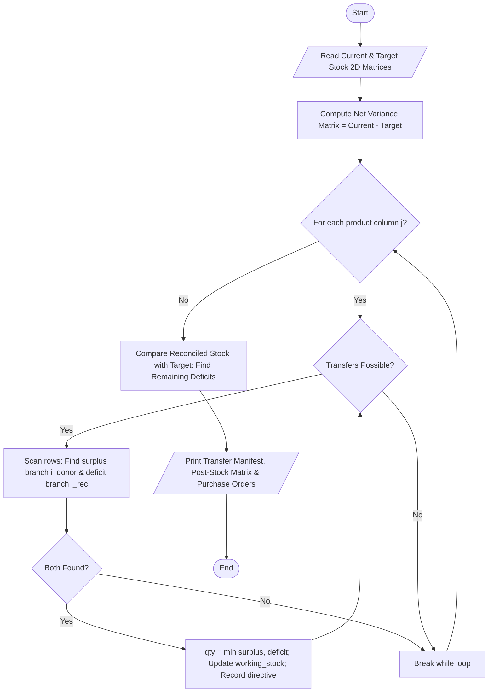

# Case Study 88: Multi-Branch Retail Inventory Transfer

## 1. Problem Statement
Retail supply chains and collegiate cooperative bookshops operating across multiple regional branch campuses regularly experience localized inventory imbalances. While one branch may face a severe stockout deficit of textbooks or laboratory drawing kits, a neighboring branch may hold idle surplus inventory. Procuring fresh stock from external manufacturers takes lead time and incurs procurement costs, whereas rebalancing existing internal inventory between branches minimizes dead stock and fulfills customer demand quickly. The objective is to design a multi-branch inventory reconciliation engine that analyzes $M \times N$ 2D stock matrices, identifies surpluses and deficits, executes an automated greedy inter-branch stock transfer algorithm, and audits residual deficits requiring external vendor re-ordering.

---

## 2. Objectives
- Represent multi-location inventory using 2D nested lists (`current_stock` and `target_stock` of dimensions $M \times N$).
- Compute a net variance matrix ($Variance = Current - Target$) to classify branch inventory into Surplus ($>0$), Deficit ($<0$), and Balanced ($=0$).
- Design and implement an inter-branch transfer loop that matches donor branches to recipient branches product-by-product.
- Track discrete transfer directives stored as tuples: `(product, from_branch, to_branch, quantity, logistics_cost)`.
- Compute aggregate logistics expenditures based on a fixed unit transit fee.
- Reconcile post-transfer inventory levels and generate automated purchase orders for unresolved deficits.
- Strictly adhere to 1st-year B.Tech syllabus limitations: loops, conditionals, 2D nested lists, lists, and tuples (no functions, no classes/OOP, no dictionaries, no NumPy).

---

## 3. Assumptions
- There are $M = 4$ branches: Campus-North, Campus-South, Campus-Central, Campus-East.
- There are $N = 4$ stock items: Python Textbooks, Lab Notebooks, Scientific Calculators, and Engineering Drawing Kits.
- Unit transportation handling cost is fixed at $\text{Rs. } 8.50$ per relocated item.
- Intra-network transfers always take priority over external re-orders.
- If total network stock for an item is less than aggregate branch targets, the residual unmet deficit is flagged for Central Vendor re-ordering.

---

## 4. Algorithm
- **Step 1:** Read lists of branch names and product names.
- **Step 2:** Populate $M \times N$ 2D matrices for `current_stock` and `target_stock`.
- **Step 3:** Compute $M \times N$ `variance_matrix` where $Variance[i][j] = current\_stock[i][j] - target\_stock[i][j]$.
- **Step 4:** Initialize `working_stock` as a deep duplicate of `current_stock` and `transfer_directives = []`.
- **Step 5 (Product-by-Product Transfer Loop):** For each product column $j \in [0, N-1]$:
  - While transfers are possible:
    - Search for first branch $i_{donor}$ where $working\_stock[i_{donor}][j] > target\_stock[i_{donor}][j]$.
    - Search for first branch $i_{rec}$ where $working\_stock[i_{rec}][j] < target\_stock[i_{rec}][j]$.
    - If both exist:
      - $available\_surplus = working\_stock[i_{donor}][j] - target\_stock[i_{donor}][j]$.
      - $needed\_deficit = target\_stock[i_{rec}][j] - working\_stock[i_{rec}][j]$.
      - $transfer\_qty = \min(available\_surplus, needed\_deficit)$.
      - $working\_stock[i_{donor}][j] -= transfer\_qty$.
      - $working\_stock[i_{rec}][j] += transfer\_qty$.
      - Append `(product[j], branch[i_donor], branch[i_rec], transfer_qty, transfer_qty * 8.50)` to `transfer_directives`.
    - Else:
      - Terminate `while` loop for this product.
- **Step 6 (Post-Transfer Audit):** Traverse reconciled `working_stock` against `target_stock`. If $working\_stock[i][j] < target\_stock[i][j]$, append remaining deficit to `external_procurement_needed`.
- **Step 7:** Display the pre-transfer variance grid, transfer manifest, post-transfer status matrix, and external purchase order requirements.

---

## 5. Flowchart


---

## 6. Pseudocode
```text
BEGIN MultiBranchInventoryTransfer
    READ branches (M items), products (N items)
    READ current_stock (M x N matrix), target_stock (M x N matrix)

    variance_matrix = []
    FOR i FROM 0 TO M - 1:
        row = []
        FOR j FROM 0 TO N - 1:
            APPEND (current_stock[i][j] - target_stock[i][j]) TO row
        END FOR
        APPEND row TO variance_matrix
    END FOR

    working_stock = COPY(current_stock)
    transfer_directives = []

    FOR j FROM 0 TO N - 1:
        CONTINUE_LOOP = TRUE
        WHILE CONTINUE_LOOP:
            donor = -1, rec = -1
            FOR i FROM 0 TO M - 1:
                diff = working_stock[i][j] - target_stock[i][j]
                IF diff > 0 AND donor == -1 THEN donor = i
                IF diff < 0 AND rec == -1 THEN rec = i
            END FOR

            IF donor != -1 AND rec != -1 THEN
                surplus = working_stock[donor][j] - target_stock[donor][j]
                deficit = target_stock[rec][j] - working_stock[rec][j]
                qty = MIN(surplus, deficit)

                working_stock[donor][j] = working_stock[donor][j] - qty
                working_stock[rec][j] = working_stock[rec][j] + qty
                fee = qty * 8.50
                APPEND (products[j], branches[donor], branches[rec], qty, fee) TO transfer_directives
            ELSE
                CONTINUE_LOOP = FALSE
            END IF
        END WHILE
    END FOR

    PRINT variance_matrix, transfer_manifest, working_stock, and purchase_orders
END
```

---

## 7. Python Source Code
*Strictly adhering to syllabus constraints: loops, conditionals, 2D nested lists, arithmetic accumulators, and tuples.*

```python
# Refer to solution.py in the same directory for complete executable script.
```

---

## 8. Test Cases

### Test Case 1: Balanced Inter-Branch Redistribution
- **Condition:** Campus-North has $+25$ surplus textbooks, while Campus-South needs $20$ and Campus-East needs $13$.
- **Outcome:** North transfers $20$ textbooks to South and remaining $5$ textbooks to East. North satisfies its own target ($20$), South satisfies target ($30$), and East is left with an unresolved deficit of $8$ units.

### Test Case 2: Multi-Item Cross-Campus Swapping
- **Condition:** Campus-South holds surplus calculators ($+25$) and kits ($+20$), but lacks textbooks and notebooks.
- **Outcome:** South acts as donor for calculators and kits to North and East, while receiving textbooks and notebooks from North. Cross-shipments are reconciled without deadlock.

### Test Case 3: External Procurement Trigger
- **Condition:** Campus-East remains $8$ textbooks short because the total network supply ($45 + 10 + 25 + 12 = 92$) falls short of total network demand ($20 + 30 + 25 + 25 = 100$).
- **Outcome:** Automatically caught in Stage 4; program logs a re-order ticket for 8 textbooks from the Central Vendor.

---

## 9. Output & Execution Log
```text
================================================================================
     MULTI-BRANCH RETAIL INVENTORY RECONCILIATION & TRANSFER (Case Study 88)
================================================================================
Enter '1' for interactive entry or '0' for Automated Test Dataset: 0
[Loading Standard Retail Logistics Network: 4 Branches x 4 Key Academic Items...]

--------------------------------------------------------------------------------
STAGE 1: PRE-TRANSFER INVENTORY VARIANCE STATUS
--------------------------------------------------------------------------------
Branch Name      Python Textbo   Lab Notebook    Scientific Ca   Engg Drawing    
--------------------------------------------------------------------------------
Campus-North     +25 (Surplus)   +20 (Surplus)   -15 (Deficit)   -12 (Deficit)   
Campus-South     -20 (Deficit)   -20 (Deficit)   +25 (Surplus)   +20 (Surplus)   
Campus-Central   0 (Balanced)    +80 (Surplus)   +5 (Surplus)    0 (Balanced)    
Campus-East      -13 (Deficit)   -40 (Deficit)   -10 (Deficit)   -8 (Deficit)    

================================================================================
STAGE 2: RECOMMENDED INTER-BRANCH STOCK TRANSFER MANIFEST
================================================================================
Product            From (Donor)     To (Recipient)   Units    Logistics Cost
--------------------------------------------------------------------------------
Python Textbook    Campus-North     Campus-South     20       Rs. 170.00    
Python Textbook    Campus-North     Campus-East      5        Rs. 42.50     
Lab Notebook       Campus-North     Campus-South     20       Rs. 170.00    
Lab Notebook       Campus-Central   Campus-East      40       Rs. 340.00    
Scientific Calc    Campus-South     Campus-North     15       Rs. 127.50    
Scientific Calc    Campus-South     Campus-East      10       Rs. 85.00     
Engg Drawing Kit   Campus-South     Campus-North     12       Rs. 102.00    
Engg Drawing Kit   Campus-South     Campus-East      8        Rs. 68.00     
--------------------------------------------------------------------------------
Total Transfer Actions: 8 | Total Units Relocated: 130 | Total Cost: Rs. 1105.00

================================================================================
STAGE 3: POST-TRANSFER RECONCILED INVENTORY STATUS
================================================================================
Branch Name      Python Textbo   Lab Notebook    Scientific Ca   Engg Drawing    
--------------------------------------------------------------------------------
Campus-North     20 [SATISFIED]  100 [SATISFIED] 30 [SATISFIED]  20 [SATISFIED]  
Campus-South     30 [SATISFIED]  100 [SATISFIED] 25 [SATISFIED]  20 [SATISFIED]  
Campus-Central   25 [SATISFIED]  160 [SURPLUS +40] 30 [SURPLUS +5] 25 [SATISFIED]  
Campus-East      17 [SHORT 8]    100 [SATISFIED] 20 [SATISFIED]  20 [SATISFIED]  

================================================================================
STAGE 4: EXTERNAL WAREHOUSE RE-ORDER ORDERS REQUIRED
================================================================================
Internal inter-branch inventory was insufficient for the following remaining deficits:
  [RE-ORDER] Campus-East      requires 8 additional units of 'Python Textbook' from Central Vendor
================================================================================
```

---

## 10. Conclusion
Case Study 88 models supply chain balancing through 2D matrix manipulation. The nested loop traversal and greedy matching algorithm allow students to explore real-world inventory reconciliation and transportation economics using only elementary Python data structures.
