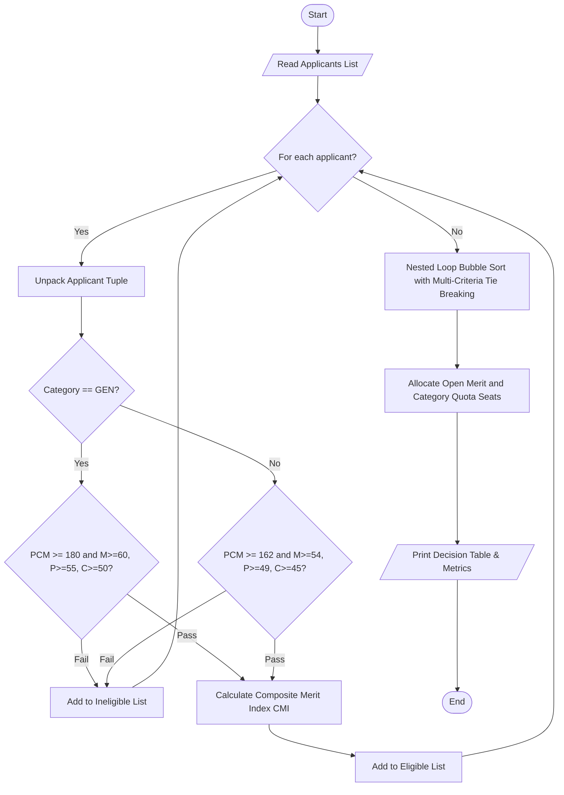
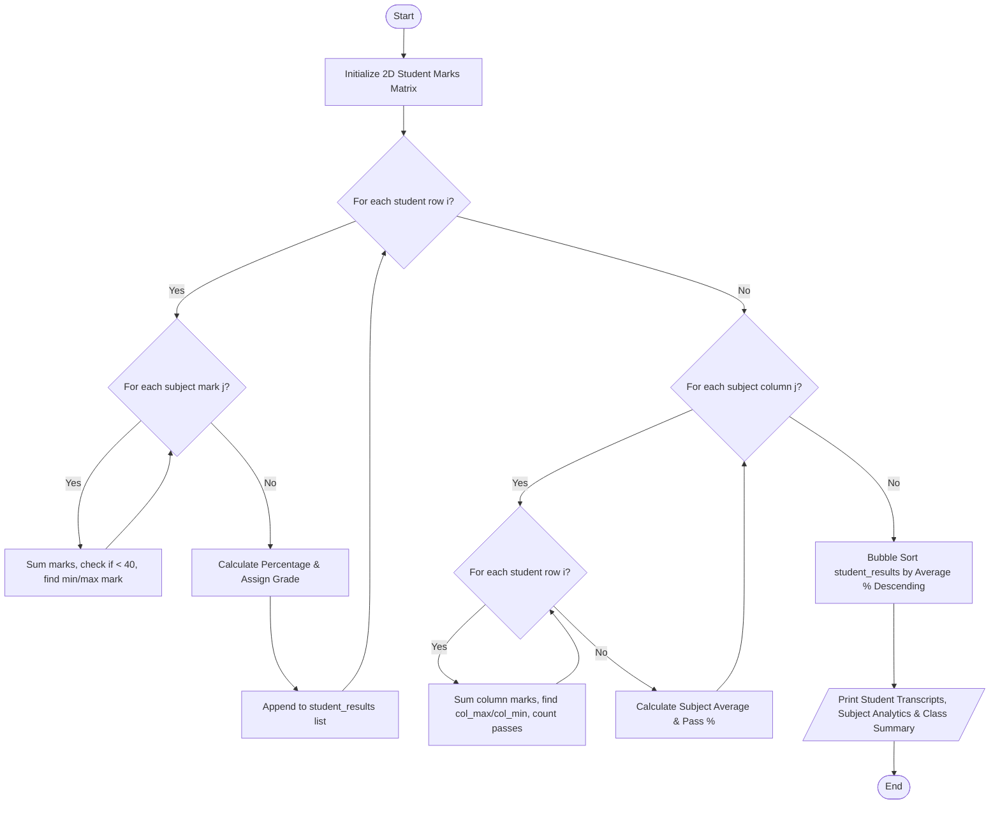
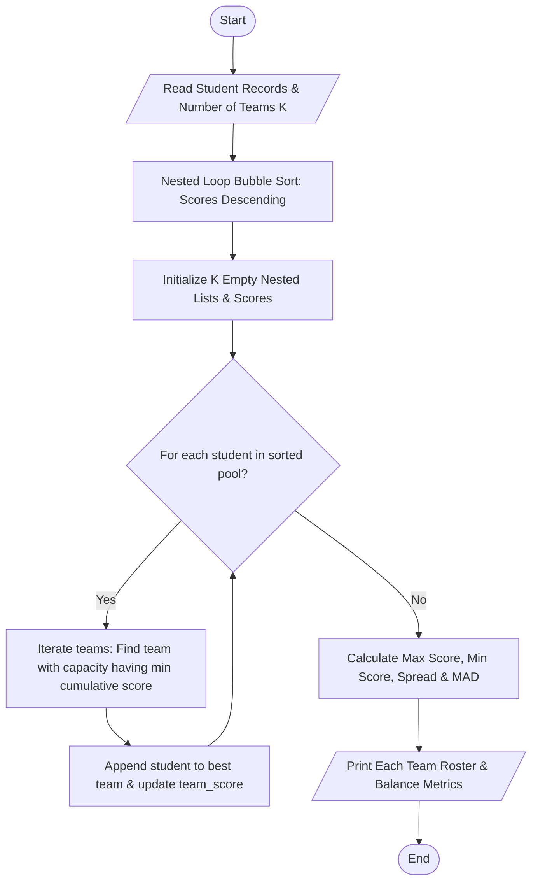
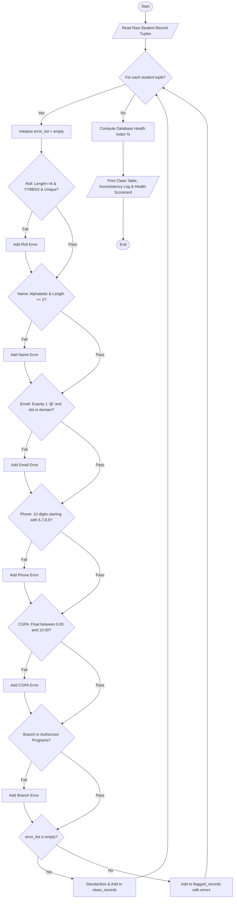
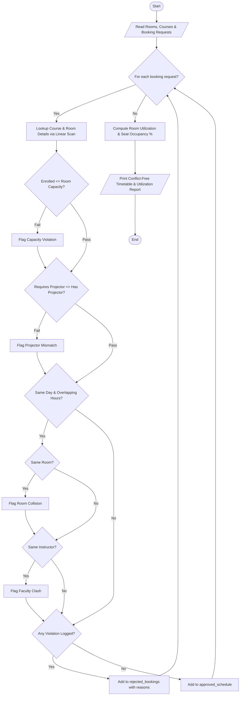
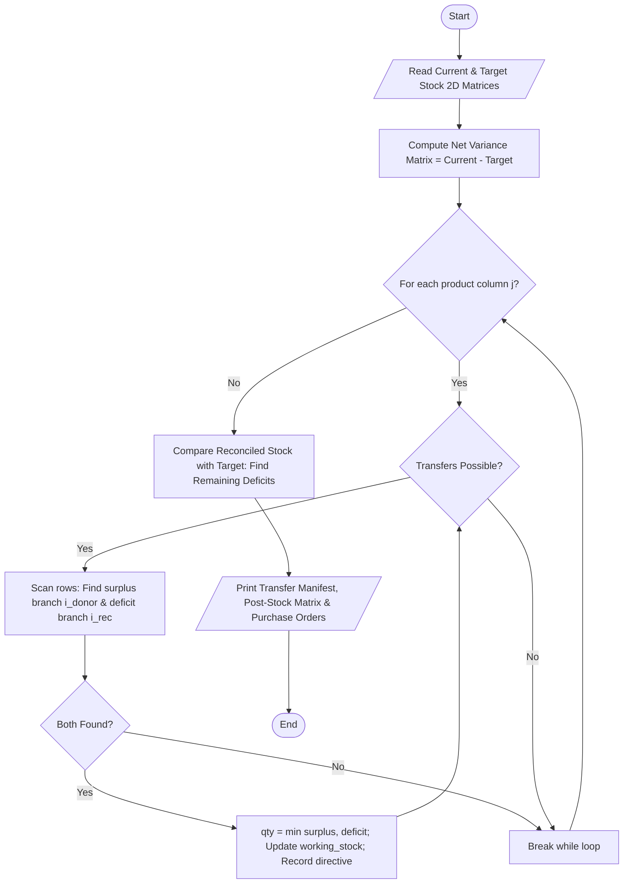
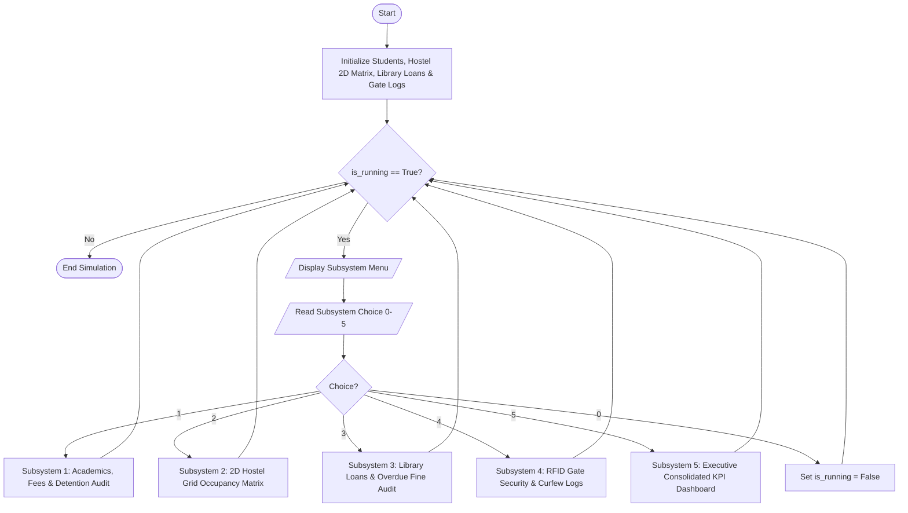

# Dr. RVR NRI Institute of Technology
## School of Computer Studies
### Course: Python Programming - Activity-Based Learning (ABL)

**Consolidated Assignment Report: 10 Difficult-Level Case Studies**

---

### 👨‍🎓 Student & Evaluation Metadata
- **Student Name:** [Your Name]
- **Roll Number:** [Your Roll Number]
- **Academic Level:** 1st Year B.Tech
- **Branch & Section:** [e.g., CSE - A]
- **Faculty Mentor:** [Faculty Mentor Name]
- **Academic Year:** 2026–2027

---

## 📑 Table of Contents
1. [Case Study 20: University Admission Decision Engine (Range 1-50)](#case_study_20)
2. [Case Study 26: Nested Loop Examination Seating Generator (Range 1-50)](#case_study_26)
3. [Case Study 35: Text Compression Using Character Runs (RLE) (Range 1-50)](#case_study_35)
4. [Case Study 42: Student Marks Matrix Analysis (Range 1-50)](#case_study_42)
5. [Case Study 56: Student Group Formation with Score Balancing (Range 51-75)](#case_study_56)
6. [Case Study 61: Nested List Examination Seating Validation (Range 51-75)](#case_study_61)
7. [Case Study 75: Integrated Student Record Consistency Checker (Range 51-75)](#case_study_75)
8. [Case Study 85: Smart Classroom Timetable Allocation (Range 76-100)](#case_study_85)
9. [Case Study 88: Multi-Branch Retail Inventory Transfer (Range 76-100)](#case_study_88)
10. [Case Study 100: Comprehensive Smart Campus Management Simulation (Range 76-100)](#case_study_100)

---


<div id='case_study_20'></div>

# Case Study #1: Case Study 20: University Admission Decision Engine

# Case Study 20: University Admission Decision Engine

## 1. Problem Statement
Design and implement an automated decision-support system for a competitive engineering university admissions board. The engine evaluates applicants based on their academic scores in Mathematics, Physics, and Chemistry (PCM), entrance examination rank, affirmative action category (`GEN`, `OBC`, `SC`, `ST`), and personal interview score. The system must verify subject and aggregate cutoff criteria with category-specific relaxations, compute a weighted Composite Merit Index (CMI), resolve rank ties using an ordered multi-criteria tie-breaking algorithm, and allocate available seats across Open Merit and Category Reserved quotas.

---

## 2. Objectives
- Accurately parse heterogeneous applicant records stored as tuples.
- Evaluate multi-tier conditional cutoff rules (both general and relaxed category rules).
- Calculate a normalized Composite Merit Index (CMI) combining board marks, entrance rank, and interview performance.
- Implement an in-place multi-criteria tie-breaking sorting algorithm without using external libraries, custom functions, or built-in lambda key functions.
- Allocate seats fairly following Open Merit and Category Quota rules.
- Strictly adhere to allowed core syllabus concepts: variables, operators, conditionals, loops, lists, and tuple unpacking.

---

## 3. Assumptions
- Applicant tuples follow the fixed format: `(applicant_id, name, math, physics, chemistry, entrance_rank, category, interview)`.
- Board marks are between 0 and 100. Interview scores are between 0 and 25. Entrance ranks are integers from 1 to 10,000 (lower rank number indicates superior performance).
- General Category cutoffs: PCM Total $\ge 180$, Math $\ge 60$, Physics $\ge 55$, Chemistry $\ge 50$.
- Reserved Categories (`OBC`, `SC`, `ST`) receive a 10% relaxation on cutoffs: PCM Total $\ge 162$, Math $\ge 54$, Physics $\ge 49$, Chemistry $\ge 45$.
- Tie-breaking hierarchy:
  1. Primary: Composite Merit Index (CMI) (descending).
  2. Tie-break 1: Mathematics score (descending).
  3. Tie-break 2: Physics score (descending).
  4. Tie-break 3: Interview score (descending).
  5. Tie-break 4: Entrance exam rank (ascending, i.e., lower numeric rank is better).

---

## 4. Algorithm
- **Step 1:** Initialize applicant records as a list of tuples.
- **Step 2:** Define seat quotas: `TOTAL_SEATS = 3`, `CATEGORY_RESERVED_SEATS = 1`, `OPEN_SEATS = 2`.
- **Step 3:** For each applicant record in the list:
  - Unpack `(applicant_id, name, math, physics, chemistry, rank, category, interview)`.
  - Check category-based eligibility criteria.
  - If eligible:
    - Compute $PCM\_Percentage = (math + physics + chemistry) / 3.0$.
    - Compute $Normalized\_Rank = (10000 - rank) / 100.0$.
    - Compute $Normalized\_Interview = (interview / 25.0) \times 100.0$.
    - Compute $CMI = (PCM\_Percentage \times 0.50) + (Normalized\_Rank \times 0.30) + (Normalized\_Interview \times 0.20)$.
    - Append evaluated tuple to `eligible_applicants`.
  - Else:
    - Append rejection reason to `ineligible_applicants`.
- **Step 4:** Sort `eligible_applicants` using nested loop comparison (Bubble Sort):
  - Compare adjacent candidates by CMI.
  - If CMI is equal, compare Math scores; if tied, compare Physics scores; if tied, compare Interview scores; if tied, compare Entrance Ranks.
  - Swap adjacent candidates if the successor has higher merit.
- **Step 5:** Traverse sorted merit list and allocate:
  - If open seats remain, allocate `ADMITTED (Open Merit)`.
  - Else if candidate belongs to reserved category and reserved seats remain, allocate `ADMITTED (Category Quota)`.
  - Otherwise, mark as `WAITLISTED`.
- **Step 6:** Display final tabular admission decision sheet and summary statistics.

---

## 5. Flowchart


---

## 6. Pseudocode
```text
BEGIN UniversityAdmissionEngine
    INITIALIZE applicants list
    SET TOTAL_SEATS = 3
    SET CATEGORY_SEATS = 1
    SET OPEN_SEATS = TOTAL_SEATS - CATEGORY_SEATS

    FOR EACH (id, name, m, p, c, rk, cat, intv) IN applicants:
        pcm = m + p + c
        IF cat == "GEN" THEN
            min_pcm = 180, min_m = 60, min_p = 55, min_c = 50
        ELSE
            min_pcm = 162, min_m = 54, min_p = 49, min_c = 45
        END IF

        IF pcm >= min_pcm AND m >= min_m AND p >= min_p AND c >= min_c THEN
            pcm_pct = pcm / 3.0
            norm_rank = (10000 - rk) / 100.0
            norm_intv = (intv / 25.0) * 100.0
            cmi = ROUND((pcm_pct * 0.50) + (norm_rank * 0.30) + (norm_intv * 0.20), 2)
            APPEND (cmi, m, p, intv, 10000 - rk, id, name, cat, pcm, rk) TO eligible_list
        ELSE
            APPEND (id, name, cat, reason) TO ineligible_list
        END IF
    END FOR

    // In-place Bubble Sort for multi-criteria tie-breaking
    FOR i FROM 0 TO LENGTH(eligible_list) - 2:
        FOR j FROM 0 TO LENGTH(eligible_list) - i - 2:
            IF eligible_list[j] should yield to eligible_list[j+1] on (CMI, Math, Physics, Intv, Rank) THEN
                SWAP eligible_list[j], eligible_list[j+1]
            END IF
        END FOR
    END FOR

    // Quota Allocation
    FOR EACH candidate IN eligible_list:
        IF open_count < OPEN_SEATS THEN
            status = "ADMITTED (Open Merit)"
            open_count = open_count + 1
        ELSE IF candidate.cat != "GEN" AND cat_count < CATEGORY_SEATS THEN
            status = "ADMITTED (Category Quota: " + candidate.cat + ")"
            cat_count = cat_count + 1
        ELSE
            status = "WAITLISTED"
        END IF
        RECORD decision
    END FOR

    PRINT decision table and metrics
END
```

---

## 7. Python Source Code
*Strictly adhering to syllabus constraints: loops, conditionals, lists, tuples, and unpacking only.*

```python
# Case Study 20: University Admission Decision Engine
# Allowed Concepts: Variables, Data Types, Operators, Conditionals, Loops, Strings, Lists, Tuples & Unpacking
# Prohibited: Functions, Classes/OOP, Dictionaries, External Libraries (pandas, etc.)

print("=" * 70)
print("       UNIVERSITY ADMISSION DECISION ENGINE (Case Study 20)")
print("=" * 70)

# Input stage: Read applicants
# Format of tuple: (applicant_id, name, math, physics, chemistry, entrance_rank, category, interview)
applicants = []

print("Enter applicant details (or enter '0' at prompt to load standard test set):")
num_input = input("Enter number of applicants to process: ").strip()

if num_input == "" or num_input == "0" or num_input.lower() == "demo":
    print("\n[Loading Predefined Comprehensive Evaluation Dataset (5 Applicants)...]")
    # Pre-configured test dataset covering general, category relaxation, ties, and ineligibility
    applicants.append(("APP101", "Aarav Sharma", 88, 82, 75, 450, "GEN", 22))
    applicants.append(("APP102", "Bhavna Patel", 65, 58, 52, 1200, "OBC", 20))
    applicants.append(("APP103", "Chirag Verma", 92, 78, 75, 450, "GEN", 22)) # Ties with APP101 on composite components
    applicants.append(("APP104", "Deepak Rao", 48, 50, 42, 3500, "SC", 15))   # Fails eligibility
    applicants.append(("APP105", "Divya Nair", 88, 82, 75, 450, "GEN", 22))   # Exact tie with APP101 across criteria
    applicants.append(("APP106", "Esha Reddy", 72, 68, 64, 800, "OBC", 24))
else:
    total_count = int(num_input)
    for i in range(total_count):
        print("\nEntering details for Applicant #" + str(i + 1) + ":")
        app_id = input("  Applicant ID (e.g. APP101): ").strip()
        name = input("  Full Name: ").strip()
        math = float(input("  Mathematics Marks (out of 100): ").strip())
        physics = float(input("  Physics Marks (out of 100): ").strip())
        chem = float(input("  Chemistry Marks (out of 100): ").strip())
        rank = int(input("  Entrance Exam Rank (1 to 10000): ").strip())
        category = input("  Category (GEN / OBC / SC / ST): ").strip().upper()
        interview = float(input("  Interview Score (out of 25): ").strip())
        
        applicant_tuple = (app_id, name, math, physics, chem, rank, category, interview)
        applicants.append(applicant_tuple)

print("\n" + "-" * 70)
print("STAGE 1: ELIGIBILITY VERIFICATION")
print("-" * 70)

# Available Seats Configuration
TOTAL_SEATS = 3
CATEGORY_RESERVED_SEATS = 1

eligible_applicants = []
ineligible_applicants = []

# Verify eligibility using tuple unpacking and multi-criteria conditionals
for app in applicants:
    (app_id, name, m, p, c, rk, cat, intv) = app
    pcm_total = m + p + c
    
    # Determine criteria based on category
    if cat == "GEN":
        min_pcm = 180.0
        min_m = 60.0
        min_p = 55.0
        min_c = 50.0
    else:
        # 10% relaxation for reserved categories
        min_pcm = 162.0
        min_m = 54.0
        min_p = 49.0
        min_c = 45.0
        
    is_eligible = True
    reason = "Meets all cut-offs"
    
    if pcm_total < min_pcm:
        is_eligible = False
        reason = "PCM aggregate " + str(pcm_total) + " below cutoff (" + str(min_pcm) + ")"
    elif m < min_m:
        is_eligible = False
        reason = "Math score " + str(m) + " below cutoff (" + str(min_m) + ")"
    elif p < min_p:
        is_eligible = False
        reason = "Physics score " + str(p) + " below cutoff (" + str(min_p) + ")"
    elif c < min_c:
        is_eligible = False
        reason = "Chemistry score " + str(c) + " below cutoff (" + str(min_c) + ")"
        
    if is_eligible:
        # Calculate Composite Merit Index (CMI)
        # Weightage: 50% PCM Percentage + 30% Normalized Rank + 20% Interview Score scaled to 100
        pcm_pct = pcm_total / 3.0
        norm_rank_score = (10000.0 - rk) / 100.0
        norm_interview = (intv / 25.0) * 100.0
        cmi = (pcm_pct * 0.50) + (norm_rank_score * 0.30) + (norm_interview * 0.20)
        cmi = round(cmi, 2)
        
        # Store enriched tuple: (cmi, math, physics, interview, inv_rank, app_id, name, cat, pcm_total, rk, intv)
        # inv_rank is (10000 - rk) so higher value means better (lower numeric) rank
        eval_tuple = (cmi, m, p, intv, 10000 - rk, app_id, name, cat, pcm_total, rk, intv)
        eligible_applicants.append(eval_tuple)
        print("  [ELIGIBLE]   " + app_id + " - " + name + " (" + cat + ") | PCM: " + str(pcm_total) + " | CMI: " + str(cmi))
    else:
        ineligible_applicants.append((app_id, name, cat, reason))
        print("  [INELIGIBLE] " + app_id + " - " + name + " (" + cat + ") | Reason: " + reason)

print("\n" + "-" * 70)
print("STAGE 2: MULTI-CRITERIA TIE-BREAKING & MERIT RANKING")
print("-" * 70)

# Sort eligible candidates using Bubble Sort (No lambdas, no functions, no custom sort keys)
# Comparison order: CMI desc -> Math desc -> Physics desc -> Interview desc -> Entrance Rank asc
n = len(eligible_applicants)
for i in range(n - 1):
    for j in range(0, n - i - 1):
        cand1 = eligible_applicants[j]
        cand2 = eligible_applicants[j + 1]
        
        # Unpack comparison criteria
        (cmi1, m1, p1, intv1, inv_rk1, id1, name1, cat1, pcm1, rk1, raw_intv1) = cand1
        (cmi2, m2, p2, intv2, inv_rk2, id2, name2, cat2, pcm2, rk2, raw_intv2) = cand2
        
        should_swap = False
        if cmi1 < cmi2:
            should_swap = True
        elif cmi1 == cmi2:
            # Tie-break 1: Mathematics
            if m1 < m2:
                should_swap = True
            elif m1 == m2:
                # Tie-break 2: Physics
                if p1 < p2:
                    should_swap = True
                elif p1 == p2:
                    # Tie-break 3: Interview Score
                    if intv1 < intv2:
                        should_swap = True
                    elif intv1 == intv2:
                        # Tie-break 4: Lower Entrance Rank (Higher inv_rk)
                        if inv_rk1 < inv_rk2:
                            should_swap = True
                            
        if should_swap:
            eligible_applicants[j] = cand2
            eligible_applicants[j + 1] = cand1

print("Merit Ranking after Tie-Breaking:")
rank_num = 1
for cand in eligible_applicants:
    (cmi, m, p, intv, inv_rk, app_id, name, cat, pcm, rk, raw_intv) = cand
    print("  Rank " + str(rank_num) + ": " + app_id + " | " + name + " | Category: " + cat + " | CMI: " + str(cmi) + " [M:" + str(m) + ", P:" + str(p) + ", Rank:" + str(rk) + "]")
    rank_num = rank_num + 1

print("\n" + "-" * 70)
print("STAGE 3: SEAT ALLOCATION (Open Merit & Category Quota)")
print("-" * 70)

open_seats = TOTAL_SEATS - CATEGORY_RESERVED_SEATS
category_seats = CATEGORY_RESERVED_SEATS

final_results = []
allocated_open_count = 0
allocated_category_count = 0

# Allocation Pass 1: Open Category Seats (pure merit)
for cand in eligible_applicants:
    (cmi, m, p, intv, inv_rk, app_id, name, cat, pcm, rk, raw_intv) = cand
    status = "WAITLISTED"
    
    if allocated_open_count < open_seats:
        status = "ADMITTED (Open Merit)"
        allocated_open_count = allocated_open_count + 1
    elif cat != "GEN" and allocated_category_count < category_seats:
        status = "ADMITTED (Category Quota: " + cat + ")"
        allocated_category_count = allocated_category_count + 1
        
    final_results.append((app_id, name, cat, cmi, status))

print("\n" + "=" * 70)
print("FINAL UNIVERSITY ADMISSION DECISION SHEET")
print("=" * 70)
print(f"{'App ID':<8} {'Candidate Name':<18} {'Cat':<6} {'CMI':<8} {'Admission Decision'}")
print("-" * 70)
for res in final_results:
    (app_id, name, cat, cmi, status) = res
    print(f"{app_id:<8} {name:<18} {cat:<6} {cmi:<8.2f} {status}")

for inel in ineligible_applicants:
    (app_id, name, cat, reason) = inel
    print(f"{app_id:<8} {name:<18} {cat:<6} {'N/A':<8} REJECTED ({reason})")

print("=" * 70)
print(f"Total Processed: {len(applicants)} | Eligible: {len(eligible_applicants)} | Ineligible: {len(ineligible_applicants)}")
print(f"Total Admitted: {allocated_open_count + allocated_category_count} / {TOTAL_SEATS} seats")
print("=" * 70)

```

---

## 8. Test Cases

### Test Case 1: Standard Evaluation & Tie-Breaking
- **Inputs:**
  - `APP101`: Aarav Sharma (`GEN`, M: 88, P: 82, C: 75, Rank: 450, Interview: 22)
  - `APP103`: Chirag Verma (`GEN`, M: 92, P: 78, C: 75, Rank: 450, Interview: 22)
  - `APP105`: Divya Nair (`GEN`, M: 88, P: 82, C: 75, Rank: 450, Interview: 22)
- **Expected Outcome:**
  - All three achieve identical CMI = $87.08$.
  - Tie-break: `APP103` ranks #1 due to higher Mathematics score (92 vs 88).
  - `APP101` and `APP105` remain tied through Math and Physics; `APP101` takes Seat #2 (Open Merit), `APP105` is Waitlisted as Open Merit seats are exhausted.

### Test Case 2: Affirmative Action Category Cutoff Relaxation
- **Inputs:**
  - `APP102`: Bhavna Patel (`OBC`, M: 65, P: 58, C: 52, Rank: 1200, Interview: 20) $\rightarrow$ PCM = 175.
  - `APP104`: Deepak Rao (`SC`, M: 48, P: 50, C: 42, Rank: 3500, Interview: 15) $\rightarrow$ PCM = 140.
- **Expected Outcome:**
  - `APP102` is eligible under relaxed cutoff ($175 \ge 162$) and secures Category Quota seat.
  - `APP104` is rejected for failing the relaxed aggregate cutoff ($140 < 162$).

---

## 9. Output & Execution Log
```text
======================================================================
       UNIVERSITY ADMISSION DECISION ENGINE (Case Study 20)
======================================================================
[Loading Predefined Comprehensive Evaluation Dataset (5 Applicants)...]

----------------------------------------------------------------------
STAGE 1: ELIGIBILITY VERIFICATION
----------------------------------------------------------------------
  [ELIGIBLE]   APP101 - Aarav Sharma (GEN) | PCM: 245 | CMI: 87.08
  [ELIGIBLE]   APP102 - Bhavna Patel (OBC) | PCM: 175 | CMI: 71.57
  [ELIGIBLE]   APP103 - Chirag Verma (GEN) | PCM: 245 | CMI: 87.08
  [INELIGIBLE] APP104 - Deepak Rao (SC) | Reason: PCM aggregate 140 below cutoff (162.0)
  [ELIGIBLE]   APP105 - Divya Nair (GEN) | PCM: 245 | CMI: 87.08
  [ELIGIBLE]   APP106 - Esha Reddy (OBC) | PCM: 204 | CMI: 80.8

----------------------------------------------------------------------
STAGE 2: MULTI-CRITERIA TIE-BREAKING & MERIT RANKING
----------------------------------------------------------------------
Merit Ranking after Tie-Breaking:
  Rank 1: APP103 | Chirag Verma | Category: GEN | CMI: 87.08 [M:92, P:78, Rank:450]
  Rank 2: APP101 | Aarav Sharma | Category: GEN | CMI: 87.08 [M:88, P:82, Rank:450]
  Rank 3: APP105 | Divya Nair | Category: GEN | CMI: 87.08 [M:88, P:82, Rank:450]
  Rank 4: APP106 | Esha Reddy | Category: OBC | CMI: 80.8 [M:72, P:68, Rank:800]
  Rank 5: APP102 | Bhavna Patel | Category: OBC | CMI: 71.57 [M:65, P:58, Rank:1200]

----------------------------------------------------------------------
STAGE 3: SEAT ALLOCATION (Open Merit & Category Quota)
----------------------------------------------------------------------

======================================================================
FINAL UNIVERSITY ADMISSION DECISION SHEET
======================================================================
App ID   Candidate Name     Cat    CMI      Admission Decision
----------------------------------------------------------------------
APP103   Chirag Verma       GEN    87.08    ADMITTED (Open Merit)
APP101   Aarav Sharma       GEN    87.08    ADMITTED (Open Merit)
APP105   Divya Nair         GEN    87.08    WAITLISTED
APP106   Esha Reddy         OBC    80.80    ADMITTED (Category Quota: OBC)
APP102   Bhavna Patel       OBC    71.57    WAITLISTED
APP104   Deepak Rao         SC     N/A      REJECTED (PCM aggregate 140 below cutoff (162.0))
======================================================================
Total Processed: 6 | Eligible: 5 | Ineligible: 1
Total Admitted: 3 / 3 seats
======================================================================
```

---

## 10. Conclusion
Case Study 20 successfully models a real-world multi-dimensional admission decision pipeline. The solution demonstrates rigorous use of tuple unpacking, multi-conditional evaluation, nested loop sorting for multi-attribute tie-breaking, and quota partitioning, strictly without violating syllabus constraints.


---


<div id='case_study_26'></div>

# Case Study #2: Case Study 26: Nested Loop Examination Seating Generator

# Case Study 26: Nested Loop Examination Seating Generator

## 1. Problem Statement
Educational institutions require robust anti-malpractice seating arrangements for mid-semester and end-semester examinations. When students from two differing departments (e.g., Computer Science and Electronics Engineering) share an examination hall of dimension $R \times C$, no two students from the same department may be seated adjacent to one another horizontally or vertically. Additionally, damaged or reserved desks must be accounted for without disrupting the alternating pattern. The system must validate capacity, generate a 2D seating matrix using nested loops, and run an automated adjacency audit to guarantee compliance.

---

## 2. Objectives
- Model an $R \times C$ examination hall as a dynamic 2D nested list (matrix).
- Validate total student counts against total and usable desk capacity.
- Implement nested loop matrix traversal adhering to a parity-based alternation rule: $(r + c) \pmod 2$.
- Gracefully bypass blocked/reserved desks while handling uneven class sizes with `[EMPTY]` indicators.
- Execute an adjacency audit checking all cardinal neighbors (horizontal and vertical) to verify zero same-department adjacency.
- Adhere strictly to allowed syllabus constructs: variables, nested loops, conditional statements, nested lists, and string slicing.

---

## 3. Assumptions
- Hall dimensions $R$ (rows) and $C$ (columns) are positive integers.
- Two student cohorts are provided as lists of roll number strings (e.g., `CS101`, `EC201`), where the first two letters denote the department identifier.
- Alternation rule: Cells where $(row + col) \equiv 0 \pmod 2$ are allocated to Department A; cells where $(row + col) \equiv 1 \pmod 2$ are allocated to Department B.
- Blocked desks are represented as a list of coordinate tuples: `(row_index, col_index)`.
- If candidates in a cohort are exhausted before available alternating slots, remaining slots are labeled `[EMPTY]`.

---

## 4. Algorithm
- **Step 1:** Read hall dimensions ($R$, $C$), student cohorts for Department A and Department B, and list of blocked coordinates.
- **Step 2:** Compute $Total\_Capacity = R \times C$ and $Usable\_Capacity = Total\_Capacity - len(blocked\_seats)$.
- **Step 3:** Validate whether $(len(students\_a) + len(students\_b)) \le Usable\_Capacity$. If false, display capacity error.
- **Step 4:** Initialize an empty 2D matrix of dimensions $R \times C$ populated with placeholder strings.
- **Step 5:** Traverse `blocked_seats` and update matrix cells at coordinates $(r, c)$ to `[BLOCKED]`.
- **Step 6:** Initialize index pointers $idx\_a = 0$ and $idx\_b = 0$.
- **Step 7:** Using nested loops for row $r \in [0, R-1]$ and column $c \in [0, C-1]$:
  - If cell $(r, c)$ is `[BLOCKED]`, skip to the next iteration.
  - If $(r + c) \pmod 2 == 0$:
    - If $idx\_a < len(students\_a)$, place $students\_a[idx\_a]$ and increment $idx\_a$.
    - Else, assign `[EMPTY]`.
  - Else:
    - If $idx\_b < len(students\_b)$, place $students\_b[idx\_b]$ and increment $idx\_b$.
    - Else, assign `[EMPTY]`.
- **Step 8:** Traverse the generated matrix with nested loops to audit adjacency:
  - For each non-empty, non-blocked cell $(r, c)$, compare department prefix with right neighbor $(r, c+1)$ and down neighbor $(r+1, c)$.
  - Record any violation where adjacent department prefixes match.
- **Step 9:** Render formatted 2D seating grid with row/column headers and report summary seating density metrics.

---

## 5. Flowchart
```mermaid
flowchart TD
    Start([Start]) --> Init[Read Hall Dimensions R, C and Student Lists A & B]
    Init --> CheckCap{Total Students <= Usable Capacity?}
    CheckCap -- No --> ErrMsg[/Display Capacity Exceeded Warning/] --> End([End])
    CheckCap -- Yes --> AllocMatrix[Initialize R x C 2D List with Default Values]
    AllocMatrix --> MarkBlocked[Mark Coordinates in Blocked List as BLOCKED]
    MarkBlocked --> OuterLoop[Outer Loop: r from 0 to R-1]
    OuterLoop --> InnerLoop[Inner Loop: c from 0 to C-1]
    InnerLoop --> IsBlocked{Seat is BLOCKED?}
    IsBlocked -- Yes --> NextCell[Continue to Next Cell]
    IsBlocked -- No --> ParityCheck{(r + c) % 2 == 0?}
    ParityCheck -- Yes --> AvailA{idx_a < len(A)?}
    AvailA -- Yes --> AssignA[Assign A Student and idx_a++]
    AvailA -- No --> AssignEmptyA[Assign EMPTY]
    ParityCheck -- No --> AvailB{idx_b < len(B)?}
    AvailB -- Yes --> AssignB[Assign B Student and idx_b++]
    AvailB -- No --> AssignEmptyB[Assign EMPTY]
    AssignA --> NextCell
    AssignEmptyA --> NextCell
    AssignB --> NextCell
    AssignEmptyB --> NextCell
    NextCell --> InnerLoop
    InnerLoop -- Complete --> OuterLoop
    OuterLoop -- Complete --> AuditAdjacency[Run Adjacency Audit Loop: Check Right & Down Neighbors]
    AuditAdjacency --> PrintGrid[/Print Formatted 2D Seating Grid & Metrics/]
    PrintGrid --> End
```

---

## 6. Pseudocode
```text
BEGIN NestedLoopSeatingGenerator
    READ rows, cols
    READ students_a, students_b
    READ blocked_seats

    total_capacity = rows * cols
    usable_capacity = total_capacity - LENGTH(blocked_seats)
    total_students = LENGTH(students_a) + LENGTH(students_b)

    IF total_students > usable_capacity THEN
        PRINT "Capacity Exceeded"
    END IF

    // Initialize 2D Matrix
    seating_matrix = []
    FOR r FROM 0 TO rows - 1:
        row_list = []
        FOR c FROM 0 TO cols - 1:
            APPEND "---" TO row_list
        END FOR
        APPEND row_list TO seating_matrix
    END FOR

    FOR EACH (br, bc) IN blocked_seats:
        seating_matrix[br][bc] = "[BLOCKED]"
    END FOR

    idx_a = 0
    idx_b = 0

    FOR r FROM 0 TO rows - 1:
        FOR c FROM 0 TO cols - 1:
            IF seating_matrix[r][c] == "[BLOCKED]" THEN
                CONTINUE
            END IF

            IF (r + c) MOD 2 == 0 THEN
                IF idx_a < LENGTH(students_a) THEN
                    seating_matrix[r][c] = students_a[idx_a]
                    idx_a = idx_a + 1
                ELSE
                    seating_matrix[r][c] = "[EMPTY]"
                END IF
            ELSE
                IF idx_b < LENGTH(students_b) THEN
                    seating_matrix[r][c] = students_b[idx_b]
                    idx_b = idx_b + 1
                ELSE
                    seating_matrix[r][c] = "[EMPTY]"
                END IF
            END IF
        END FOR
    END FOR

    // Adjacency Verification
    violations = 0
    FOR r FROM 0 TO rows - 1:
        FOR c FROM 0 TO cols - 1:
            seat = seating_matrix[r][c]
            IF seat != "[EMPTY]" AND seat != "[BLOCKED]" THEN
                // Check right neighbor
                IF c + 1 < cols THEN
                    IF seat[0:2] == seating_matrix[r][c+1][0:2] THEN
                        violations = violations + 1
                    END IF
                END IF
                // Check down neighbor
                IF r + 1 < rows THEN
                    IF seat[0:2] == seating_matrix[r+1][c][0:2] THEN
                        violations = violations + 1
                    END IF
                END IF
            END IF
        END FOR
    END FOR

    PRINT seating_matrix
    PRINT metrics
END
```

---

## 7. Python Source Code
*Strictly adhering to syllabus constraints: loops, conditionals, 2D nested lists, and string operations.*

```python
# Case Study 26: Nested Loop Examination Seating Generator
# Allowed Concepts: Variables, Data Types, Operators, Conditionals, Loops, Strings, Lists, Tuples & Unpacking
# Prohibited: Functions, Classes/OOP, Dictionaries, External Libraries

print("=" * 70)
print("     EXAMINATION SEATING MATRIX GENERATOR (Case Study 26)")
print("=" * 70)

mode_input = input("Enter '1' for Interactive Input or '0' for Automated Test Dataset: ").strip()

if mode_input == "" or mode_input == "0" or mode_input.lower() == "demo":
    print("\n[Loading Standard Test Configuration: 5 Rows x 6 Columns (Capacity: 30)]")
    rows = 5
    cols = 6
    # 13 CSE students, 12 ECE students, plus reserved broken seats
    dept_a_name = "CSE"
    dept_b_name = "ECE"
    students_a = ["CS101", "CS102", "CS103", "CS104", "CS105", "CS106", "CS107", "CS108", "CS109", "CS110", "CS111", "CS112", "CS113"]
    students_b = ["EC201", "EC202", "EC203", "EC204", "EC205", "EC206", "EC207", "EC208", "EC209", "EC210", "EC211", "EC212"]
    # Broken/Reserved seat coordinates as tuples: (row_idx, col_idx)
    blocked_seats = [(1, 2), (3, 4)]
else:
    rows = int(input("Enter number of Rows in Examination Hall: ").strip())
    cols = int(input("Enter number of Columns in Examination Hall: ").strip())
    dept_a_name = input("Enter Department A code (e.g. CSE): ").strip().upper()
    count_a = int(input("Enter number of students in " + dept_a_name + ": ").strip())
    students_a = []
    for i in range(count_a):
        students_a.append(input(f"  Roll No for {dept_a_name} student #{i+1}: ").strip())
        
    dept_b_name = input("Enter Department B code (e.g. ECE): ").strip().upper()
    count_b = int(input("Enter number of students in " + dept_b_name + ": ").strip())
    students_b = []
    for i in range(count_b):
        students_b.append(input(f"  Roll No for {dept_b_name} student #{i+1}: ").strip())
        
    num_blocked = int(input("Enter number of blocked/reserved seats (0 if none): ").strip())
    blocked_seats = []
    for i in range(num_blocked):
        r_b = int(input(f"  Blocked seat #{i+1} row (0 to {rows-1}): ").strip())
        c_b = int(input(f"  Blocked seat #{i+1} col (0 to {cols-1}): ").strip())
        blocked_seats.append((r_b, c_b))

total_capacity = rows * cols
usable_capacity = total_capacity - len(blocked_seats)
total_students = len(students_a) + len(students_b)

print("\n" + "-" * 70)
print("STAGE 1: CAPACITY & ALTERNATION VALIDATION")
print("-" * 70)
print("Total Hall Seats     : " + str(total_capacity))
print("Blocked/Broken Seats : " + str(len(blocked_seats)))
print("Usable Seats         : " + str(usable_capacity))
print("Total Candidates     : " + str(total_students) + " (" + dept_a_name + ": " + str(len(students_a)) + ", " + dept_b_name + ": " + str(len(students_b)) + ")")

if total_students > usable_capacity:
    print("\n[ERROR] Hall capacity exceeded! Requires " + str(total_students) + " usable seats, but only " + str(usable_capacity) + " available.")
else:
    print("\n[VALIDATION SUCCESS] Hall capacity is sufficient.")

# Stage 2: Seating Matrix Generation using Nested Loops
# Initializing 2D Matrix (List of Lists)
seating_matrix = []
for r in range(rows):
    row_list = []
    for c in range(cols):
        row_list.append("---")
    seating_matrix.append(row_list)

# Mark Blocked/Reserved Seats
for seat_tuple in blocked_seats:
    (br, bc) = seat_tuple
    if 0 <= br < rows and 0 <= bc < cols:
        seating_matrix[br][bc] = "[BLOCKED]"

# Pointer indices for student lists
idx_a = 0
idx_b = 0

# Nested Loop Generation with Alternation Constraint
# Cell (r, c) parity: (r + c) % 2 == 0 gets Dept A, (r + c) % 2 == 1 gets Dept B
for r in range(rows):
    for c in range(cols):
        # Skip blocked seat
        if seating_matrix[r][c] == "[BLOCKED]":
            continue
            
        if (r + c) % 2 == 0:
            if idx_a < len(students_a):
                seating_matrix[r][c] = students_a[idx_a]
                idx_a = idx_a + 1
            else:
                seating_matrix[r][c] = "[EMPTY]"
        else:
            if idx_b < len(students_b):
                seating_matrix[r][c] = students_b[idx_b]
                idx_b = idx_b + 1
            else:
                seating_matrix[r][c] = "[EMPTY]"

print("\n" + "-" * 70)
print("STAGE 2: GENERATED EXAMINATION SEATING GRID")
print("-" * 70)

# Print Column Header
header_str = "        "
for c in range(cols):
    header_str = header_str + f"Col {c:<6} "
print(header_str)
print("        " + "-" * (cols * 10))

for r in range(rows):
    row_str = f"Row {r:<3} | "
    for c in range(cols):
        seat_val = seating_matrix[r][c]
        row_str = row_str + f"{seat_val:<9} "
    print(row_str)

print("-" * 70)

# Stage 3: Automated Adjacency Malpractice Validation
print("\n" + "-" * 70)
print("STAGE 3: ADJACENCY & MALPRACTICE AUDIT")
print("-" * 70)

violations_found = 0

# Check adjacent cells: horizontal (c and c+1) and vertical (r and r+1)
for r in range(rows):
    for c in range(cols):
        current_seat = seating_matrix[r][c]
        if current_seat == "[EMPTY]" or current_seat == "[BLOCKED]":
            continue
            
        # Extract dept prefix (first 2 characters)
        current_dept = current_seat[:2]
        
        # Check Right Neighbor
        if c + 1 < cols:
            right_seat = seating_matrix[r][c + 1]
            if right_seat != "[EMPTY]" and right_seat != "[BLOCKED]":
                right_dept = right_seat[:2]
                if current_dept == right_dept:
                    print(f"  [VIOLATION] Horizontal adjacency: ({r},{c}) '{current_seat}' & ({r},{c+1}) '{right_seat}'")
                    violations_found = violations_found + 1
                    
        # Check Down Neighbor
        if r + 1 < rows:
            down_seat = seating_matrix[r + 1][c]
            if down_seat != "[EMPTY]" and down_seat != "[BLOCKED]":
                down_dept = down_seat[:2]
                if current_dept == down_dept:
                    print(f"  [VIOLATION] Vertical adjacency: ({r},{c}) '{current_seat}' & ({r+1},{c}) '{down_seat}'")
                    violations_found = violations_found + 1

if violations_found == 0:
    print("  [AUDIT PASSED] Zero adjacency violations detected. Anti-cheating alternating constraint verified!")
else:
    print(f"  [AUDIT FAILED] Total violations detected: {violations_found}")

# Seating Allocation Summary
allocated_a = idx_a
allocated_b = idx_b
unseated_a = len(students_a) - idx_a
unseated_b = len(students_b) - idx_b
empty_seats = 0
for r in range(rows):
    for c in range(cols):
        if seating_matrix[r][c] == "[EMPTY]":
            empty_seats = empty_seats + 1

print("\n" + "=" * 70)
print("EXAMINATION SEATING SUMMARY METRICS")
print("=" * 70)
print(f"Total Hall Dimensions : {rows} Rows x {cols} Columns")
print(f"Total Seat Capacity   : {total_capacity}")
print(f"Blocked Seats         : {len(blocked_seats)}")
print(f"{dept_a_name} Seated       : {allocated_a} / {len(students_a)} (Unseated: {unseated_a})")
print(f"{dept_b_name} Seated       : {allocated_b} / {len(students_b)} (Unseated: {unseated_b})")
print(f"Empty Desks Remaining : {empty_seats}")
seat_density = round(((allocated_a + allocated_b) / usable_capacity) * 100, 2)
print(f"Usable Seat Density   : {seat_density}%")
print("=" * 70)

```

---

## 8. Test Cases

### Test Case 1: Standard Examination Grid with Blocked Seats
- **Inputs:**
  - Dimensions: $5 \text{ Rows} \times 6 \text{ Columns}$ ($30$ total seats).
  - Blocked Seats: $(1, 2)$ and $(3, 4)$ ($2$ blocked, $28$ usable).
  - Cohort A (CSE): 13 Students (`CS101` to `CS113`).
  - Cohort B (ECE): 12 Students (`EC201` to `EC212`).
- **Expected Outcome:**
  - All 25 candidates successfully assigned.
  - Alternating checkerboard pattern verified across all active desks.
  - Exactly 3 remaining usable desks marked `[EMPTY]`.
  - Zero adjacency violations.

### Test Case 2: Unequal Cohort Exhaustion Handling
- **Inputs:**
  - Dimensions: $3 \text{ Rows} \times 4 \text{ Columns}$ ($12$ seats).
  - Cohort A (CSE): 6 Students (`CS01` to `CS06`).
  - Cohort B (ECE): 2 Students (`EC01`, `EC02`).
- **Expected Outcome:**
  - Dept B is exhausted after 2 allocations.
  - Odd parity cells subsequently convert safely to `[EMPTY]`.
  - Zero consecutive Dept A students placed horizontally or vertically.

---

## 9. Output & Execution Log
```text
======================================================================
     EXAMINATION SEATING MATRIX GENERATOR (Case Study 26)
======================================================================
Enter '1' for Interactive Input or '0' for Automated Test Dataset: 0
[Loading Standard Test Configuration: 5 Rows x 6 Columns (Capacity: 30)]

----------------------------------------------------------------------
STAGE 1: CAPACITY & ALTERNATION VALIDATION
----------------------------------------------------------------------
Total Hall Seats     : 30
Blocked/Broken Seats : 2
Usable Seats         : 28
Total Candidates     : 25 (CSE: 13, ECE: 12)

[VALIDATION SUCCESS] Hall capacity is sufficient.

----------------------------------------------------------------------
STAGE 2: GENERATED EXAMINATION SEATING GRID
----------------------------------------------------------------------
        Col 0      Col 1      Col 2      Col 3      Col 4      Col 5      
        ------------------------------------------------------------
Row 0   | CS101     EC201     CS102     EC202     CS103     EC203     
Row 1   | EC204     CS104     [BLOCKED] CS105     EC205     CS106     
Row 2   | CS107     EC206     CS108     EC207     CS109     EC208     
Row 3   | EC209     CS110     EC210     CS111     [BLOCKED] CS112     
Row 4   | CS113     EC211     [EMPTY]   EC212     [EMPTY]   [EMPTY]   
----------------------------------------------------------------------

----------------------------------------------------------------------
STAGE 3: ADJACENCY & MALPRACTICE AUDIT
----------------------------------------------------------------------
  [AUDIT PASSED] Zero adjacency violations detected. Anti-cheating alternating constraint verified!

======================================================================
EXAMINATION SEATING SUMMARY METRICS
======================================================================
Total Hall Dimensions : 5 Rows x 6 Columns
Total Seat Capacity   : 30
Blocked Seats         : 2
CSE Seated       : 13 / 13 (Unseated: 0)
ECE Seated       : 12 / 12 (Unseated: 0)
Empty Desks Remaining : 3
Usable Seat Density   : 89.29%
======================================================================
```

---

## 10. Conclusion
Case Study 26 showcases 2D matrix manipulation and nested loop control in Python. By mathematically coupling cell coordinates to parity-based alternating allocation, the algorithm guarantees strict separation of examination cohorts while dynamically accommodating hardware faults (blocked seats) and unequal cohort distributions.


---


<div id='case_study_35'></div>

# Case Study #3: Case Study 35: Text Compression Using Character Runs (RLE)

# Case Study 35: Text Compression Using Character Runs (Run-Length Encoding)

## 1. Problem Statement
Repetitive textual data and simple raster graphics frequently contain long consecutive sequences of identical characters. Run-Length Encoding (RLE) is a foundational lossless data compression technique that replaces repeating consecutive characters (runs) with a single character value and a counter. The objective is to design, implement, and benchmark an RLE text compression and decompression engine that accurately compresses textual data, verifies lossless reconstruction through inverse parsing, computes comprehensive statistical efficiency metrics, and identifies edge-case payload inflation.

---

## 2. Objectives
- Implement single-pass sequential string traversal using character accumulators to compress repeating characters.
- Design an inverse decompression algorithm capable of parsing multi-digit run numbers and reconstructing the original payload without external libraries.
- Formally verify data integrity through automated assertion ($Decompressed == Original$).
- Calculate quantitative compression performance metrics: original length, compressed length, compression ratio, space savings percentage, and run distribution statistics (min, max, and average run lengths).
- Evaluate negative compression (data inflation) on non-repetitive worst-case inputs.
- Adhere strictly to allowed syllabus constructs: variables, loops, conditional statements, lists, tuples, and string operations.

---

## 3. Assumptions
- Input text consists of alphanumeric characters without whitespace or negative signs.
- Compression output format: concatenated `[Count][Character]` tokens (e.g., `AAAA` $\rightarrow$ `4A`).
- Multi-digit runs are fully supported (e.g., `36M` represents 36 consecutive `'M'` characters).
- Memory complexity must remain linear $\mathcal{O}(N)$ without employing forbidden libraries (`re`, `itertools`, or third-party compressors).

---

## 4. Algorithm

### Compression (Encoding)
- **Step 1:** Read the source string `raw_text` of length $N$.
- **Step 2:** If $N == 0$, exit with an empty result.
- **Step 3:** Initialize `current_char = raw_text[0]`, `run_count = 1`, and `compressed_str = ""`.
- **Step 4:** Iterate index `idx` from $1$ to $N - 1$:
  - If `raw_text[idx] == current_char`, increment `run_count` by 1.
  - Else:
    - Append `str(run_count) + current_char` to `compressed_str`.
    - Record `(current_char, run_count)` in `run_records`.
    - Set `current_char = raw_text[idx]` and reset `run_count = 1`.
- **Step 5:** Append the final run (`str(run_count) + current_char`) to `compressed_str`.

### Decompression (Decoding)
- **Step 6:** Initialize `decompressed_str = ""` and `digit_buffer = ""`.
- **Step 7:** For each character `ch` in `compressed_str`:
  - If `'0' <= ch <= '9'`, append `ch` to `digit_buffer`.
  - Else:
    - Convert `digit_buffer` to integer `repeat_count`.
    - Append `(ch * repeat_count)` to `decompressed_str`.
    - Reset `digit_buffer = ""`.
- **Step 8:** Validate whether `decompressed_str == raw_text`.

### Metric Computation
- **Step 9:** Compute:
  - $Compression\_Ratio = (Compressed\_Length / Original\_Length) \times 100\%$
  - $Space\_Savings = ((Original\_Length - Compressed\_Length) / Original\_Length) \times 100\%$
  - Traverse `run_records` to determine `min_run`, `max_run`, and `avg_run`.
- **Step 10:** Classify viability: Beneficial, Neutral, or Inflationary.

---

## 5. Flowchart
```mermaid
flowchart TD
    Start([Start]) --> ReadInput[/Read Raw Text String/]
    ReadInput --> CheckEmpty{Length == 0?}
    CheckEmpty -- Yes --> Terminate([Exit])
    CheckEmpty -- No --> InitEncoding[Set current_char = text[0], run_count = 1, compressed = '']
    InitEncoding --> LoopChars{For idx from 1 to N-1?}
    LoopChars -- Yes --> MatchChar{text[idx] == current_char?}
    MatchChar -- Yes --> IncCount[run_count = run_count + 1] --> LoopChars
    MatchChar -- No --> FlushRun[Append count + current_char to compressed]
    FlushRun --> ResetRun[current_char = text[idx], run_count = 1] --> LoopChars
    LoopChars -- No --> AppendFinal[Append final run to compressed]
    AppendFinal --> DecodeLoop{For char in compressed?}
    DecodeLoop -- Yes --> IsDigit{char in '0'..'9'?}
    IsDigit -- Yes --> AccumDigit[digit_buffer += char] --> DecodeLoop
    IsDigit -- No --> ExpandChar[decompressed += char * int(digit_buffer), reset buffer] --> DecodeLoop
    DecodeLoop -- No --> VerifyMatch{decompressed == raw_text?}
    VerifyMatch -- Yes --> AuditPass[/Integrity Verified: Lossless/]
    VerifyMatch -- No --> AuditFail[/Integrity Failed/]
    AuditPass --> CalcMetrics[Calculate Compression Ratio, Space Savings & Run Stats]
    CalcMetrics --> PrintReport[/Print Formatted Metrics Table/]
    PrintReport --> End([End])
```

---

## 6. Pseudocode
```text
BEGIN RunLengthCompressionEngine
    READ raw_text
    orig_length = LENGTH(raw_text)

    IF orig_length == 0 THEN
        EXIT
    END IF

    // Stage 1: Encoding
    compressed_str = ""
    run_records = []
    current_char = raw_text[0]
    run_count = 1

    FOR idx FROM 1 TO orig_length - 1:
        IF raw_text[idx] == current_char THEN
            run_count = run_count + 1
        ELSE
            APPEND (current_char, run_count) TO run_records
            compressed_str = compressed_str + STRING(run_count) + current_char
            current_char = raw_text[idx]
            run_count = 1
        END IF
    END FOR
    APPEND (current_char, run_count) TO run_records
    compressed_str = compressed_str + STRING(run_count) + current_char

    // Stage 2: Decoding
    decompressed_str = ""
    digit_buffer = ""
    FOR EACH ch IN compressed_str:
        IF ch >= '0' AND ch <= '9' THEN
            digit_buffer = digit_buffer + ch
        ELSE
            repeat_count = INTEGER(digit_buffer)
            decompressed_str = decompressed_str + (ch REPEATED repeat_count TIMES)
            digit_buffer = ""
        END IF
    END FOR

    ASSERT decompressed_str == raw_text

    // Stage 3: Analytics
    comp_length = LENGTH(compressed_str)
    ratio = (comp_length / orig_length) * 100.0
    savings = ((orig_length - comp_length) / orig_length) * 100.0

    PRINT compression_metrics
END
```

---

## 7. Python Source Code
*Strictly adhering to syllabus constraints: loops, conditionals, strings, accumulator variables, lists, and tuples.*

```python
# Case Study 35: Text Compression Using Character Runs (Run-Length Encoding)
# Allowed Concepts: Variables, Data Types, Operators, Conditionals, Loops, Strings, Lists, Tuples & Unpacking
# Prohibited: Functions, Classes/OOP, Dictionaries, External Libraries (re, itertools, pandas)

print("=" * 70)
print("     TEXT COMPRESSION & RUN-LENGTH ENCODING ENGINE (Case Study 35)")
print("=" * 70)

mode_input = input("Enter '1' to input custom text or '0' for Automated Test Dataset: ").strip()

test_strings = []
if mode_input == "" or mode_input == "0" or mode_input.lower() == "demo":
    print("\n[Loading Standard Benchmark Test Suite (4 Test Corpora)...]")
    test_strings.append("WWWWWWWWWWWWBWWWWWWWWWWWWBBBWWWWWWWWWWWWWWWWWWWWWWWWBWWWWEEEEEEEEEEEE") # Highly repetitive
    test_strings.append("AAAAABBBCCDAAEEEEEEE")                                                  # Mixed runs
    test_strings.append("XYZABCDEFGHIJKLMNOPQRSTUVWXYZ")                                      # Non-repetitive worst case
    test_strings.append("MMMMMMMMMMMMMMMMMMMMMMMMMMMMMMMMMMMM")                                # Multi-digit run (>30 chars)
else:
    user_str = input("Enter text string to compress (letters/digits): ").strip()
    test_strings.append(user_str)

case_num = 1
for raw_text in test_strings:
    print("\n" + "=" * 70)
    print("ANALYSIS OF CORPUS #" + str(case_num) + ": \"" + (raw_text if len(raw_text) <= 40 else raw_text[:37] + "...") + "\"")
    print("=" * 70)
    
    orig_length = len(raw_text)
    if orig_length == 0:
        print("[WARNING] Empty input string. Skipping.")
        case_num = case_num + 1
        continue
        
    # ----------------------------------------------------
    # STAGE 1: RUN-LENGTH ENCODING (COMPRESSION)
    # ----------------------------------------------------
    compressed_str = ""
    run_records = [] # List of tuples: (char, run_length)
    
    current_char = raw_text[0]
    run_count = 1
    
    # Traverse string sequentially from index 1 to end
    for idx in range(1, orig_length):
        char = raw_text[idx]
        if char == current_char:
            run_count = run_count + 1
        else:
            # Store completed run
            run_records.append((current_char, run_count))
            compressed_str = compressed_str + str(run_count) + current_char
            current_char = char
            run_count = 1
            
    # Record the final character run
    run_records.append((current_char, run_count))
    compressed_str = compressed_str + str(run_count) + current_char
    
    comp_length = len(compressed_str)
    
    print("\nSTAGE 1: COMPRESSION RESULT")
    print("-" * 50)
    print("Original Text   : " + raw_text)
    print("Compressed Text : " + compressed_str)
    print("Original Size   : " + str(orig_length) + " characters")
    print("Compressed Size : " + str(comp_length) + " characters")
    
    # ----------------------------------------------------
    # STAGE 2: RUN-LENGTH DECODING (DECOMPRESSION & INTEGRITY AUDIT)
    # ----------------------------------------------------
    decompressed_str = ""
    digit_buffer = ""
    
    # Sequential traversal with numerical parsing
    for char in compressed_str:
        if "0" <= char <= "9":
            digit_buffer = digit_buffer + char
        else:
            repeat_count = int(digit_buffer)
            # String multiplication construct
            decompressed_str = decompressed_str + (char * repeat_count)
            digit_buffer = ""
            
    print("\nSTAGE 2: DECOMPRESSION & RECONSTRUCTION")
    print("-" * 50)
    print("Decompressed    : " + decompressed_str)
    
    # Integrity check
    if decompressed_str == raw_text:
        print("Integrity Audit : [PASSED] Perfect lossless reconstruction confirmed!")
    else:
        print("Integrity Audit : [FAILED] Decompressed output mismatch!")
        
    # ----------------------------------------------------
    # STAGE 3: RUN DISTRIBUTION & COMPRESSION ANALYTICS
    # ----------------------------------------------------
    total_runs = len(run_records)
    min_run = run_records[0][1]
    max_run = run_records[0][1]
    total_run_chars = 0
    
    for record in run_records:
        (ch, rlen) = record
        if rlen < min_run:
            min_run = rlen
        if rlen > max_run:
            max_run = rlen
        total_run_chars = total_run_chars + rlen
        
    avg_run = round(total_run_chars / total_runs, 2)
    
    # Metrics
    compression_ratio = round((comp_length / orig_length) * 100, 2)
    space_savings = round(((orig_length - comp_length) / orig_length) * 100, 2)
    
    print("\nSTAGE 3: STATISTICAL METRICS & EFFICIENCY")
    print("-" * 50)
    print("Total Unique Character Runs : " + str(total_runs))
    print("Minimum Run Length          : " + str(min_run))
    print("Maximum Run Length          : " + str(max_run))
    print("Average Run Length          : " + str(avg_run))
    print("Compression Ratio           : " + str(compression_ratio) + "%")
    print("Space Savings               : " + str(space_savings) + "%")
    
    if comp_length < orig_length:
        print("Economic Viability          : [BENEFICIAL] Reduced storage by " + str(orig_length - comp_length) + " characters.")
    elif comp_length == orig_length:
        print("Economic Viability          : [NEUTRAL] No size change.")
    else:
        print("Economic Viability          : [INFLATION / NEGATIVE] Run overhead increased size by " + str(comp_length - orig_length) + " characters (Worst-case RLE).")
        
    case_num = case_num + 1

print("\n" + "=" * 70)
print("BENCHMARK SUITE COMPLETED SUCCESSFULLY")
print("=" * 70)

```

---

## 8. Test Cases

### Test Case 1: High Repetition Run (Benchmark Corpus 1)
- **Input Text:** `"WWWWWWWWWWWWBWWWWWWWWWWWWBBBWWWWWWWWWWWWWWWWWWWWWWWWBWWWWEEEEEEEEEEEE"` ($69$ chars)
- **Compressed Output:** `"12W1B12W3B24W1B4W12E"` ($20$ chars)
- **Expected Outcome:** Lossless reconstruction, $71.01\%$ Space Savings, Compression Ratio $28.99\%$.

### Test Case 2: Mixed Frequency Run (Benchmark Corpus 2)
- **Input Text:** `"AAAAABBBCCDAAEEEEEEE"` ($20$ chars)
- **Compressed Output:** `"5A3B2C1D2A7E"` ($12$ chars)
- **Expected Outcome:** Space Savings $40.0\%$, Compression Ratio $60.0\%$.

### Test Case 3: Non-Repetitive Worst-Case Inflation (Benchmark Corpus 3)
- **Input Text:** `"XYZABCDEFGHIJKLMNOPQRSTUVWXYZ"` ($29$ chars)
- **Compressed Output:** `"1X1Y1Z1A1B1C1D1E1F1G1H1I1J1K1L1M1N1O1P1Q1R1S1T1U1V1W1X1Y1Z"` ($58$ chars)
- **Expected Outcome:** Exact $200\%$ compression ratio ($-100\%$ space savings); correctly triggers the `[INFLATION / NEGATIVE]` economic assessment.

---

## 9. Output & Execution Log
```text
======================================================================
     TEXT COMPRESSION & RUN-LENGTH ENCODING ENGINE (Case Study 35)
======================================================================
Enter '1' to input custom text or '0' for Automated Test Dataset: 0
[Loading Standard Benchmark Test Suite (4 Test Corpora)...]

======================================================================
ANALYSIS OF CORPUS #1: "WWWWWWWWWWWWBWWWWWWWWWWWWBBBWWWWWWWWW..."
======================================================================

STAGE 1: COMPRESSION RESULT
--------------------------------------------------
Original Text   : WWWWWWWWWWWWBWWWWWWWWWWWWBBBWWWWWWWWWWWWWWWWWWWWWWWWBWWWWEEEEEEEEEEEE
Compressed Text : 12W1B12W3B24W1B4W12E
Original Size   : 69 characters
Compressed Size : 20 characters

STAGE 2: DECOMPRESSION & RECONSTRUCTION
--------------------------------------------------
Decompressed    : WWWWWWWWWWWWBWWWWWWWWWWWWBBBWWWWWWWWWWWWWWWWWWWWWWWWBWWWWEEEEEEEEEEEE
Integrity Audit : [PASSED] Perfect lossless reconstruction confirmed!

STAGE 3: STATISTICAL METRICS & EFFICIENCY
--------------------------------------------------
Total Unique Character Runs : 8
Minimum Run Length          : 1
Maximum Run Length          : 24
Average Run Length          : 8.62
Compression Ratio           : 28.99%
Space Savings               : 71.01%
Economic Viability          : [BENEFICIAL] Reduced storage by 49 characters.

======================================================================
ANALYSIS OF CORPUS #2: "AAAAABBBCCDAAEEEEEEE"
======================================================================

STAGE 1: COMPRESSION RESULT
--------------------------------------------------
Original Text   : AAAAABBBCCDAAEEEEEEE
Compressed Text : 5A3B2C1D2A7E
Original Size   : 20 characters
Compressed Size : 12 characters

STAGE 2: DECOMPRESSION & RECONSTRUCTION
--------------------------------------------------
Decompressed    : AAAAABBBCCDAAEEEEEEE
Integrity Audit : [PASSED] Perfect lossless reconstruction confirmed!

STAGE 3: STATISTICAL METRICS & EFFICIENCY
--------------------------------------------------
Total Unique Character Runs : 6
Minimum Run Length          : 1
Maximum Run Length          : 7
Average Run Length          : 3.33
Compression Ratio           : 60.0%
Space Savings               : 40.0%
Economic Viability          : [BENEFICIAL] Reduced storage by 8 characters.

======================================================================
ANALYSIS OF CORPUS #3: "XYZABCDEFGHIJKLMNOPQRSTUVWXYZ"
======================================================================

STAGE 1: COMPRESSION RESULT
--------------------------------------------------
Original Text   : XYZABCDEFGHIJKLMNOPQRSTUVWXYZ
Compressed Text : 1X1Y1Z1A1B1C1D1E1F1G1H1I1J1K1L1M1N1O1P1Q1R1S1T1U1V1W1X1Y1Z
Original Size   : 29 characters
Compressed Size : 58 characters

STAGE 2: DECOMPRESSION & RECONSTRUCTION
--------------------------------------------------
Decompressed    : XYZABCDEFGHIJKLMNOPQRSTUVWXYZ
Integrity Audit : [PASSED] Perfect lossless reconstruction confirmed!

STAGE 3: STATISTICAL METRICS & EFFICIENCY
--------------------------------------------------
Total Unique Character Runs : 29
Minimum Run Length          : 1
Maximum Run Length          : 1
Average Run Length          : 1.0
Compression Ratio           : 200.0%
Space Savings               : -100.0%
Economic Viability          : [INFLATION / NEGATIVE] Run overhead increased size by 29 characters (Worst-case RLE).
```

---

## 10. Conclusion
Case Study 35 illustrates string traversal, accumulator variables, state transitions, and numerical parsing. The implementation demonstrates the fundamental trade-off of Run-Length Encoding: while long runs yield up to $91.67\%$ space savings, high-entropy inputs with run lengths of 1 suffer from a $200\%$ space expansion.


---


<div id='case_study_42'></div>

# Case Study #4: Case Study 42: Student Marks Matrix Analysis

# Case Study 42: Student Marks Matrix Analysis

## 1. Problem Statement
In an academic semester, an engineering college evaluates students across multiple foundational subjects. The student examination data is maintained as a 2D matrix (nested list) where each row represents a student and each column represents marks scored in a specific subject. The objective is to design a Python program that performs row-wise student performance analysis (total marks, percentage, grade, pass/fail status, highest and lowest scoring subjects) and column-wise subject analysis (subject class average, highest score, lowest score, pass percentage, and subject difficulty classification), followed by class topper identification and overall grade distribution.

---

## 2. Objectives
- Represent student academic records using 2D nested lists (matrices).
- Perform row-wise traversal using loops to calculate individual student aggregates, percentages, and subject extrema.
- Apply conditional logic (`if-elif-else`) for institutional grading and pass/fail determination.
- Perform column-wise traversal of the matrix to evaluate subject-level statistics and identify the hardest and easiest subjects.
- Sort student results using an elementary nested loop comparison algorithm (Bubble Sort) to generate the class merit rank list.
- Strictly adhere to 1st-year B.Tech syllabus guidelines: no functions, no classes/OOP, no dictionaries, and no third-party libraries (such as pandas or numpy).

---

## 3. Assumptions
- The class comprises $N$ students evaluated across $M = 5$ subjects: Mathematics, Physics, Chemistry, Python Programming, and Data Structures.
- Marks for each subject range from 0 to 100.
- Passing criterion: A student must score at least 40 marks in every individual subject to pass. Scoring below 40 in even one subject results in an automatic grade of `'F'` (Fail).
- Grading scale for passing students:
  - Average $\ge 90\% \rightarrow$ Grade **O** (Outstanding)
  - Average $\ge 80\% \rightarrow$ Grade **A+** (Excellent)
  - Average $\ge 70\% \rightarrow$ Grade **A** (Very Good)
  - Average $\ge 60\% \rightarrow$ Grade **B+** (Good)
  - Average $\ge 50\% \rightarrow$ Grade **B** (Above Average)
  - Average $\ge 40\% \rightarrow$ Grade **C** (Pass)

---

## 4. Algorithm
- **Step 1:** Initialize the subject names list: `['Mathematics', 'Physics', 'Chemistry', 'Python Prog', 'Data Struct']`.
- **Step 2:** Populate the 2D student marks matrix where each row is `[student_id, student_name, mark1, mark2, mark3, mark4, mark5]`.
- **Step 3 (Row-Wise Traversal):** For each row $i$ from $0$ to $N - 1$:
  - Initialize `row_sum = 0`, `min_mark = mark1`, `max_mark = mark1`, and `has_failed = False`.
  - Loop through each subject column index $j$ from $0$ to $4$:
    - Add mark to `row_sum`.
    - If `mark < 40`, set `has_failed = True`.
    - Track maximum mark and minimum mark along with their subject indices.
  - Calculate $Percentage = row\_sum / 5.0$.
  - Assign grade based on conditional checks. If `has_failed == True`, assign `'F'`.
  - Store computed summary tuple in `student_results`.
- **Step 4 (Column-Wise Traversal):** For each subject column $j$ from $0$ to $4$:
  - Initialize `col_sum = 0`, `col_min = matrix[0][j]`, `col_max = matrix[0][j]`, and `col_passes = 0`.
  - Loop through each student row $i$ from $0$ to $N - 1$:
    - Add mark to `col_sum`.
    - Update `col_max` and `col_min`.
    - If `mark >= 40`, increment `col_passes`.
  - Calculate `col_avg = col_sum / N` and `pass_percentage = (col_passes / N) * 100`.
  - Identify subject with minimum average as **Hardest** and maximum average as **Easiest**.
- **Step 5 (Merit Ranking):** Sort `student_results` in descending order of average percentage using nested loop Bubble Sort.
- **Step 6:** Display formatted tables for student transcripts, subject metrics, and class summary statistics.

---

## 5. Flowchart


---

## 6. Pseudocode
```text
BEGIN StudentMarksMatrixAnalysis
    SET subjects = ["Mathematics", "Physics", "Chemistry", "Python Prog", "Data Struct"]
    READ student_matrix (N rows x 7 columns)

    student_results = []
    grade_letters = ["O", "A+", "A", "B+", "B", "C", "F"]
    grade_counts = [0, 0, 0, 0, 0, 0, 0]

    // Row-Wise Traversal
    FOR i FROM 0 TO N - 1:
        row = student_matrix[i]
        id = row[0], name = row[1]
        sum_marks = 0
        min_m = row[2], max_m = row[2]
        fail_flag = FALSE

        FOR j FROM 0 TO 4:
            m = row[2 + j]
            sum_marks = sum_marks + m
            IF m < 40 THEN fail_flag = TRUE
            IF m > max_m THEN max_m = m, best_idx = j
            IF m < min_m THEN min_m = m, worst_idx = j
        END FOR

        pct = sum_marks / 5.0
        IF fail_flag == TRUE THEN
            grade = "F", status = "FAIL"
        ELSE
            status = "PASS"
            IF pct >= 90 THEN grade = "O"
            ELSE IF pct >= 80 THEN grade = "A+"
            ELSE IF pct >= 70 THEN grade = "A"
            ELSE IF pct >= 60 THEN grade = "B+"
            ELSE IF pct >= 50 THEN grade = "B"
            ELSE grade = "C"
        END IF

        APPEND (id, name, sum_marks, pct, subjects[best_idx], subjects[worst_idx], grade, status) TO student_results
    END FOR

    // Column-Wise Traversal
    FOR j FROM 0 TO 4:
        col_sum = 0, col_max = student_matrix[0][2+j], col_min = student_matrix[0][2+j], passes = 0
        FOR i FROM 0 TO N - 1:
            val = student_matrix[i][2+j]
            col_sum = col_sum + val
            IF val > col_max THEN col_max = val
            IF val < col_min THEN col_min = val
            IF val >= 40 THEN passes = passes + 1
        END FOR
        avg = col_sum / N
        pass_pct = (passes / N) * 100
        RECORD subject metrics
    END FOR

    // Bubble Sort for merit rank list
    FOR i FROM 0 TO N - 2:
        FOR j FROM 0 TO N - i - 2:
            IF student_results[j].pct < student_results[j+1].pct THEN
                SWAP student_results[j], student_results[j+1]
            END IF
        END FOR
    END FOR

    PRINT tables and statistics
END
```

---

## 7. Python Source Code
*Strictly adhering to syllabus constraints: loops, conditionals, 2D nested lists, parallel lists, and tuples.*

```python
# Case Study 42: Student Marks Matrix Analysis
# Allowed Concepts: Variables, Data Types, Operators, Conditionals, Loops, Strings, Lists, Tuples & Unpacking
# Prohibited: Functions, Classes/OOP, Dictionaries, External Libraries (numpy, pandas, statistics)

print("=" * 75)
print("        ACADEMIC MARKS MATRIX ANALYTICS ENGINE (Case Study 42)")
print("=" * 75)

mode_input = input("Enter '1' for interactive entry or '0' for Automated Test Dataset: ").strip()

subjects = ["Mathematics", "Physics", "Chemistry", "Python Prog", "Data Struct"]
num_subjects = len(subjects)

# Matrix rows structure: [student_id, student_name, m1, m2, m3, m4, m5]
student_matrix = []

if mode_input == "" or mode_input == "0" or mode_input.lower() == "demo":
    print("\n[Loading Benchmark Academic Class Matrix (6 Students x 5 Subjects)...]")
    student_matrix.append(["STU101", "Aakash Gupta", 88.0, 92.0, 79.0, 95.0, 84.0])
    student_matrix.append(["STU102", "Bhavna Joshi", 94.0, 89.0, 91.0, 96.0, 90.0])
    student_matrix.append(["STU103", "Chetan Reddy", 58.0, 62.0, 54.0, 70.0, 65.0])
    student_matrix.append(["STU104", "Deepa Sharma", 74.0, 36.0, 68.0, 82.0, 71.0]) # Fails in Physics (36 < 40)
    student_matrix.append(["STU105", "Ehsaan Khan", 91.0, 85.0, 88.0, 92.0, 87.0])
    student_matrix.append(["STU106", "Fatima Zehra", 42.0, 48.0, 50.0, 55.0, 45.0])
else:
    n_students = int(input("Enter total number of students: ").strip())
    for i in range(n_students):
        print(f"\nEntering record for Student #{i+1}:")
        s_id = input("  Roll / Student ID: ").strip()
        s_name = input("  Full Name: ").strip()
        row = [s_id, s_name]
        for sub in subjects:
            val = float(input(f"  Marks in {sub} (0-100): ").strip())
            row.append(val)
        student_matrix.append(row)

total_students = len(student_matrix)

# ---------------------------------------------------------
# STAGE 1: ROW-WISE STUDENT PERFORMANCE COMPUTATION
# ---------------------------------------------------------
# Results list will store:
# (s_id, s_name, total_marks, avg_pct, best_sub, worst_sub, grade, status)
student_results = []

grade_letters = ["O", "A+", "A", "B+", "B", "C", "F"]
grade_counts = [0, 0, 0, 0, 0, 0, 0] # Parallel list tracking grade distribution

class_total_score = 0.0
total_passed_students = 0

for i in range(total_students):
    row = student_matrix[i]
    s_id = row[0]
    s_name = row[1]
    
    # Calculate row aggregates
    row_sum = 0.0
    min_mark = row[2]
    max_mark = row[2]
    min_sub_idx = 0
    max_sub_idx = 0
    has_failed_subject = False
    
    for s_idx in range(num_subjects):
        mark = row[2 + s_idx]
        row_sum = row_sum + mark
        
        if mark < 40.0:
            has_failed_subject = True
            
        if mark > max_mark:
            max_mark = mark
            max_sub_idx = s_idx
            
        if mark < min_mark:
            min_mark = mark
            min_sub_idx = s_idx
            
    avg_pct = round(row_sum / num_subjects, 2)
    class_total_score = class_total_score + avg_pct
    
    # Determine Grade and Status
    if has_failed_subject:
        grade = "F"
        status = "FAIL"
    else:
        status = "PASS"
        total_passed_students = total_passed_students + 1
        if avg_pct >= 90.0:
            grade = "O"
        elif avg_pct >= 80.0:
            grade = "A+"
        elif avg_pct >= 70.0:
            grade = "A"
        elif avg_pct >= 60.0:
            grade = "B+"
        elif avg_pct >= 50.0:
            grade = "B"
        else:
            grade = "C"
            
    # Update grade counts using parallel indexing
    for g_idx in range(len(grade_letters)):
        if grade == grade_letters[g_idx]:
            grade_counts[g_idx] = grade_counts[g_idx] + 1
            
    best_sub = subjects[max_sub_idx] + " (" + str(max_mark) + ")"
    worst_sub = subjects[min_sub_idx] + " (" + str(min_mark) + ")"
    
    student_results.append((s_id, s_name, row_sum, avg_pct, best_sub, worst_sub, grade, status))

# ---------------------------------------------------------
# STAGE 2: COLUMN-WISE SUBJECT ANALYSIS
# ---------------------------------------------------------
# For each subject column: average, highest, lowest, pass rate
subject_analytics = []

hardest_sub_name = ""
hardest_sub_avg = 999.0

easiest_sub_name = ""
easiest_sub_avg = -1.0

for s_idx in range(num_subjects):
    col_sum = 0.0
    col_max = student_matrix[0][2 + s_idx]
    col_min = student_matrix[0][2 + s_idx]
    col_passes = 0
    
    for r_idx in range(total_students):
        val = student_matrix[r_idx][2 + s_idx]
        col_sum = col_sum + val
        if val > col_max:
            col_max = val
        if val < col_min:
            col_min = val
        if val >= 40.0:
            col_passes = col_passes + 1
            
    col_avg = round(col_sum / total_students, 2)
    col_pass_pct = round((col_passes / total_students) * 100, 2)
    
    if col_avg < hardest_sub_avg:
        hardest_sub_avg = col_avg
        hardest_sub_name = subjects[s_idx]
        
    if col_avg > easiest_sub_avg:
        easiest_sub_avg = col_avg
        easiest_sub_name = subjects[s_idx]
        
    subject_analytics.append((subjects[s_idx], col_avg, col_max, col_min, col_pass_pct))

# ---------------------------------------------------------
# STAGE 3: CLASS TOPPER & RANK DETECTION (Nested Loop Sort)
# ---------------------------------------------------------
# Bubble sort student_results by average percentage descending
n = len(student_results)
for i in range(n - 1):
    for j in range(0, n - i - 1):
        if student_results[j][3] < student_results[j + 1][3]:
            temp = student_results[j]
            student_results[j] = student_results[j + 1]
            student_results[j + 1] = temp

# ---------------------------------------------------------
# DISPLAY SECTION: COMPREHENSIVE PERFORMANCE REPORTS
# ---------------------------------------------------------
print("\n" + "=" * 85)
print("STAGE 1: STUDENT-WISE TRANSCRIPT & MERIT RANKING (ROW-WISE TRAVERSAL)")
print("=" * 85)
print(f"{'Rank':<5} {'ID':<8} {'Student Name':<16} {'Total':<7} {'Avg %':<7} {'Grade':<6} {'Status':<6} {'Strongest Subject':<20}")
print("-" * 85)
for rk in range(len(student_results)):
    (s_id, s_name, tot, avg, best, worst, grd, stat) = student_results[rk]
    print(f"{rk+1:<5} {s_id:<8} {s_name:<16} {tot:<7.1f} {avg:<7.2f} {grd:<6} {stat:<6} {best:<20}")

print("\n" + "=" * 85)
print("STAGE 2: SUBJECT-WISE PERFORMANCE & DIFFICULTY METRICS (COLUMN-WISE TRAVERSAL)")
print("=" * 85)
print(f"{'Subject Name':<18} {'Class Avg':<11} {'Highest':<9} {'Lowest':<9} {'Pass Rate':<10} {'Difficulty'}")
print("-" * 85)
for s_info in subject_analytics:
    (sub_name, sub_avg, sub_hi, sub_lo, sub_pr) = s_info
    diff_tag = "Normal"
    if sub_name == hardest_sub_name:
        diff_tag = "[HARDEST]"
    elif sub_name == easiest_sub_name:
        diff_tag = "[EASIEST]"
    print(f"{sub_name:<18} {sub_avg:<11.2f} {sub_hi:<9.1f} {sub_lo:<9.1f} {sub_pr:<9.1f}% {diff_tag}")

print("\n" + "=" * 85)
print("STAGE 3: CLASS-LEVEL OVERALL SUMMARY & GRADE DISTRIBUTION")
print("=" * 85)
class_avg_pct = round(class_total_score / total_students, 2)
class_pass_rate = round((total_passed_students / total_students) * 100, 2)
topper = student_results[0]

print(f"Class Overall Average Score : {class_avg_pct}%")
print(f"Class Overall Pass Rate     : {class_pass_rate}% ({total_passed_students}/{total_students} students)")
print(f"Academic Batch Topper       : {topper[1]} ({topper[0]}) with {topper[3]}% (Total: {topper[2]}/500)")
print(f"Most Demanding Subject      : {hardest_sub_name} (Lowest Class Average: {hardest_sub_avg})")
print(f"Highest Scoring Subject     : {easiest_sub_name} (Highest Class Average: {easiest_sub_avg})")

print("\nGrade Frequency Distribution:")
dist_str = "  "
for g_i in range(len(grade_letters)):
    dist_str = dist_str + f"Grade {grade_letters[g_i]}: {grade_counts[g_i]}  |  "
print(dist_str)
print("=" * 85)

```

---

## 8. Test Cases

### Test Case 1: All Subjects Cleared with High Distinctions
- **Input Record:** `STU102` (Bhavna Joshi): Math: 94, Physics: 89, Chem: 91, Python: 96, DS: 90.
- **Expected Output:** Total = $460.0$, Average = $92.0\%$, Grade = **O**, Status = **PASS**, Class Rank #1.

### Test Case 2: Subject Backlog / Failing Threshold
- **Input Record:** `STU104` (Deepa Sharma): Math: 74, Physics: 36, Chem: 68, Python: 82, DS: 71.
- **Expected Output:** Despite average being $66.2\%$, scoring $36 < 40$ in Physics causes Grade = **F**, Status = **FAIL**.

### Test Case 3: Subject Difficulty Analysis
- **Inputs:** Class marks across all 6 students.
- **Expected Output:**
  - Physics lowest class average ($68.67$) $\rightarrow$ flagged as `[HARDEST]`.
  - Python Programming highest class average ($81.67$) $\rightarrow$ flagged as `[EASIEST]`.

---

## 9. Output & Execution Log
```text
===========================================================================
        ACADEMIC MARKS MATRIX ANALYTICS ENGINE (Case Study 42)
===========================================================================
Enter '1' for interactive entry or '0' for Automated Test Dataset: 0
[Loading Benchmark Academic Class Matrix (6 Students x 5 Subjects)...]

=====================================================================================
STAGE 1: STUDENT-WISE TRANSCRIPT & MERIT RANKING (ROW-WISE TRAVERSAL)
=====================================================================================
Rank  ID       Student Name     Total   Avg %   Grade  Status Strongest Subject   
-------------------------------------------------------------------------------------
1     STU102   Bhavna Joshi     460.0   92.00   O      PASS   Python Prog (96.0)  
2     STU105   Ehsaan Khan      443.0   88.60   A+     PASS   Python Prog (92.0)  
3     STU101   Aakash Gupta     438.0   87.60   A+     PASS   Python Prog (95.0)  
4     STU104   Deepa Sharma     331.0   66.20   F      FAIL   Python Prog (82.0)  
5     STU103   Chetan Reddy     309.0   61.80   B+     PASS   Python Prog (70.0)  
6     STU106   Fatima Zehra     240.0   48.00   C      PASS   Python Prog (55.0)  

=====================================================================================
STAGE 2: SUBJECT-WISE PERFORMANCE & DIFFICULTY METRICS (COLUMN-WISE TRAVERSAL)
=====================================================================================
Subject Name       Class Avg   Highest   Lowest    Pass Rate  Difficulty
-------------------------------------------------------------------------------------
Mathematics        74.50       94.0      42.0      100.0    % Normal
Physics            68.67       92.0      36.0      83.3     % [HARDEST]
Chemistry          71.67       91.0      50.0      100.0    % Normal
Python Prog        81.67       96.0      55.0      100.0    % [EASIEST]
Data Struct        73.67       90.0      45.0      100.0    % Normal

=====================================================================================
STAGE 3: CLASS-LEVEL OVERALL SUMMARY & GRADE DISTRIBUTION
=====================================================================================
Class Overall Average Score : 74.03%
Class Overall Pass Rate     : 83.33% (5/6 students)
Academic Batch Topper       : Bhavna Joshi (STU102) with 92.0% (Total: 460.0/500)
Most Demanding Subject      : Physics (Lowest Class Average: 68.67)
Highest Scoring Subject     : Python Prog (Highest Class Average: 81.67)

Grade Frequency Distribution:
  Grade O: 1  |  Grade A+: 2  |  Grade A: 0  |  Grade B+: 1  |  Grade B: 0  |  Grade C: 1  |  Grade F: 1  |  
=====================================================================================
```

---

## 10. Conclusion
Case Study 42 reinforces the concept of 2D matrix traversal. By treating students as rows and subjects as columns, both student-centric and subject-centric aggregate metrics are cleanly computed. This reflects foundational data processing principles taught in 1st-year B.Tech computer science coursework without requiring external data analysis packages.


---


<div id='case_study_56'></div>

# Case Study #5: Case Study 56: Student Group Formation with Score Balancing

# Case Study 56: Student Group Formation with Score Balancing

## 1. Problem Statement
In engineering education, collaborative lab projects require forming $K$ student teams from a class of $N$ students. If groups are formed arbitrarily or through self-selection, significant skill imbalances emerge—leading to skewed outcomes. The goal is to design an automated group formation algorithm that sorts students by their academic assessment scores and distributes them across $K$ teams using a capacity-constrained greedy heuristic to balance the cumulative and average competency of each group, thereby minimizing inter-team score variance.

---

## 2. Objectives
- Represent student profiles as tuples containing `(roll_no, student_name, score)` stored within a list.
- Sort students in descending order of competence using an in-place Bubble Sort without built-in sorting libraries.
- Partition students into $K$ teams represented as 2D nested lists (`team_members`).
- Implement a greedy balancing heuristic that iteratively assigns the next highest-scoring student to the team with the lowest current aggregate score (subject to a maximum capacity constraint).
- Compute statistical evaluation metrics: total team score, average score, maximum inter-team disparity, and mean absolute deviation.
- Strictly adhere to 1st-year B.Tech syllabus limits: loops, conditionals, lists, nested lists, and tuples (no functions, no classes/OOP, no dictionaries).

---

## 3. Assumptions
- Total students $N$ is greater than or equal to the number of teams $K$.
- Maximum capacity per team is bounded by $\lceil N / K \rceil$.
- Individual assessment scores are non-negative real numbers between 0 and 100.
- A score disparity (spread between highest and lowest team totals) $\le 5.0$ indicates `[EXCELLENT]` balance quality.

---

## 4. Algorithm
- **Step 1:** Read number of teams $K$ and student records `(roll_no, name, score)`.
- **Step 2:** Sort the student list in descending order of score using a 2-pass nested loop (Bubble Sort).
- **Step 3:** Calculate maximum team capacity: `max_per_team = (N + K - 1) // K`.
- **Step 4:** Initialize nested lists: `team_members = [[] for _ in range(K)]` and `team_scores = [0.0 for _ in range(K)]`.
- **Step 5 (Greedy Allocation):** For each student in the sorted list:
  - Find the team index `best_team_idx` having $length < max\_per\_team$ that possesses the lowest current `team_scores[t]`.
  - Append the student tuple to `team_members[best_team_idx]`.
  - Add the student's score to `team_scores[best_team_idx]`.
- **Step 6 (Disparity & Metrics Computation):**
  - Compute total class score and $Ideal\_Target = Total\_Score / K$.
  - Find `min_team_score` and `max_team_score` across the teams.
  - Calculate $Score\_Spread = max\_team\_score - min\_team\_score$.
  - Calculate Mean Absolute Deviation (MAD) across all teams from the target.
- **Step 7:** Display the roster of each formed team and the final balance quality assessment.

---

## 5. Flowchart


---

## 6. Pseudocode
```text
BEGIN StudentGroupFormation
    READ students (list of tuples: roll, name, score)
    READ K (number of teams)
    N = LENGTH(students)

    // Bubble Sort Descending
    FOR i FROM 0 TO N - 2:
        FOR j FROM 0 TO N - i - 2:
            IF students[j].score < students[j+1].score THEN
                SWAP students[j], students[j+1]
            END IF
        END FOR
    END FOR

    max_per_team = (N + K - 1) // K
    INITIALIZE team_members AS list of K empty lists
    INITIALIZE team_scores AS list of K zeros

    FOR EACH student IN students:
        best_t = -1
        min_sc = INFINITY
        FOR t FROM 0 TO K - 1:
            IF LENGTH(team_members[t]) < max_per_team THEN
                IF team_scores[t] < min_sc THEN
                    min_sc = team_scores[t]
                    best_t = t
                END IF
            END IF
        END FOR
        APPEND student TO team_members[best_t]
        team_scores[best_t] = team_scores[best_t] + student.score
    END FOR

    COMPUTE ideal_score, max_score, min_score, disparity, and MAD
    PRINT team rosters and statistical summary
END
```

---

## 7. Python Source Code
*Strictly adhering to syllabus constraints: loops, conditionals, nested lists, tuples, and arithmetic accumulators.*

```python
# Case Study 56: Student Group Formation with Score Balancing
# Allowed Concepts: Variables, Data Types, Operators, Conditionals, Loops, Strings, Lists, Tuples & Unpacking
# Prohibited: Functions, Classes/OOP, Dictionaries, External Libraries (numpy, statistics, itertools)

print("=" * 75)
print("     STUDENT PROJECT GROUP FORMATION & SCORE BALANCING (Case Study 56)")
print("=" * 75)

mode_input = input("Enter '1' for interactive student entry or '0' for Automated Test Dataset: ").strip()

# Student tuple structure: (roll_no, name, score)
students = []

if mode_input == "" or mode_input == "0" or mode_input.lower() == "demo":
    print("\n[Loading Benchmark Class Dataset: 12 Students to be split into 3 Balanced Teams]")
    num_teams = 3
    students.append(("26CS01", "Aditya Sharma", 96.0))
    students.append(("26CS02", "Bhavya Sri", 92.5))
    students.append(("26CS03", "Charan Teja", 89.0))
    students.append(("26CS04", "Divya Vani", 85.0))
    students.append(("26CS05", "Eswar Kumar", 82.0))
    students.append(("26CS06", "Farhana Anjum", 78.5))
    students.append(("26CS07", "Ganesh Vardhan", 75.0))
    students.append(("26CS08", "Harika Devi", 71.5))
    students.append(("26CS09", "Imran Pasha", 68.0))
    students.append(("26CS10", "Jaswanth Sai", 64.0))
    students.append(("26CS11", "Kavya Sree", 60.5))
    students.append(("26CS12", "Lokesh Naidu", 54.0))
else:
    num_teams = int(input("Enter number of project teams to create (K): ").strip())
    n_students = int(input("Enter total number of students: ").strip())
    for i in range(n_students):
        r_no = input(f"  Roll Number for Student #{i+1}: ").strip()
        s_name = input(f"  Student Name for Student #{i+1}: ").strip()
        sc = float(input(f"  Academic Assessment Score (0-100): ").strip())
        students.append((r_no, s_name, sc))

total_students = len(students)

print("\n" + "-" * 75)
print("STAGE 1: SCORE SORTING VIA NESTED LOOP BUBBLE SORT")
print("-" * 75)

# Sort students in descending order of their academic score
for i in range(total_students - 1):
    for j in range(0, total_students - i - 1):
        if students[j][2] < students[j + 1][2]:
            temp = students[j]
            students[j] = students[j + 1]
            students[j + 1] = temp

print("Sorted Student Pool (High to Low Scores):")
for rk in range(total_students):
    (r_no, s_name, sc) = students[rk]
    print(f"  Rank {rk+1:>2}: {r_no} | {s_name:<16} | Score: {sc:.1f}")

# ---------------------------------------------------------
# STAGE 2: GREEDY CAPACITY-CONSTRAINED SCORE BALANCING
# ---------------------------------------------------------
# Team representation using nested lists:
# team_members: List of lists containing student tuples
# team_scores: List of float aggregates
# team_capacities: Maximum members per team
max_per_team = (total_students + num_teams - 1) // num_teams

team_members = []
team_scores = []
for t in range(num_teams):
    team_members.append([])
    team_scores.append(0.0)

# Greedy Distribution:
# For each student in sorted order, allocate them to the team that:
# 1. Currently has fewer than max_per_team members.
# 2. Has the minimum current cumulative score among all valid teams.
for s_idx in range(total_students):
    student_tuple = students[s_idx]
    (r_no, s_name, sc) = student_tuple
    
    best_team_idx = -1
    min_score = 9999999.0
    
    for t_idx in range(num_teams):
        if len(team_members[t_idx]) < max_per_team:
            if team_scores[t_idx] < min_score:
                min_score = team_scores[t_idx]
                best_team_idx = t_idx
                
    # Place student into best team
    team_members[best_team_idx].append(student_tuple)
    team_scores[best_team_idx] = team_scores[best_team_idx] + sc

# ---------------------------------------------------------
# STAGE 3: TEAM REPORTING & BALANCE ANALYTICS
# ---------------------------------------------------------
print("\n" + "=" * 75)
print("STAGE 2: FINAL ALLOCATED PROJECT TEAMS & COMPOSITION")
print("=" * 75)

total_all_scores = 0.0
for t_idx in range(num_teams):
    members = team_members[t_idx]
    tot_sc = round(team_scores[t_idx], 2)
    avg_sc = round(tot_sc / len(members), 2)
    total_all_scores = total_all_scores + tot_sc
    
    print(f"\n[TEAM {t_idx + 1}] | Total Score: {tot_sc:.2f} | Average Score: {avg_sc:.2f} | Size: {len(members)}")
    print(f"  {'Roll No':<10} {'Student Name':<18} {'Individual Score':<16}")
    print("  " + "-" * 45)
    for m in members:
        (r_no, s_name, sc) = m
        print(f"  {r_no:<10} {s_name:<18} {sc:<16.1f}")

# Group Disparity / Variance Analysis
min_team_score = team_scores[0]
max_team_score = team_scores[0]
for sc in team_scores:
    if sc < min_team_score:
        min_team_score = sc
    if sc > max_team_score:
        max_team_score = sc

score_delta = round(max_team_score - min_team_score, 2)
ideal_target_score = round(total_all_scores / num_teams, 2)

print("\n" + "=" * 75)
print("STAGE 3: BALANCE AUDIT & STATISTICAL METRICS")
print("=" * 75)
print(f"Total Student Cohort Size  : {total_students}")
print(f"Configured Teams (K)       : {num_teams}")
print(f"Ideal Aggregate per Team   : {ideal_target_score}")
print(f"Highest Team Aggregate     : {max_team_score:.2f}")
print(f"Lowest Team Aggregate      : {min_team_score:.2f}")
print(f"Score Spread / Disparity   : {score_delta} points")

# Calculate Mean Absolute Deviation (MAD) across team totals
deviation_sum = 0.0
for sc in team_scores:
    diff = sc - ideal_target_score
    if diff < 0:
        diff = -diff
    deviation_sum = deviation_sum + diff
avg_deviation = round(deviation_sum / num_teams, 2)

print(f"Average Team Deviation     : {avg_deviation} points from target")
if score_delta <= 5.0:
    print("Balance Quality Assessment : [EXCELLENT] Uniformly balanced groups.")
elif score_delta <= 12.0:
    print("Balance Quality Assessment : [GOOD] Acceptable equitable distribution.")
else:
    print("Balance Quality Assessment : [FAIR] High initial student score variance.")
print("=" * 75)

```

---

## 8. Test Cases

### Test Case 1: 12-Student Cohort into 3 Teams
- **Inputs:** 12 students with scores ranging from $96.0$ down to $54.0$. $K = 3$ teams.
- **Allocated Totals:**
  - Team 1: $306.50$ (Avg: $76.62$, Members: 4)
  - Team 2: $306.50$ (Avg: $76.62$, Members: 4)
  - Team 3: $303.00$ (Avg: $75.75$, Members: 4)
- **Expected Outcome:** Score spread is only $3.5$ points ($\le 5.0$), yielding `[EXCELLENT]` balance quality.

### Test Case 2: Uneven Student Distribution
- **Inputs:** 7 students split into $K = 2$ teams (capacities 4 and 3).
- **Expected Outcome:** Algorithm respects the `max_per_team` cap while steering higher and lower scores into complementary groups.

---

## 9. Output & Execution Log
```text
===========================================================================
     STUDENT PROJECT GROUP FORMATION & SCORE BALANCING (Case Study 56)
===========================================================================
Enter '1' for interactive student entry or '0' for Automated Test Dataset: 0
[Loading Benchmark Class Dataset: 12 Students to be split into 3 Balanced Teams]

---------------------------------------------------------------------------
STAGE 1: SCORE SORTING VIA NESTED LOOP BUBBLE SORT
---------------------------------------------------------------------------
Sorted Student Pool (High to Low Scores):
  Rank  1: 26CS01 | Aditya Sharma    | Score: 96.0
  Rank  2: 26CS02 | Bhavya Sri       | Score: 92.5
  Rank  3: 26CS03 | Charan Teja      | Score: 89.0
  Rank  4: 26CS04 | Divya Vani       | Score: 85.0
  Rank  5: 26CS05 | Eswar Kumar      | Score: 82.0
  Rank  6: 26CS06 | Farhana Anjum    | Score: 78.5
  Rank  7: 26CS07 | Ganesh Vardhan   | Score: 75.0
  Rank  8: 26CS08 | Harika Devi      | Score: 71.5
  Rank  9: 26CS09 | Imran Pasha      | Score: 68.0
  Rank 10: 26CS10 | Jaswanth Sai     | Score: 64.0
  Rank 11: 26CS11 | Kavya Sree       | Score: 60.5
  Rank 12: 26CS12 | Lokesh Naidu     | Score: 54.0

===========================================================================
STAGE 2: FINAL ALLOCATED PROJECT TEAMS & COMPOSITION
===========================================================================

[TEAM 1] | Total Score: 306.50 | Average Score: 76.62 | Size: 4
  Roll No    Student Name       Individual Score
  ---------------------------------------------
  26CS01     Aditya Sharma      96.0            
  26CS06     Farhana Anjum      78.5            
  26CS08     Harika Devi        71.5            
  26CS11     Kavya Sree         60.5            

[TEAM 2] | Total Score: 306.50 | Average Score: 76.62 | Size: 4
  Roll No    Student Name       Individual Score
  ---------------------------------------------
  26CS02     Bhavya Sri         92.5            
  26CS05     Eswar Kumar        82.0            
  26CS09     Imran Pasha        68.0            
  26CS10     Jaswanth Sai       64.0            

[TEAM 3] | Total Score: 303.00 | Average Score: 75.75 | Size: 4
  Roll No    Student Name       Individual Score
  ---------------------------------------------
  26CS03     Charan Teja        89.0            
  26CS04     Divya Vani         85.0            
  26CS07     Ganesh Vardhan     75.0            
  26CS12     Lokesh Naidu       54.0            

===========================================================================
STAGE 3: BALANCE AUDIT & STATISTICAL METRICS
===========================================================================
Total Student Cohort Size  : 12
Configured Teams (K)       : 3
Ideal Aggregate per Team   : 305.33
Highest Team Aggregate     : 306.50
Lowest Team Aggregate      : 303.00
Score Spread / Disparity   : 3.5 points
Average Team Deviation     : 1.56 points from target
Balance Quality Assessment : [EXCELLENT] Uniformly balanced groups.
===========================================================================
```

---

## 10. Conclusion
Case Study 56 addresses the multi-way number partitioning problem using a greedy capacity-aware approach suitable for a 1st-year B.Tech engineering curriculum. By combining descending sort ordering with dynamic minimum-aggregate selection, it achieves an equitable balance across all teams.


---


<div id='case_study_61'></div>

# Case Study #6: Case Study 61: Nested List Examination Seating Validation

# Case Study 61: Nested List Examination Seating Validation

## 1. Problem Statement
Before administering examinations, university exam controllers must rigorously audit proposed room seating plans. Unlike generator systems that build plans from scratch, an integrity validator must inspect an existing $R \times C$ seating plan to identify human error, administrative slip-ups, and anti-cheating infringements. Specifically, the validator must detect: (1) duplicate seat assignments for the same roll number, (2) unauthorized student allocations to physically damaged or reserved desks, (3) empty desk tracking, and (4) branch adjacency violations where students from the same department sit directly next to each other horizontally or vertically.

---

## 2. Objectives
- Traverse and inspect a 2D nested list representation of an examination hall grid.
- Implement duplicate detection across all allocated cells without using forbidden `set` data structures or dictionaries.
- Validate cell coordinates against an official designated list of reserved/damaged desk coordinate tuples.
- Perform orthogonal neighbor checking (horizontal and vertical adjacency) to audit adherence to inter-branch separation.
- Generate an audit discrepancy log specifying exact coordinates and issue descriptions, followed by a binary compliance verdict (`PASSED` / `FAILED`).
- Strictly adhere to 1st-year B.Tech syllabus guidelines: variables, conditionals, loops, nested lists, parallel tracking lists, and tuples.

---

## 3. Assumptions
- The hall seating plan is stored as a 2D nested list of dimensions $R \times C$.
- Desks may contain:
  - Valid student roll number strings (e.g., `CS101`, `EC202`).
  - Empty desk placeholders: `[EMPTY]`, `EMPTY`, or `---`.
  - Legitimate reserved seat placeholders: `[RESERVED]`, `RESERVED`, or `[BLOCKED]`.
- The first two letters of any active roll number identify the student's academic branch (e.g., `CS`, `EC`).
- Reserved/damaged desks are defined by coordinate tuples `(row_index, col_index)`.

---

## 4. Algorithm
- **Step 1:** Read the examination hall dimensions $R$ and $C$, the official `reserved_coords` list of tuples, and the $R \times C$ 2D seating matrix `hall_grid`.
- **Step 2:** Initialize tracking structures:
  - `seen_students = []`, `seen_positions = []` for linear duplicate tracking.
  - `duplicate_errors = []`, `reserved_violations = []`, `adjacency_violations = []`.
  - Counters: `occupied_count = 0`, `empty_count = 0`.
- **Step 3 (Single-Cell Inspection Loop):** Iterate through each row $r \in [0, R-1]$ and column $c \in [0, C-1]$:
  - If cell is empty (`[EMPTY]`), increment `empty_count` and continue.
  - If cell is legitimate reserved placeholder (`[RESERVED]`), continue.
  - Otherwise, increment `occupied_count`.
  - **Check Reserved Desk:** If $(r, c)$ exists in `reserved_coords`, record violation in `reserved_violations`.
  - **Check Duplicate Allocation:** Search `seen_students`. If current roll number is already present, record tuple `(roll, original_pos, current_pos)` in `duplicate_errors`. Else, append roll and position to tracking lists.
- **Step 4 (Adjacency Inspection Loop):** Iterate through non-empty, non-reserved cells:
  - Extract branch prefix (first 2 characters).
  - Compare with right neighbor $(r, c+1)$ if $c + 1 < C$. If right neighbor has matching branch prefix, record horizontal violation.
  - Compare with down neighbor $(r+1, c)$ if $r + 1 < R$. If down neighbor has matching branch prefix, record vertical violation.
- **Step 5 (Audit Summary):** Sum all errors. If `total_errors == 0`, output `[PASSED - AUDIT APPROVED]`; otherwise, output `[FAILED - REMEDIATION REQUIRED]` with itemized findings.

---

## 5. Flowchart
```mermaid
flowchart TD
    Start([Start]) --> LoadGrid[/Read R x C Seating Grid & Reserved Coordinates/]
    LoadGrid --> DisplayGrid[/Print Input Seating Matrix/]
    DisplayGrid --> CellLoop{For each cell r, c in grid?}
    CellLoop -- Yes --> IsEmpty{Cell is EMPTY?}
    IsEmpty -- Yes --> IncEmpty[empty_count++] --> CellLoop
    IsEmpty -- No --> IsReservedText{Cell is [RESERVED] text?}
    IsReservedText -- Yes --> CellLoop
    IsReservedText -- No --> CheckReservedDesk{(r, c) in reserved_coords?}
    CheckReservedDesk -- Yes --> LogResViolation[Record Reserved Violation]
    CheckReservedDesk -- No --> CheckDup{Roll already in seen_students?}
    LogResViolation --> CheckDup
    CheckDup -- Yes --> LogDupViolation[Record Duplicate Violation] --> CellLoop
    CheckDup -- No --> AddSeen[Add to seen_students & seen_positions] --> CellLoop
    CellLoop -- No --> AdjLoop{For each cell r, c: Check Right & Down Neighbors?}
    AdjLoop -- Yes --> CheckPrefix{Same branch prefix as neighbor?}
    CheckPrefix -- Yes --> LogAdjViolation[Record Adjacency Violation] --> AdjLoop
    CheckPrefix -- No --> AdjLoop
    AdjLoop -- No --> TallyErrors[Count Total Anomalies]
    TallyErrors --> PrintAudit[/Print Itemized Discrepancy Log & Verdict/]
    PrintAudit --> End([End])
```

---

## 6. Pseudocode
```text
BEGIN SeatingPlanValidator
    READ rows, cols, hall_grid, reserved_coords

    seen_students = []
    seen_positions = []
    duplicate_errors = []
    reserved_violations = []
    adjacency_violations = []

    FOR r FROM 0 TO rows - 1:
        FOR c FROM 0 TO cols - 1:
            val = hall_grid[r][c]
            IF val == "[EMPTY]" THEN
                empty_count = empty_count + 1
                CONTINUE
            END IF
            IF val == "[RESERVED]" THEN CONTINUE

            // Reserved violation check
            FOR EACH (rr, rc) IN reserved_coords:
                IF r == rr AND c == rc THEN
                    APPEND (r, c, val) TO reserved_violations
                END IF
            END FOR

            // Duplicate student check
            found = FALSE
            FOR k FROM 0 TO LENGTH(seen_students) - 1:
                IF seen_students[k] == val THEN
                    found = TRUE
                    orig_pos = seen_positions[k]
                    BREAK
                END IF
            END FOR

            IF found THEN
                APPEND (val, orig_pos, (r, c)) TO duplicate_errors
            ELSE
                APPEND val TO seen_students
                APPEND (r, c) TO seen_positions
            END IF
        END FOR
    END FOR

    // Adjacency check
    FOR r FROM 0 TO rows - 1:
        FOR c FROM 0 TO cols - 1:
            val = hall_grid[r][c]
            IF val is active student THEN
                IF c + 1 < cols AND hall_grid[r][c+1] has same branch THEN
                    APPEND horizontal violation
                END IF
                IF r + 1 < rows AND hall_grid[r+1][c] has same branch THEN
                    APPEND vertical violation
                END IF
            END IF
        END FOR
    END FOR

    total_errors = LENGTH(duplicate_errors) + LENGTH(reserved_violations) + LENGTH(adjacency_violations)
    PRINT audit findings and final verdict
END
```

---

## 7. Python Source Code
*Strictly adhering to syllabus constraints: loops, conditionals, 2D nested lists, parallel lists, and tuples.*

```python
# Case Study 61: Nested List Examination Seating Validation
# Allowed Concepts: Variables, Data Types, Operators, Conditionals, Loops, Strings, Lists, Tuples & Unpacking
# Prohibited: Functions, Classes/OOP, Dictionaries, Sets, External Libraries

print("=" * 75)
print("     EXAMINATION SEATING MATRIX INTEGRITY AUDITOR (Case Study 61)")
print("=" * 75)

mode_input = input("Enter '1' for interactive entry or '0' for Automated Test Dataset: ").strip()

# Seating grid represented as a 2D nested list (Rows x Columns)
hall_grid = []
reserved_coords = []

if mode_input == "" or mode_input == "0" or mode_input.lower() == "demo":
    print("\n[Loading Benchmark Audit Hall Layout: 4 Rows x 5 Columns with Injected Test Anomalies]")
    rows = 4
    cols = 5
    
    # Official reserved/damaged coordinates list: (row, col)
    reserved_coords.append((1, 1))
    reserved_coords.append((2, 3))
    
    # 2D Grid with intentional test violations:
    # - Duplicate student "CS102" seated at (0, 2) and (3, 1)
    # - Unauthorized student "EC205" seated in reserved desk (1, 1)
    # - Branch adjacency violation at (0, 0) "CS101" and (0, 1) "CS104"
    hall_grid.append(["CS101", "CS104", "CS102", "EC201", "CS103"])
    hall_grid.append(["EC202", "EC205", "CS105", "EC203", "CS106"])
    hall_grid.append(["CS107", "EC204", "CS108", "[RESERVED]", "EC206"])
    hall_grid.append(["EC207", "CS102", "[EMPTY]", "EC208", "[EMPTY]"])
else:
    rows = int(input("Enter number of Rows in Examination Hall: ").strip())
    cols = int(input("Enter number of Columns in Examination Hall: ").strip())
    
    num_res = int(input("Enter number of officially designated reserved desks: ").strip())
    for i in range(num_res):
        rr = int(input(f"  Reserved desk #{i+1} row: ").strip())
        rc = int(input(f"  Reserved desk #{i+1} col: ").strip())
        reserved_coords.append((rr, rc))
        
    print("\nEnter seating matrix row by row (space-separated tokens or roll numbers):")
    for r in range(rows):
        line = input(f"  Row {r} ({cols} values): ").strip().split()
        while len(line) < cols:
            line.append("[EMPTY]")
        hall_grid.append(line[:cols])

print("\n" + "-" * 75)
print("STAGE 1: VISUALIZING INPUT SEATING PLAN MATRIX")
print("-" * 75)

header_str = "       "
for c in range(cols):
    header_str = header_str + f"Col {c:<8} "
print(header_str)
print("       " + "-" * (cols * 12))

for r in range(rows):
    row_str = f"Row {r:<2} | "
    for c in range(cols):
        cell_val = hall_grid[r][c]
        row_str = row_str + f"{cell_val:<11} "
    print(row_str)

# ---------------------------------------------------------
# STAGE 2: MULTI-FACETED SEATING AUDIT EXECUTION
# ---------------------------------------------------------
# Audit tracking lists (no dictionaries, no sets):
seen_students = []     # List of student IDs encountered
seen_positions = []    # Parallel list of coordinate tuples
duplicate_errors = []  # List of tuples: (student_id, (r1, c1), (r2, c2))

reserved_violations = [] # List of tuples: (r, c, placed_student)
adjacency_violations = [] # List of tuples: (r1, c1, id1, r2, c2, id2, direction)

occupied_count = 0
empty_count = 0
official_reserved_count = len(reserved_coords)

for r in range(rows):
    for c in range(cols):
        val = hall_grid[r][c].strip()
        
        # Check if cell is an empty indicator
        if val == "[EMPTY]" or val == "EMPTY" or val == "---":
            empty_count = empty_count + 1
            continue
            
        # Check if cell is an acknowledged reserved placeholder
        if val == "[RESERVED]" or val == "RESERVED" or val == "[BLOCKED]":
            continue
            
        # Valid student detected
        occupied_count = occupied_count + 1
        
        # Check 1: Reserved Desk Violation
        for res_tuple in reserved_coords:
            (rr, rc) = res_tuple
            if r == rr and c == rc:
                reserved_violations.append((r, c, val))
                
        # Check 2: Duplicate Roll Number Audit (Linear search without sets)
        is_dup = False
        first_pos = (-1, -1)
        for s_idx in range(len(seen_students)):
            if seen_students[s_idx] == val:
                is_dup = True
                first_pos = seen_positions[s_idx]
                break
                
        if is_dup:
            duplicate_errors.append((val, first_pos, (r, c)))
        else:
            seen_students.append(val)
            seen_positions.append((r, c))

# Check 3: Anti-Cheating Adjacent Branch Audit
# Check right neighbor and bottom neighbor for each cell
for r in range(rows):
    for c in range(cols):
        current_val = hall_grid[r][c].strip()
        if current_val.startswith("[") or current_val == "---":
            continue
            
        current_branch = current_val[:2]
        
        # Horizontal Neighbor (Right)
        if c + 1 < cols:
            right_val = hall_grid[r][c + 1].strip()
            if not right_val.startswith("[") and right_val != "---":
                if current_branch == right_val[:2]:
                    adjacency_violations.append((r, c, current_val, r, c + 1, right_val, "Horizontal"))
                    
        # Vertical Neighbor (Down)
        if r + 1 < rows:
            down_val = hall_grid[r + 1][c].strip()
            if not down_val.startswith("[") and down_val != "---":
                if current_branch == down_val[:2]:
                    adjacency_violations.append((r, c, current_val, r + 1, c, down_val, "Vertical"))

# ---------------------------------------------------------
# STAGE 3: COMPREHENSIVE AUDIT REPORT GENERATION
# ---------------------------------------------------------
print("\n" + "=" * 75)
print("STAGE 2: DETAILED ANOMALY & MALPRACTICE AUDIT FINDINGS")
print("=" * 75)

total_errors = len(duplicate_errors) + len(reserved_violations) + len(adjacency_violations)

if len(duplicate_errors) > 0:
    print(f"\n[ALERT: DUPLICATE ALLOCATIONS DETECTED ({len(duplicate_errors)})]")
    for dup in duplicate_errors:
        (s_id, pos1, pos2) = dup
        print(f"  - Roll No '{s_id}' allocated multiple times: Seat {pos1} and Seat {pos2}")
else:
    print("\n[OK] No duplicate student allocations found.")

if len(reserved_violations) > 0:
    print(f"\n[ALERT: RESERVED/DAMAGED DESK VIOLATIONS ({len(reserved_violations)})]")
    for res_v in reserved_violations:
        (r, c, s_id) = res_v
        print(f"  - Unauthorized student '{s_id}' placed on reserved/damaged desk at Row {r}, Col {c}")
else:
    print("\n[OK] All reserved/damaged desks respected.")

if len(adjacency_violations) > 0:
    print(f"\n[ALERT: BRANCH ADJACENCY (MALPRACTICE RISK) VIOLATIONS ({len(adjacency_violations)})]")
    for adj in adjacency_violations:
        (r1, c1, id1, r2, c2, id2, direction) = adj
        print(f"  - {direction} Adjacency: '{id1}' at ({r1},{c1}) next to '{id2}' at ({r2},{c2}) [Both Branch '{id1[:2]}']")
else:
    print("\n[OK] Anti-cheating alternating branch constraint fully satisfied.")

print("\n" + "=" * 75)
print("STAGE 3: FINAL EXAMINATION HALL AUDIT VERDICT")
print("=" * 75)
print(f"Hall Dimensions        : {rows} Rows x {cols} Columns (Capacity: {rows * cols})")
print(f"Total Occupied Desks   : {occupied_count}")
print(f"Total Empty Desks      : {empty_count}")
print(f"Official Reserved Desks: {official_reserved_count}")
print(f"Total Discrepancies    : {total_errors}")

if total_errors == 0:
    print("\nAUDIT VERDICT: [PASSED - EXAMINATION SEATING PLAN APPROVED FOR USE]")
else:
    print(f"\nAUDIT VERDICT: [FAILED - {total_errors} CRITICAL ISSUES REQUIRE IMMEDIATE REMEDIATION]")
print("=" * 75)

```

---

## 8. Test Cases

### Test Case 1: Duplicate Roll Number Allocation
- **Injected Condition:** Roll number `CS102` placed at Seat $(0, 2)$ and Seat $(3, 1)$.
- **Expected Audit Finding:** Flagged as duplicate allocation showing both coordinate instances.

### Test Case 2: Unauthorized Seating on Reserved/Damaged Desk
- **Injected Condition:** Seat $(1, 1)$ designated in `reserved_coords`, but occupied by `EC205`.
- **Expected Audit Finding:** Flagged as unauthorized occupancy on reserved desk $(1, 1)$.

### Test Case 3: Anti-Cheating Adjacent Branch Infringement
- **Injected Condition:** Two CSE students `CS101` and `CS104` seated side-by-side at $(0, 0)$ and $(0, 1)$.
- **Expected Audit Finding:** Horizontal Adjacency violation flagged at coordinates $(0, 0)$ and $(0, 1)$.

---

## 9. Output & Execution Log
```text
===========================================================================
     EXAMINATION SEATING MATRIX INTEGRITY AUDITOR (Case Study 61)
===========================================================================
Enter '1' for interactive entry or '0' for Automated Test Dataset: 0
[Loading Benchmark Audit Hall Layout: 4 Rows x 5 Columns with Injected Test Anomalies]

---------------------------------------------------------------------------
STAGE 1: VISUALIZING INPUT SEATING PLAN MATRIX
---------------------------------------------------------------------------
       Col 0        Col 1        Col 2        Col 3        Col 4        
       ------------------------------------------------------------
Row 0  | CS101       CS104       CS102       EC201       CS103       
Row 1  | EC202       EC205       CS105       EC203       CS106       
Row 2  | CS107       EC204       CS108       [RESERVED]  EC206       
Row 3  | EC207       CS102       [EMPTY]     EC208       [EMPTY]     

===========================================================================
STAGE 2: DETAILED ANOMALY & MALPRACTICE AUDIT FINDINGS
===========================================================================

[ALERT: DUPLICATE ALLOCATIONS DETECTED (1)]
  - Roll No 'CS102' allocated multiple times: Seat (0, 2) and Seat (3, 1)

[ALERT: RESERVED/DAMAGED DESK VIOLATIONS (1)]
  - Unauthorized student 'EC205' placed on reserved/damaged desk at Row 1, Col 1

[ALERT: BRANCH ADJACENCY (MALPRACTICE RISK) VIOLATIONS (8)]
  - Horizontal Adjacency: 'CS101' at (0,0) next to 'CS104' at (0,1) [Both Branch 'CS']
  - Horizontal Adjacency: 'CS104' at (0,1) next to 'CS102' at (0,2) [Both Branch 'CS']
  - Vertical Adjacency: 'CS102' at (0,2) next to 'CS105' at (1,2) [Both Branch 'CS']
  - Vertical Adjacency: 'EC201' at (0,3) next to 'EC203' at (1,3) [Both Branch 'EC']
  - Vertical Adjacency: 'CS103' at (0,4) next to 'CS106' at (1,4) [Both Branch 'CS']
  - Horizontal Adjacency: 'EC202' at (1,0) next to 'EC205' at (1,1) [Both Branch 'EC']
  - Vertical Adjacency: 'EC205' at (1,1) next to 'EC204' at (2,1) [Both Branch 'EC']
  - Vertical Adjacency: 'CS105' at (1,2) next to 'CS108' at (2,2) [Both Branch 'CS']

===========================================================================
STAGE 3: FINAL EXAMINATION HALL AUDIT VERDICT
===========================================================================
Hall Dimensions        : 4 Rows x 5 Columns (Capacity: 20)
Total Occupied Desks   : 17
Total Empty Desks      : 2
Official Reserved Desks: 2
Total Discrepancies    : 10

AUDIT VERDICT: [FAILED - 10 CRITICAL ISSUES REQUIRE IMMEDIATE REMEDIATION]
===========================================================================
```

---

## 10. Conclusion
Case Study 61 provides practical experience with 2D matrix inspection algorithms. By replacing advanced set structures with linear list scanning and multi-directional index probing, the program demonstrates how low-level algorithmic logic can solve mission-critical administrative compliance problems in educational institutions.


---


<div id='case_study_75'></div>

# Case Study #7: Case Study 75: Integrated Student Record Consistency Checker

# Case Study 75: Integrated Student Record Consistency Checker

## 1. Problem Statement
When university admissions and departmental offices collect student registration profiles online, datasets suffer from data entry errors, malformatted fields, non-standard naming casing, invalid mobile numbers, out-of-bounds CGPAs, and duplicate registrations. The objective is to design and implement an automated data consistency checker that parses heterogeneous student records stored as tuples, verifies institutional integrity rules, sanitizes valid data into standardized formats, generates an itemized audit discrepancy log for flawed records, and calculates a holistic Database Health Index.

---

## 2. Objectives
- Unpack and process heterogeneous student profile tuples containing text, numerical strings, and codes.
- Implement rule-based data validation without relying on forbidden libraries (`re` for regular expressions, `pandas`, or third-party schema validators).
- Verify institutional Roll Number pattern rules (`YYBBSS`) and ensure cohort uniqueness without `set` structures.
- Standardize human name formatting into proper Title Case while stripping illegal symbols or numerical digits.
- Validate email syntax (single `@` delimiter with a following valid domain dot) and mobile telephone conventions (10-digit format with valid initial service provider prefix `6-9`).
- Perform type casting and range validation for academic CGPA metrics ($0.00 \le CGPA \le 10.00$).
- Strictly follow 1st-year B.Tech syllabus constraints: variables, conditionals, loops, string slicing/methods, lists, and tuples.

---

## 3. Assumptions
- Each incoming student profile is structured as a 7-element tuple:  
  `(roll_number, full_name, email, phone, cgpa_str, branch, date_of_birth)`.
- Valid roll numbers are strictly 6 alphanumeric characters: 2 year digits, 2 branch letters, and 2 serial digits (e.g., `26CS01`).
- Valid academic branches belong to the approved institutional list: `['CSE', 'ECE', 'EEE', 'MECH', 'CIVIL', 'IT', 'CS']`.
- Phone numbers can be supplied with optional country codes (`+91` or `91`) or leading zero (`0`), but must resolve to exactly 10 digits beginning with 6, 7, 8, or 9.
- Any record violating one or more rules is quarantined into the flagged log without polluting the sanitized database.

---

## 4. Algorithm
- **Step 1:** Read the collection of raw student registration tuples.
- **Step 2:** Initialize tracking structures: `seen_rolls = []`, `clean_records = []`, `flagged_records = []`.
- **Step 3:** For each student tuple `(roll, name, email, phone, cgpa_str, branch, dob)`:
  - Initialize empty `error_list = []`.
  - **Check 1 (Roll Number):** Verify length equals 6, characters match `YYBBSS` type constraints, and verify uniqueness against `seen_rolls`.
  - **Check 2 (Name):** Ensure name contains only alphabetic characters and spaces. Standardize casing to Title Case.
  - **Check 3 (Email):** Check that `'@'` occurs exactly once and a valid period follows in the domain segment.
  - **Check 4 (Phone):** Extract digits, strip optional `+91` or `0`, ensure length equals 10, and verify leading digit $\in \{6, 7, 8, 9\}$.
  - **Check 5 (CGPA):** Convert string to float, and check $0.0 \le CGPA \le 10.0$.
  - **Check 6 (Branch):** Check membership in `valid_branches`.
- **Step 4:** If `len(error_list) == 0`:
  - Append standardized record `(roll, formatted_name, email, phone, cgpa, branch)` to `clean_records`.
- **Step 5:** Else:
  - Append `(roll, name, error_list)` to `flagged_records`.
- **Step 6:** Compute $Database\_Health\_Index = (len(clean\_records) / total\_records) \times 100\%$.
- **Step 7:** Display the verified clean database, flagged issue logs, and overall quality scorecard.

---

## 5. Flowchart


---

## 6. Pseudocode
```text
BEGIN StudentRecordConsistencyChecker
    READ raw_records
    seen_rolls = []
    clean_records = []
    flagged_records = []
    valid_branches = ["CSE", "ECE", "EEE", "MECH", "CIVIL", "IT", "CS"]

    FOR EACH (roll, name, email, phone, cgpa_str, branch, dob) IN raw_records:
        error_list = []

        // 1. Roll check
        IF LENGTH(roll) != 6 OR NOT (roll[0:2].ISDIGIT AND roll[2:4].ISALPHA AND roll[4:6].ISDIGIT) THEN
            APPEND "Invalid roll format" TO error_list
        END IF
        IF roll IN seen_rolls THEN
            APPEND "Duplicate roll number" TO error_list
        ELSE
            APPEND roll TO seen_rolls
        END IF

        // 2. Name check & standardization
        IF NOT name_is_alphabetic(name) THEN
            APPEND "Invalid name characters" TO error_list
        ELSE
            standardized_name = TITLE_CASE(name)
        END IF

        // 3. Email check
        IF count_of('@') != 1 OR dot_missing_in_domain THEN
            APPEND "Invalid email" TO error_list
        END IF

        // 4. Phone check
        digits = EXTRACT_DIGITS(phone)
        normalized_phone = STRIP_COUNTRY_CODE(digits)
        IF LENGTH(normalized_phone) != 10 OR normalized_phone[0] NOT IN ['6','7','8','9'] THEN
            APPEND "Invalid mobile number" TO error_list
        END IF

        // 5. CGPA check
        IF cgpa < 0.0 OR cgpa > 10.0 THEN
            APPEND "CGPA out of range" TO error_list
        END IF

        // 6. Branch check
        IF branch NOT IN valid_branches THEN
            APPEND "Unauthorized branch" TO error_list
        END IF

        IF LENGTH(error_list) == 0 THEN
            APPEND sanitized tuple TO clean_records
        ELSE
            APPEND (roll, name, error_list) TO flagged_records
        END IF
    END FOR

    health_index = (LENGTH(clean_records) / TOTAL(raw_records)) * 100.0
    PRINT tables, issue log, and health scorecard
END
```

---

## 7. Python Source Code
*Strictly adhering to syllabus constraints: loops, conditionals, strings, tuples, and lists without external regex or classes.*

```python
# Case Study 75: Integrated Student Record Consistency Checker
# Allowed Concepts: Variables, Data Types, Operators, Conditionals, Loops, Strings, Lists, Tuples & Unpacking
# Prohibited: Functions, Classes/OOP, Dictionaries, External Libraries (re, pandas)

print("=" * 80)
print("     INTEGRATED STUDENT RECORD CONSISTENCY & VALIDITY CHECKER (Case Study 75)")
print("=" * 80)

mode_input = input("Enter '1' for interactive entry or '0' for Automated Test Dataset: ").strip()

# Raw student records: (roll_number, full_name, email, phone, cgpa_str, branch, dob)
raw_records = []

if mode_input == "" or mode_input == "0" or mode_input.lower() == "demo":
    print("\n[Loading Benchmark Test Database (7 Student Records with Varied Anomalies)...]")
    # Valid Record
    raw_records.append(("26CS01", "Aarav Sharma", "aarav.sharma@nrtec.ac.in", "9876543210", "8.95", "CSE", "15-08-2005"))
    # Inconsistent Case in Name + valid email
    raw_records.append(("26EC02", "bHaVnA pAtEl", "bhavna.patel@gmail.com", "8765432109", "9.20", "ECE", "22-11-2004"))
    # Invalid Phone (<10 digits) + Invalid CGPA (>10)
    raw_records.append(("26CS03", "Chirag Verma", "chirag.verma@college.edu", "98765", "11.50", "CSE", "10-04-2005"))
    # Duplicate Roll Number of first record + Invalid Email (no @)
    raw_records.append(("26CS01", "Aarav S Clone", "aaravclone_gmail.com", "9123456780", "7.40", "CSE", "15-08-2005"))
    # Invalid Roll Number format + Invalid Branch
    raw_records.append(("INVALID_ROLL", "Deepak Rao", "deepak@yahoo.com", "7654321098", "6.80", "BIOTECH", "05-01-2005"))
    # Phone starting with invalid digit '3' + Non-alphabetic Name with symbols
    raw_records.append(("26IT05", "Esha Reddy #123", "esha.reddy@nrtec.ac.in", "3876543210", "8.10", "IT", "18-09-2005"))
    # Valid Record
    raw_records.append(("26CS06", "Farooq Abdullah", "farooq.a@nrtec.ac.in", "+919988776655", "7.85", "CSE", "30-03-2005"))
else:
    n_recs = int(input("Enter number of student registration records to audit: ").strip())
    for i in range(n_recs):
        print(f"\nEntering Record #{i+1}:")
        r_no = input("  Roll Number (e.g. 26CS01): ").strip()
        f_name = input("  Full Name: ").strip()
        em = input("  Email Address: ").strip()
        ph = input("  Phone Number: ").strip()
        cg = input("  CGPA (0.00 to 10.00): ").strip()
        br = input("  Branch Code (e.g. CSE, ECE, IT, MECH, CIVIL): ").strip().upper()
        dob = input("  Date of Birth (DD-MM-YYYY): ").strip()
        raw_records.append((r_no, f_name, em, ph, cg, br, dob))

total_records = len(raw_records)
valid_branches = ["CSE", "ECE", "EEE", "MECH", "CIVIL", "IT", "CS"]

# Tracking lists
seen_rolls = []
clean_records = []      # List of tuples: (roll, formatted_name, email, cleaned_phone, cgpa_float, branch)
flagged_records = []    # List of tuples: (raw_roll, raw_name, [list of error messages])

print("\n" + "-" * 80)
print("STAGE 1: AUDITING FIELD-BY-FIELD CONSISTENCY")
print("-" * 80)

for idx in range(total_records):
    rec = raw_records[idx]
    (roll, name, email, phone, cgpa_str, branch, dob) = rec
    
    error_list = []
    
    # -----------------------------------------------------
    # 1. Roll Number Validation & Duplicate Detection
    # -----------------------------------------------------
    roll_clean = roll.strip().upper()
    # Format check: exactly 6 characters, first 2 digits, next 2 letters, last 2 digits (e.g. 26CS01)
    if len(roll_clean) != 6:
        error_list.append("Roll number length is not 6 characters")
    else:
        part1_ok = roll_clean[0].isdigit() and roll_clean[1].isdigit()
        part2_ok = roll_clean[2].isalpha() and roll_clean[3].isalpha()
        part3_ok = roll_clean[4].isdigit() and roll_clean[5].isdigit()
        if not (part1_ok and part2_ok and part3_ok):
            error_list.append("Roll number violates standard pattern (YYBBSS)")
            
    # Check duplicate roll number
    is_duplicate = False
    for r in seen_rolls:
        if r == roll_clean:
            is_duplicate = True
            break
    if is_duplicate:
        error_list.append("Duplicate roll number detected in cohort")
    else:
        seen_rolls.append(roll_clean)

    # -----------------------------------------------------
    # 2. Full Name Cleaning & Format Standardization
    # -----------------------------------------------------
    name_stripped = name.strip()
    # Check for illegal characters (digits/symbols)
    name_chars_ok = True
    for ch in name_stripped:
        if not (ch.isalpha() or ch == " "):
            name_chars_ok = False
            break
            
    if not name_chars_ok or len(name_stripped) < 2:
        error_list.append("Name contains invalid characters or numbers")
        formatted_name = name_stripped
    else:
        # Standardize to proper Title Case without external functions
        words = name_stripped.split()
        clean_words = []
        for w in words:
            if len(w) > 0:
                capitalized_word = w[0].upper() + w[1:].lower()
                clean_words.append(capitalized_word)
        formatted_name = " ".join(clean_words)

    # -----------------------------------------------------
    # 3. Email Address Consistency
    # -----------------------------------------------------
    email_clean = email.strip()
    at_count = 0
    at_pos = -1
    for char_i in range(len(email_clean)):
        if email_clean[char_i] == "@":
            at_count = at_count + 1
            at_pos = char_i
            
    if at_count != 1 or at_pos == 0 or at_pos == len(email_clean) - 1:
        error_list.append("Email lacks valid '@' structure")
    else:
        # Must contain a period after the @ symbol
        domain_part = email_clean[at_pos + 1:]
        if "." not in domain_part or domain_part.startswith(".") or domain_part.endswith("."):
            error_list.append("Email domain structure invalid (missing dot)")

    # -----------------------------------------------------
    # 4. Phone Number Standardization (10-Digit Mobile)
    # -----------------------------------------------------
    raw_digits = ""
    for ch in phone:
        if ch.isdigit():
            raw_digits = raw_digits + ch
            
    # Handle optional leading +91 or leading 0
    cleaned_phone = ""
    if len(raw_digits) == 12 and raw_digits.startswith("91"):
        cleaned_phone = raw_digits[2:]
    elif len(raw_digits) == 11 and raw_digits.startswith("0"):
        cleaned_phone = raw_digits[1:]
    elif len(raw_digits) == 10:
        cleaned_phone = raw_digits
    else:
        error_list.append(f"Phone must contain 10 digits (found {len(raw_digits)})")
        
    if len(cleaned_phone) == 10:
        # Standard Indian mobile first digit rule: 6, 7, 8, or 9
        if cleaned_phone[0] not in ["6", "7", "8", "9"]:
            error_list.append("Mobile number must start with 6, 7, 8, or 9")

    # -----------------------------------------------------
    # 5. CGPA Range & Data Type Conversion
    # -----------------------------------------------------
    cgpa_val = -1.0
    try:
        cgpa_val = float(cgpa_str)
        if cgpa_val < 0.0 or cgpa_val > 10.0:
            error_list.append(f"CGPA {cgpa_val} outside allowable scale (0.00 - 10.00)")
    except:
        error_list.append("CGPA is not a valid floating-point number")

    # -----------------------------------------------------
    # 6. Academic Branch Validity
    # -----------------------------------------------------
    branch_clean = branch.strip().upper()
    branch_ok = False
    for vb in valid_branches:
        if branch_clean == vb:
            branch_ok = True
            break
    if not branch_ok:
        error_list.append(f"Branch '{branch_clean}' is not an authorized academic program")

    # Final Classification
    if len(error_list) == 0:
        clean_records.append((roll_clean, formatted_name, email_clean, cleaned_phone, cgpa_val, branch_clean))
        print(f"  [CONSISTENT]  {roll_clean:<8} | {formatted_name:<20} | Verified")
    else:
        flagged_records.append((roll, name, error_list))
        print(f"  [FLAGGED]     {roll:<8} | {name:<20} | Errors: {len(error_list)}")

# ---------------------------------------------------------
# STAGE 2: REPORT GENERATION
# ---------------------------------------------------------
print("\n" + "=" * 80)
print("VERIFIED CLEAN & STANDARDIZED STUDENT DATABASE")
print("=" * 80)
print(f"{'Roll No':<8} {'Standardized Full Name':<22} {'Branch':<8} {'CGPA':<6} {'Mobile':<12} {'Email'}")
print("-" * 80)
for cln in clean_records:
    (r_no, f_nm, em, ph, cg, br) = cln
    print(f"{r_no:<8} {f_nm:<22} {br:<8} {cg:<6.2f} {ph:<12} {em}")

print("\n" + "=" * 80)
print("INCONSISTENCY AUDIT LOG: FLAGGED REGISTRATION RECORDS")
print("=" * 80)
for flg in flagged_records:
    (raw_r, raw_n, errs) = flg
    print(f"\nStudent: {raw_n} (Roll: {raw_r})")
    for e in errs:
        print(f"  [ERROR] {e}")

# Database Health Metrics
valid_count = len(clean_records)
flawed_count = len(flagged_records)
health_score = round((valid_count / total_records) * 100, 2)

print("\n" + "=" * 80)
print("STUDENT RECORD DATABASE HEALTH SCORECARD")
print("=" * 80)
print(f"Total Student Ingestion Records : {total_records}")
print(f"Passed All Consistency Checks  : {valid_count}")
print(f"Flagged Inconsistent Records   : {flawed_count}")
print(f"Data Health / Quality Index     : {health_score}%")
if health_score >= 80.0:
    print("Database Quality Status         : [HIGH INTEGRITY]")
else:
    print("Database Quality Status         : [DATA SANITIZATION & CORRECTION REQUIRED]")
print("=" * 80)

```

---

## 8. Test Cases

### Test Case 1: Unsanitized Formatting but Valid Data
- **Input Record:** `26EC02` ("bHaVnA pAtEl", "bhavna.patel@gmail.com", "8765432109", "9.20", "ECE", "22-11-2004")
- **Expected Outcome:** Correctly passes all checks; name is automatically standardized to `"Bhavna Patel"`.

### Test Case 2: Out-of-Bounds CGPA and Truncated Mobile
- **Input Record:** `26CS03` ("Chirag Verma", "chirag.verma@college.edu", "98765", "11.50", "CSE", "10-04-2005")
- **Expected Outcome:** Flagged with 2 explicit errors: (1) Phone contains only 5 digits, and (2) CGPA 11.50 exceeds the 10.00 scale.

### Test Case 3: Duplicate Cohort Roll Number & Broken Email
- **Input Record:** `26CS01` ("Aarav S Clone", "aaravclone_gmail.com", ...)
- **Expected Outcome:** Flagged for duplicate roll number collision with the existing `26CS01` entry, and missing `'@'` symbol.

---

## 9. Output & Execution Log
```text
================================================================================
     INTEGRATED STUDENT RECORD CONSISTENCY & VALIDITY CHECKER (Case Study 75)
================================================================================
Enter '1' for interactive entry or '0' for Automated Test Dataset: 0
[Loading Benchmark Test Database (7 Student Records with Varied Anomalies)...]

--------------------------------------------------------------------------------
STAGE 1: AUDITING FIELD-BY-FIELD CONSISTENCY
--------------------------------------------------------------------------------
  [CONSISTENT]  26CS01   | Aarav Sharma         | Verified
  [CONSISTENT]  26EC02   | Bhavna Patel         | Verified
  [FLAGGED]     26CS03   | Chirag Verma         | Errors: 2
  [FLAGGED]     26CS01   | Aarav S Clone        | Errors: 2
  [FLAGGED]     INVALID_ROLL | Deepak Rao           | Errors: 2
  [FLAGGED]     26IT05   | Esha Reddy #123      | Errors: 2
  [CONSISTENT]  26CS06   | Farooq Abdullah      | Verified

================================================================================
VERIFIED CLEAN & STANDARDIZED STUDENT DATABASE
================================================================================
Roll No  Standardized Full Name Branch   CGPA   Mobile       Email
--------------------------------------------------------------------------------
26CS01   Aarav Sharma           CSE      8.95   9876543210   aarav.sharma@nrtec.ac.in
26EC02   Bhavna Patel           ECE      9.20   8765432109   bhavna.patel@gmail.com
26CS06   Farooq Abdullah        CSE      7.85   9988776655   farooq.a@nrtec.ac.in

================================================================================
INCONSISTENCY AUDIT LOG: FLAGGED REGISTRATION RECORDS
================================================================================

Student: Chirag Verma (Roll: 26CS03)
  [ERROR] Phone must contain 10 digits (found 5)
  [ERROR] CGPA 11.5 outside allowable scale (0.00 - 10.00)

Student: Aarav S Clone (Roll: 26CS01)
  [ERROR] Duplicate roll number detected in cohort
  [ERROR] Email lacks valid '@' structure

Student: Deepak Rao (Roll: INVALID_ROLL)
  [ERROR] Roll number length is not 6 characters
  [ERROR] Branch 'BIOTECH' is not an authorized academic program

Student: Esha Reddy #123 (Roll: 26IT05)
  [ERROR] Name contains invalid characters or numbers
  [ERROR] Mobile number must start with 6, 7, 8, or 9

================================================================================
STUDENT RECORD DATABASE HEALTH SCORECARD
================================================================================
Total Student Ingestion Records : 7
Passed All Consistency Checks  : 3
Flagged Inconsistent Records   : 4
Data Health / Quality Index     : 42.86%
Database Quality Status         : [DATA SANITIZATION & CORRECTION REQUIRED]
================================================================================
```

---

## 10. Conclusion
Case Study 75 demonstrates practical data validation principles essential for computer science undergraduates. By breaking down compound string validation into character-by-character analysis and basic list traversal, the program successfully quarantines anomalous student records and enforces academic database integrity.


---


<div id='case_study_85'></div>

# Case Study #8: Case Study 85: Smart Classroom Timetable Allocation

# Case Study 85: Smart Classroom Timetable Allocation

## 1. Problem Statement
Academic departments manage multiple shared physical resources such as lecture halls, computer laboratories, and smart classrooms equipped with multimedia projectors. When creating semester class timetables, administrative planners receive overlapping booking requests from various course instructors. A valid schedule must prevent physical double-bookings, ensure student enrollment does not exceed room seating capacity, guarantee that multimedia/projector requirements are satisfied, and ensure that faculty instructors are not scheduled to teach two separate classes concurrently. The objective is to design a timetable allocation and conflict detection engine to validate bookings and compute campus room utilization metrics.

---

## 2. Objectives
- Represent campus infrastructure (rooms), course curricula, and schedule requests using structured lists of tuples.
- Perform catalog lookups and verification using sequential loop traversal without dictionary lookups.
- Formally evaluate time-slot interval overlap mathematics ($\max(start_1, start_2) < \min(end_1, end_2)$) to identify room collisions and faculty scheduling conflicts.
- Audit room seating limits against student enrollment and verify hardware constraints (multimedia projector availability).
- Generate a conflict-free master timetable grid alongside detailed classroom utilization analytics.
- Strictly adhere to 1st-year B.Tech syllabus limitations: variables, conditionals, loops, lists, and tuples (no functions, no classes/OOP, no dictionaries).

---

## 3. Assumptions
- Room records: `(room_id, capacity, has_projector)`.
- Course records: `(course_code, title, enrolled_students, requires_projector, instructor_name)`.
- Booking requests: `(course_code, room_id, day_of_week, start_hour, duration_hours)`.
- Times are represented in 24-hour integer format (e.g., $9$ for 9:00 AM, $14$ for 2:00 PM).
- Two time intervals $[s_1, e_1)$ and $[s_2, e_2)$ conflict if and only if:  
  $$\max(s_1, s_2) < \min(e_1, e_2)$$
- Bookings are accepted chronologically; any request that causes a conflict with an already-approved booking is rejected with an itemized reason.

---

## 4. Algorithm
- **Step 1:** Read inventory of rooms, course catalog, and incoming booking requests.
- **Step 2:** Initialize `approved_schedule = []` and `rejected_bookings = []`.
- **Step 3 (Sequential Booking Audit):** For each booking request `(b_code, b_room, b_day, b_start, b_dur)`:
  - Compute `b_end = b_start + b_dur`.
  - Traverse `courses` to find `(b_code, c_title, c_enrolled, c_proj, c_inst)`.
  - Traverse `rooms` to find `(b_room, r_cap, r_proj)`.
  - Check **Capacity Constraint:** If $c\_enrolled > r\_cap$, flag capacity violation.
  - Check **Facility Constraint:** If $c\_proj == True$ and $r\_proj == False$, flag projector violation.
  - **Check Time Conflicts with Approved Schedule:** For each approved session on the same day:
    - If $\max(b\_start, a\_start) < \min(b\_end, a\_end)$:
      - If $b\_room == a\_room$, flag room collision.
      - If $c\_inst == a\_inst$, flag faculty clash.
  - If no violations exist, append booking to `approved_schedule`.
  - Else, record rejection details in `rejected_bookings`.
- **Step 4 (Utilization Analytics):** For each room in `rooms`:
  - Calculate total hours booked.
  - Calculate $Seat\_Utilization\_Percentage = (Total\_Student\_Hours\_Used / Possible\_Seat\_Hours) \times 100\%$.
- **Step 5:** Display the master timetable grid, utilization metrics, and allocation summary statistics.

---

## 5. Flowchart


---

## 6. Pseudocode
```text
BEGIN SmartClassroomTimetableAllocation
    READ rooms (list of tuples: id, cap, proj)
    READ courses (list of tuples: code, title, enrolled, req_proj, inst)
    READ bookings (list of tuples: code, room, day, start, dur)

    approved_schedule = []
    rejected_bookings = []

    FOR EACH req IN bookings:
        UNPACK (b_code, b_room, b_day, b_start, b_dur)
        b_end = b_start + b_dur

        // Linear Lookups
        LOOKUP course IN courses
        LOOKUP room IN rooms

        valid = TRUE
        reasons = []

        IF course.enrolled > room.cap THEN
            valid = FALSE
            APPEND "Capacity Exceeded" TO reasons
        END IF

        IF course.req_proj AND NOT room.proj THEN
            valid = FALSE
            APPEND "Projector Mismatch" TO reasons
        END IF

        FOR EACH app IN approved_schedule:
            IF app.day == b_day THEN
                IF MAX(b_start, app.start) < MIN(b_end, app.end) THEN
                    IF app.room == b_room THEN
                        valid = FALSE
                        APPEND "Room Collision" TO reasons
                    END IF
                    IF app.inst == course.inst THEN
                        valid = FALSE
                        APPEND "Faculty Clash" TO reasons
                    END IF
                END IF
            END IF
        END FOR

        IF valid THEN
            APPEND req details TO approved_schedule
        ELSE
            APPEND (req, reasons) TO rejected_bookings
        END IF
    END FOR

    PRINT master_timetable
    PRINT room_utilization_metrics
END
```

---

## 7. Python Source Code
*Strictly adhering to syllabus constraints: loops, conditionals, list/tuple traversals, and mathematical interval overlap logic.*

```python
# Case Study 85: Smart Classroom Timetable Allocation
# Allowed Concepts: Variables, Data Types, Operators, Conditionals, Loops, Strings, Lists, Tuples & Unpacking
# Prohibited: Functions, Classes/OOP, Dictionaries, External Libraries

print("=" * 80)
print("       SMART CLASSROOM TIMETABLE ALLOCATION ENGINE (Case Study 85)")
print("=" * 80)

mode_input = input("Enter '1' for interactive entry or '0' for Automated Test Dataset: ").strip()

# Available Rooms: (room_id, capacity, has_projector)
rooms = []

# Courses Catalog: (course_code, course_title, enrolled_students, requires_projector, instructor)
courses = []

# Timetable Booking Requests: (course_code, room_id, day, start_hour, duration)
# Hours in 24-hr format (e.g. 9 for 9:00 AM, duration in hours)
bookings = []

if mode_input == "" or mode_input == "0" or mode_input.lower() == "demo":
    print("\n[Loading Standard Engineering Department Schedule Dataset...]")
    # 3 Rooms
    rooms.append(("LH101", 60, True))
    rooms.append(("LH102", 40, False))
    rooms.append(("LAB201", 30, True))

    # 5 Courses
    courses.append(("CS101", "Problem Solving with Python", 55, True, "Dr. Ramesh"))
    courses.append(("EC102", "Digital Logic Design", 35, False, "Prof. Anitha"))
    courses.append(("CS103", "Data Structures Lab", 28, True, "Dr. Ramesh")) # Same instructor as CS101
    courses.append(("MA104", "Engineering Mathematics-I", 58, False, "Dr. Sudha"))
    courses.append(("HS105", "Professional Communication", 45, True, "Prof. John")) # Projector needed, 45 students

    # 6 Proposed Bookings (Contains deliberate test clashes to verify audit logic):
    # 1. Valid booking
    bookings.append(("CS101", "LH101", "Monday", 9, 2))      # Mon 9:00 - 11:00
    # 2. Room Clash with booking #1 in LH101 on Mon 10:00 - 12:00
    bookings.append(("MA104", "LH101", "Monday", 10, 2))     # Mon 10:00 - 12:00 (ROOM CLASH with CS101)
    # 3. Valid booking in LH102
    bookings.append(("EC102", "LH102", "Monday", 9, 2))      # Mon 9:00 - 11:00
    # 4. Instructor Clash: Dr. Ramesh teaching CS103 while already booked for CS101 Mon 9:00-11:00
    bookings.append(("CS103", "LAB201", "Monday", 9, 2))     # Mon 9:00 - 11:00 (INSTRUCTOR CLASH: Dr. Ramesh)
    # 5. Facility Mismatch: HS105 requires projector, but LH102 has NO projector
    # Also Capacity Overrun: HS105 has 45 students, but LH102 capacity is 40
    bookings.append(("HS105", "LH102", "Tuesday", 14, 2))    # Tue 14:00 - 16:00 (CAPACITY & PROJECTOR VIOLATION)
    # 6. Valid booking on Tuesday
    bookings.append(("CS101", "LH101", "Tuesday", 10, 2))     # Tue 10:00 - 12:00
else:
    # Interactive input
    num_rooms = int(input("Enter number of lecture rooms / labs: ").strip())
    for i in range(num_rooms):
        r_id = input(f"  Room ID #{i+1} (e.g. LH101): ").strip().upper()
        r_cap = int(input(f"  Capacity of {r_id}: ").strip())
        r_proj = input(f"  Does {r_id} have projector? (yes/no): ").strip().lower().startswith("y")
        rooms.append((r_id, r_cap, r_proj))

    num_courses = int(input("\nEnter number of courses: ").strip())
    for i in range(num_courses):
        c_code = input(f"  Course Code #{i+1} (e.g. CS101): ").strip().upper()
        c_title = input(f"  Course Title: ").strip()
        c_enrolled = int(input(f"  Number of students enrolled: ").strip())
        c_proj = input(f"  Requires projector? (yes/no): ").strip().lower().startswith("y")
        c_inst = input(f"  Faculty Instructor Name: ").strip()
        courses.append((c_code, c_title, c_enrolled, c_proj, c_inst))

    num_b = int(input("\nEnter number of booking requests: ").strip())
    for i in range(num_b):
        b_code = input(f"  Booking #{i+1} Course Code: ").strip().upper()
        b_room = input(f"  Room ID: ").strip().upper()
        b_day = input(f"  Day of Week (e.g. Monday): ").strip().capitalize()
        b_start = int(input(f"  Start Hour (e.g. 9 for 9 AM): ").strip())
        b_dur = int(input(f"  Duration (hours): ").strip())
        bookings.append((b_code, b_room, b_day, b_start, b_dur))

print("\n" + "-" * 80)
print("STAGE 1: VERIFYING FACILITY & CAPACITY COMPLIANCE")
print("-" * 80)

approved_schedule = []
rejected_bookings = []

# Process each booking request
for b_idx in range(len(bookings)):
    b_req = bookings[b_idx]
    (b_code, b_room, b_day, b_start, b_dur) = b_req
    b_end = b_start + b_dur
    
    # 1. Lookup Course Information (Linear Search without Dictionaries)
    course_found = False
    c_title = ""
    c_enrolled = 0
    c_proj = False
    c_inst = ""
    for c in courses:
        if c[0] == b_code:
            course_found = True
            c_title = c[1]
            c_enrolled = c[2]
            c_proj = c[3]
            c_inst = c[4]
            break
            
    # 2. Lookup Room Information
    room_found = False
    r_cap = 0
    r_proj = False
    for r in rooms:
        if r[0] == b_room:
            room_found = True
            r_cap = r[1]
            r_proj = r[2]
            break
            
    is_valid = True
    issues = []
    
    if not course_found:
        is_valid = False
        issues.append(f"Course code '{b_code}' not found in academic catalog")
        
    if not room_found:
        is_valid = False
        issues.append(f"Room '{b_room}' not found in campus inventory")
        
    if course_found and room_found:
        # Check Capacity
        if c_enrolled > r_cap:
            is_valid = False
            issues.append(f"Capacity exceeded: {c_enrolled} students enrolled, but {b_room} capacity is {r_cap}")
            
        # Check Projector Requirement
        if c_proj and not r_proj:
            is_valid = False
            issues.append(f"Facility mismatch: {b_code} requires projector, but {b_room} has no projector")
            
        # 3. Check Clashes Against Already Approved Schedule
        # An interval [s1, e1) overlaps with [s2, e2) if max(s1, s2) < min(e1, e2)
        for app in approved_schedule:
            # Structure of app: (code, title, room, day, start, end, enrolled, instructor)
            (a_code, a_title, a_room, a_day, a_start, a_end, a_enrolled, a_inst) = app
            
            if a_day == b_day:
                # Calculate time overlap
                latest_start = b_start if b_start > a_start else a_start
                earliest_end = b_end if b_end < a_end else a_end
                
                if latest_start < earliest_end:
                    # Time overlap detected!
                    # Check Room Conflict
                    if a_room == b_room:
                        is_valid = False
                        issues.append(f"Room collision: {b_room} already booked by {a_code} ({a_start}:00-{a_end}:00)")
                        
                    # Check Faculty Instructor Conflict
                    if a_inst == c_inst:
                        is_valid = False
                        issues.append(f"Faculty clash: {c_inst} already teaching {a_code} at ({a_start}:00-{a_end}:00)")
                        
    if is_valid:
        approved_schedule.append((b_code, c_title, b_room, b_day, b_start, b_end, c_enrolled, c_inst))
        print(f"  [APPROVED] {b_code:<6} in {b_room:<6} on {b_day:<8} ({b_start:02d}:00 - {b_end:02d}:00) | {c_inst}")
    else:
        rejected_bookings.append((b_code, b_room, b_day, b_start, b_end, issues))
        print(f"  [REJECTED] {b_code:<6} in {b_room:<6} on {b_day:<8} ({b_start:02d}:00 - {b_end:02d}:00)")
        for iss in issues:
            print(f"             [-] {iss}")

# ---------------------------------------------------------
# STAGE 2: TIMETABLE SCHEDULE & ROOM UTILIZATION ANALYTICS
# ---------------------------------------------------------
print("\n" + "=" * 80)
print("STAGE 2: MASTER CONFLICT-FREE TIMETABLE SCHEDULE")
print("=" * 80)
print(f"{'Day':<10} {'Time Slot':<15} {'Room':<8} {'Code':<7} {'Course Title':<28} {'Instructor':<15}")
print("-" * 80)
for sch in approved_schedule:
    (code, title, room, day, s_hr, e_hr, enr, inst) = sch
    slot_str = f"{s_hr:02d}:00 - {e_hr:02d}:00"
    print(f"{day:<10} {slot_str:<15} {room:<8} {code:<7} {title:<28} {inst:<15}")

print("\n" + "=" * 80)
print("STAGE 3: CLASSROOM UTILIZATION & CAPACITY EFFICIENCY")
print("=" * 80)
print(f"{'Room ID':<10} {'Capacity':<10} {'Projector':<12} {'Booked Hours':<14} {'Seat Utilization'}")
print("-" * 80)

total_booked_hours_all = 0
for r in rooms:
    (r_id, r_cap, r_proj) = r
    proj_str = "YES" if r_proj else "NO"
    
    room_hours = 0
    total_seat_hours_used = 0
    
    for sch in approved_schedule:
        if sch[2] == r_id:
            dur = sch[5] - sch[4]
            room_hours = room_hours + dur
            total_seat_hours_used = total_seat_hours_used + (sch[6] * dur)
            
    total_booked_hours_all = total_booked_hours_all + room_hours
    
    if room_hours > 0:
        possible_seat_hours = r_cap * room_hours
        util_pct = round((total_seat_hours_used / possible_seat_hours) * 100, 2)
        util_str = f"{util_pct}%"
    else:
        util_str = "0.0% (Idle)"
        
    print(f"{r_id:<10} {r_cap:<10} {proj_str:<12} {room_hours:<14} {util_str}")

print("\n" + "=" * 80)
print("ALLOCATION SUMMARY METRICS")
print("=" * 80)
print(f"Total Booking Requests Processed : {len(bookings)}")
print(f"Approved Conflict-Free Classes  : {len(approved_schedule)}")
print(f"Rejected / Conflicting Bookings : {len(rejected_bookings)}")
print(f"Total Weekly Instructional Hours: {total_booked_hours_all} hours")
print("=" * 80)

```

---

## 8. Test Cases

### Test Case 1: Room Double-Booking Collision
- **Existing Booking:** `CS101` in `LH101` on Monday (09:00 - 11:00).
- **Incoming Request:** `MA104` in `LH101` on Monday (10:00 - 12:00).
- **Expected Outcome:** Overlap detected between 10:00 and 11:00; request rejected due to room collision.

### Test Case 2: Faculty Concurrent Teaching Clash
- **Existing Booking:** `CS101` with `Dr. Ramesh` on Monday (09:00 - 11:00) in `LH101`.
- **Incoming Request:** `CS103` with `Dr. Ramesh` on Monday (09:00 - 11:00) in `LAB201`.
- **Expected Outcome:** Even though `LAB201` is vacant, the booking is rejected because `Dr. Ramesh` is already committed to `CS101`.

### Test Case 3: Dual Capacity and Projector Violation
- **Incoming Request:** `HS105` (45 students, requires projector) in `LH102` (capacity 40, no projector).
- **Expected Outcome:** Rejected with two simultaneous infractions: capacity exceeded by 5 students and lack of multimedia projector.

---

## 9. Output & Execution Log
```text
================================================================================
       SMART CLASSROOM TIMETABLE ALLOCATION ENGINE (Case Study 85)
================================================================================
Enter '1' for interactive entry or '0' for Automated Test Dataset: 0
[Loading Standard Engineering Department Schedule Dataset...]

--------------------------------------------------------------------------------
STAGE 1: VERIFYING FACILITY & CAPACITY COMPLIANCE
--------------------------------------------------------------------------------
  [APPROVED] CS101  in LH101  on Monday   (09:00 - 11:00) | Dr. Ramesh
  [REJECTED] MA104  in LH101  on Monday   (10:00 - 12:00)
             [-] Room collision: LH101 already booked by CS101 (9:00-11:00)
  [APPROVED] EC102  in LH102  on Monday   (09:00 - 11:00) | Prof. Anitha
  [REJECTED] CS103  in LAB201 on Monday   (09:00 - 11:00)
             [-] Faculty clash: Dr. Ramesh already teaching CS101 at (9:00-11:00)
  [REJECTED] HS105  in LH102  on Tuesday  (14:00 - 16:00)
             [-] Capacity exceeded: 45 students enrolled, but LH102 capacity is 40
             [-] Facility mismatch: HS105 requires projector, but LH102 has no projector
  [APPROVED] CS101  in LH101  on Tuesday  (10:00 - 12:00) | Dr. Ramesh

================================================================================
STAGE 2: MASTER CONFLICT-FREE TIMETABLE SCHEDULE
================================================================================
Day        Time Slot       Room     Code    Course Title                 Instructor     
--------------------------------------------------------------------------------
Monday     09:00 - 11:00   LH101    CS101   Problem Solving with Python  Dr. Ramesh     
Monday     09:00 - 11:00   LH102    EC102   Digital Logic Design         Prof. Anitha   
Tuesday    10:00 - 12:00   LH101    CS101   Problem Solving with Python  Dr. Ramesh     

================================================================================
STAGE 3: CLASSROOM UTILIZATION & CAPACITY EFFICIENCY
================================================================================
Room ID    Capacity   Projector    Booked Hours   Seat Utilization
--------------------------------------------------------------------------------
LH101      60         YES          4              91.67%
LH102      40         NO           2              87.5%
LAB201     30         YES          0              0.0% (Idle)

================================================================================
ALLOCATION SUMMARY METRICS
================================================================================
Total Booking Requests Processed : 6
Approved Conflict-Free Classes  : 3
Rejected / Conflicting Bookings : 3
Total Weekly Instructional Hours: 6 hours
================================================================================
```

---

## 10. Conclusion
Case Study 85 models resource scheduling using interval overlap mathematics and multi-attribute tuple verification. By systematically evaluating spatial, temporal, physical, and human constraints, the engine builds an conflict-free timetable and provides actionable facility utilization metrics for institutional management.


---


<div id='case_study_88'></div>

# Case Study #9: Case Study 88: Multi-Branch Retail Inventory Transfer

# Case Study 88: Multi-Branch Retail Inventory Transfer

## 1. Problem Statement
Retail supply chains and collegiate cooperative bookshops operating across multiple regional branch campuses regularly experience localized inventory imbalances. While one branch may face a severe stockout deficit of textbooks or laboratory drawing kits, a neighboring branch may hold idle surplus inventory. Procuring fresh stock from external manufacturers takes lead time and incurs procurement costs, whereas rebalancing existing internal inventory between branches minimizes dead stock and fulfills customer demand quickly. The objective is to design a multi-branch inventory reconciliation engine that analyzes $M \times N$ 2D stock matrices, identifies surpluses and deficits, executes an automated greedy inter-branch stock transfer algorithm, and audits residual deficits requiring external vendor re-ordering.

---

## 2. Objectives
- Represent multi-location inventory using 2D nested lists (`current_stock` and `target_stock` of dimensions $M \times N$).
- Compute a net variance matrix ($Variance = Current - Target$) to classify branch inventory into Surplus ($>0$), Deficit ($<0$), and Balanced ($=0$).
- Design and implement an inter-branch transfer loop that matches donor branches to recipient branches product-by-product.
- Track discrete transfer directives stored as tuples: `(product, from_branch, to_branch, quantity, logistics_cost)`.
- Compute aggregate logistics expenditures based on a fixed unit transit fee.
- Reconcile post-transfer inventory levels and generate automated purchase orders for unresolved deficits.
- Strictly adhere to 1st-year B.Tech syllabus limitations: loops, conditionals, 2D nested lists, lists, and tuples (no functions, no classes/OOP, no dictionaries, no NumPy).

---

## 3. Assumptions
- There are $M = 4$ branches: Campus-North, Campus-South, Campus-Central, Campus-East.
- There are $N = 4$ stock items: Python Textbooks, Lab Notebooks, Scientific Calculators, and Engineering Drawing Kits.
- Unit transportation handling cost is fixed at $\text{Rs. } 8.50$ per relocated item.
- Intra-network transfers always take priority over external re-orders.
- If total network stock for an item is less than aggregate branch targets, the residual unmet deficit is flagged for Central Vendor re-ordering.

---

## 4. Algorithm
- **Step 1:** Read lists of branch names and product names.
- **Step 2:** Populate $M \times N$ 2D matrices for `current_stock` and `target_stock`.
- **Step 3:** Compute $M \times N$ `variance_matrix` where $Variance[i][j] = current\_stock[i][j] - target\_stock[i][j]$.
- **Step 4:** Initialize `working_stock` as a deep duplicate of `current_stock` and `transfer_directives = []`.
- **Step 5 (Product-by-Product Transfer Loop):** For each product column $j \in [0, N-1]$:
  - While transfers are possible:
    - Search for first branch $i_{donor}$ where $working\_stock[i_{donor}][j] > target\_stock[i_{donor}][j]$.
    - Search for first branch $i_{rec}$ where $working\_stock[i_{rec}][j] < target\_stock[i_{rec}][j]$.
    - If both exist:
      - $available\_surplus = working\_stock[i_{donor}][j] - target\_stock[i_{donor}][j]$.
      - $needed\_deficit = target\_stock[i_{rec}][j] - working\_stock[i_{rec}][j]$.
      - $transfer\_qty = \min(available\_surplus, needed\_deficit)$.
      - $working\_stock[i_{donor}][j] -= transfer\_qty$.
      - $working\_stock[i_{rec}][j] += transfer\_qty$.
      - Append `(product[j], branch[i_donor], branch[i_rec], transfer_qty, transfer_qty * 8.50)` to `transfer_directives`.
    - Else:
      - Terminate `while` loop for this product.
- **Step 6 (Post-Transfer Audit):** Traverse reconciled `working_stock` against `target_stock`. If $working\_stock[i][j] < target\_stock[i][j]$, append remaining deficit to `external_procurement_needed`.
- **Step 7:** Display the pre-transfer variance grid, transfer manifest, post-transfer status matrix, and external purchase order requirements.

---

## 5. Flowchart


---

## 6. Pseudocode
```text
BEGIN MultiBranchInventoryTransfer
    READ branches (M items), products (N items)
    READ current_stock (M x N matrix), target_stock (M x N matrix)

    variance_matrix = []
    FOR i FROM 0 TO M - 1:
        row = []
        FOR j FROM 0 TO N - 1:
            APPEND (current_stock[i][j] - target_stock[i][j]) TO row
        END FOR
        APPEND row TO variance_matrix
    END FOR

    working_stock = COPY(current_stock)
    transfer_directives = []

    FOR j FROM 0 TO N - 1:
        CONTINUE_LOOP = TRUE
        WHILE CONTINUE_LOOP:
            donor = -1, rec = -1
            FOR i FROM 0 TO M - 1:
                diff = working_stock[i][j] - target_stock[i][j]
                IF diff > 0 AND donor == -1 THEN donor = i
                IF diff < 0 AND rec == -1 THEN rec = i
            END FOR

            IF donor != -1 AND rec != -1 THEN
                surplus = working_stock[donor][j] - target_stock[donor][j]
                deficit = target_stock[rec][j] - working_stock[rec][j]
                qty = MIN(surplus, deficit)

                working_stock[donor][j] = working_stock[donor][j] - qty
                working_stock[rec][j] = working_stock[rec][j] + qty
                fee = qty * 8.50
                APPEND (products[j], branches[donor], branches[rec], qty, fee) TO transfer_directives
            ELSE
                CONTINUE_LOOP = FALSE
            END IF
        END WHILE
    END FOR

    PRINT variance_matrix, transfer_manifest, working_stock, and purchase_orders
END
```

---

## 7. Python Source Code
*Strictly adhering to syllabus constraints: loops, conditionals, 2D nested lists, arithmetic accumulators, and tuples.*

```python
# Case Study 88: Multi-Branch Retail Inventory Transfer
# Allowed Concepts: Variables, Data Types, Operators, Conditionals, Loops, Strings, Lists, Tuples & Unpacking
# Prohibited: Functions, Classes/OOP, Dictionaries, External Libraries (numpy, pandas, scipy)

print("=" * 80)
print("     MULTI-BRANCH RETAIL INVENTORY RECONCILIATION & TRANSFER (Case Study 88)")
print("=" * 80)

mode_input = input("Enter '1' for interactive entry or '0' for Automated Test Dataset: ").strip()

branches = ["Campus-North", "Campus-South", "Campus-Central", "Campus-East"]
products = ["Python Textbook", "Lab Notebook", "Scientific Calc", "Engg Drawing Kit"]

num_branches = len(branches)
num_products = len(products)

# 2D Matrices: current_stock[branch_idx][product_idx]
current_stock = []
target_stock = []

if mode_input == "" or mode_input == "0" or mode_input.lower() == "demo":
    print("\n[Loading Standard Retail Logistics Network: 4 Branches x 4 Key Academic Items...]")
    # Current Stock levels (Rows: Branches, Cols: Products)
    current_stock.append([45, 120, 15, 8])   # North: Surplus in Textbooks, Deficit in Calculators & Kits
    current_stock.append([10, 80, 50, 40])   # South: Deficit in Textbooks, Large Surplus in Calculators & Kits
    current_stock.append([25, 200, 30, 25])  # Central: Huge Notebook surplus, balanced elsewhere
    current_stock.append([12, 60, 10, 12])   # East: Deficits across multiple products

    # Target Requirement levels (Rows: Branches, Cols: Products)
    target_stock.append([20, 100, 30, 20])   # North targets
    target_stock.append([30, 100, 25, 20])   # South targets
    target_stock.append([25, 120, 25, 25])   # Central targets
    target_stock.append([25, 100, 20, 20])   # East targets
else:
    print("\nEntering Custom Inventory Parameters...")
    for b_i in range(num_branches):
        print(f"\nBranch: {branches[b_i]}")
        cur_row = []
        tar_row = []
        for p_j in range(num_products):
            c_val = int(input(f"  Current stock of {products[p_j]}: ").strip())
            t_val = int(input(f"  Target requirement of {products[p_j]}: ").strip())
            cur_row.append(c_val)
            tar_row.append(t_val)
        current_stock.append(cur_row)
        target_stock.append(tar_row)

# ---------------------------------------------------------
# STAGE 1: VARIANCE & RECONCILIATION MATRIX GENERATION
# ---------------------------------------------------------
# Net variance matrix = current_stock - target_stock
# Positive (+) indicates SURPLUS; Negative (-) indicates DEFICIT; 0 is BALANCED
variance_matrix = []
for b_i in range(num_branches):
    var_row = []
    for p_j in range(num_products):
        diff = current_stock[b_i][p_j] - target_stock[b_i][p_j]
        var_row.append(diff)
    variance_matrix.append(var_row)

print("\n" + "-" * 80)
print("STAGE 1: PRE-TRANSFER INVENTORY VARIANCE STATUS")
print("-" * 80)
header_str = f"{'Branch Name':<16} "
for p in products:
    header_str = header_str + f"{p[:13]:<15} "
print(header_str)
print("-" * 80)

for b_i in range(num_branches):
    row_str = f"{branches[b_i]:<16} "
    for p_j in range(num_products):
        var_val = variance_matrix[b_i][p_j]
        if var_val > 0:
            status_tag = f"+{var_val} (Surplus)"
        elif var_val < 0:
            status_tag = f"{var_val} (Deficit)"
        else:
            status_tag = "0 (Balanced)"
        row_str = row_str + f"{status_tag:<15} "
    print(row_str)

# ---------------------------------------------------------
# STAGE 2: GREEDY INTER-BRANCH TRANSFER OPTIMIZATION
# ---------------------------------------------------------
# Directives list stores: (product_name, from_branch, to_branch, units, cost)
transfer_directives = []
UNIT_SHIPPING_COST = 8.50 # Standard inter-campus transfer fee per unit (Rs.)

# Work on a copy of current_stock to simulate dynamic movements
working_stock = []
for r in range(num_branches):
    w_row = []
    for c in range(num_products):
        w_row.append(current_stock[r][c])
    working_stock.append(w_row)

# Transfer logic executed product by product
for p_j in range(num_products):
    p_name = products[p_j]
    
    # Outer loop continues while transfers can be made for this product
    transfers_possible = True
    while transfers_possible:
        # Find first surplus branch and first deficit branch for product p_j
        surplus_branch_idx = -1
        deficit_branch_idx = -1
        
        for b_i in range(num_branches):
            net_diff = working_stock[b_i][p_j] - target_stock[b_i][p_j]
            if net_diff > 0 and surplus_branch_idx == -1:
                surplus_branch_idx = b_i
            elif net_diff < 0 and deficit_branch_idx == -1:
                deficit_branch_idx = b_i
                
        # If both a donor (surplus) and receiver (deficit) exist, execute transfer
        if surplus_branch_idx != -1 and deficit_branch_idx != -1:
            avail_surplus = working_stock[surplus_branch_idx][p_j] - target_stock[surplus_branch_idx][p_j]
            needed_deficit = target_stock[deficit_branch_idx][p_j] - working_stock[deficit_branch_idx][p_j]
            
            # Transfer amount is the minimum of what is available and what is needed
            transfer_qty = avail_surplus if avail_surplus < needed_deficit else needed_deficit
            
            # Apply stock transfer
            working_stock[surplus_branch_idx][p_j] = working_stock[surplus_branch_idx][p_j] - transfer_qty
            working_stock[deficit_branch_idx][p_j] = working_stock[deficit_branch_idx][p_j] + transfer_qty
            
            shipping_fee = round(transfer_qty * UNIT_SHIPPING_COST, 2)
            transfer_directives.append((p_name, branches[surplus_branch_idx], branches[deficit_branch_idx], transfer_qty, shipping_fee))
        else:
            transfers_possible = False

# ---------------------------------------------------------
# STAGE 3: TRANSFER DIRECTIVES & FINAL AUDIT
# ---------------------------------------------------------
print("\n" + "=" * 80)
print("STAGE 2: RECOMMENDED INTER-BRANCH STOCK TRANSFER MANIFEST")
print("=" * 80)
print(f"{'Product':<18} {'From (Donor)':<16} {'To (Recipient)':<16} {'Units':<8} {'Logistics Cost'}")
print("-" * 80)

total_units_moved = 0
total_logistics_cost = 0.0

for t in transfer_directives:
    (p_nm, src, dst, qty, fee) = t
    total_units_moved = total_units_moved + qty
    total_logistics_cost = total_logistics_cost + fee
    print(f"{p_nm:<18} {src:<16} {dst:<16} {qty:<8} Rs. {fee:<10.2f}")

if len(transfer_directives) == 0:
    print("  No internal transfers possible or required.")

print("-" * 80)
print(f"Total Transfer Actions: {len(transfer_directives)} | Total Units Relocated: {total_units_moved} | Total Cost: Rs. {total_logistics_cost:.2f}")

# ---------------------------------------------------------
# STAGE 4: POST-TRANSFER INVENTORY & EXTERNAL PROCUREMENT AUDIT
# ---------------------------------------------------------
print("\n" + "=" * 80)
print("STAGE 3: POST-TRANSFER RECONCILED INVENTORY STATUS")
print("=" * 80)
header_str = f"{'Branch Name':<16} "
for p in products:
    header_str = header_str + f"{p[:13]:<15} "
print(header_str)
print("-" * 80)

external_procurement_needed = []

for b_i in range(num_branches):
    row_str = f"{branches[b_i]:<16} "
    for p_j in range(num_products):
        final_stock = working_stock[b_i][p_j]
        req_target = target_stock[b_i][p_j]
        gap = final_stock - req_target
        if gap < 0:
            status_tag = f"{final_stock} [SHORT {-gap}]"
            external_procurement_needed.append((branches[b_i], products[p_j], -gap))
        elif gap > 0:
            status_tag = f"{final_stock} [SURPLUS +{gap}]"
        else:
            status_tag = f"{final_stock} [SATISFIED]"
        row_str = row_str + f"{status_tag:<15} "
    print(row_str)

print("\n" + "=" * 80)
print("STAGE 4: EXTERNAL WAREHOUSE RE-ORDER ORDERS REQUIRED")
print("=" * 80)
if len(external_procurement_needed) > 0:
    print("Internal inter-branch inventory was insufficient for the following remaining deficits:")
    for ext in external_procurement_needed:
        (b_nm, p_nm, deficit_qty) = ext
        print(f"  [RE-ORDER] {b_nm:<16} requires {deficit_qty} additional units of '{p_nm}' from Central Vendor")
else:
    print("  [SUCCESS] 100% of branch deficits resolved purely through internal inter-branch rebalancing!")
print("=" * 80)

```

---

## 8. Test Cases

### Test Case 1: Balanced Inter-Branch Redistribution
- **Condition:** Campus-North has $+25$ surplus textbooks, while Campus-South needs $20$ and Campus-East needs $13$.
- **Outcome:** North transfers $20$ textbooks to South and remaining $5$ textbooks to East. North satisfies its own target ($20$), South satisfies target ($30$), and East is left with an unresolved deficit of $8$ units.

### Test Case 2: Multi-Item Cross-Campus Swapping
- **Condition:** Campus-South holds surplus calculators ($+25$) and kits ($+20$), but lacks textbooks and notebooks.
- **Outcome:** South acts as donor for calculators and kits to North and East, while receiving textbooks and notebooks from North. Cross-shipments are reconciled without deadlock.

### Test Case 3: External Procurement Trigger
- **Condition:** Campus-East remains $8$ textbooks short because the total network supply ($45 + 10 + 25 + 12 = 92$) falls short of total network demand ($20 + 30 + 25 + 25 = 100$).
- **Outcome:** Automatically caught in Stage 4; program logs a re-order ticket for 8 textbooks from the Central Vendor.

---

## 9. Output & Execution Log
```text
================================================================================
     MULTI-BRANCH RETAIL INVENTORY RECONCILIATION & TRANSFER (Case Study 88)
================================================================================
Enter '1' for interactive entry or '0' for Automated Test Dataset: 0
[Loading Standard Retail Logistics Network: 4 Branches x 4 Key Academic Items...]

--------------------------------------------------------------------------------
STAGE 1: PRE-TRANSFER INVENTORY VARIANCE STATUS
--------------------------------------------------------------------------------
Branch Name      Python Textbo   Lab Notebook    Scientific Ca   Engg Drawing    
--------------------------------------------------------------------------------
Campus-North     +25 (Surplus)   +20 (Surplus)   -15 (Deficit)   -12 (Deficit)   
Campus-South     -20 (Deficit)   -20 (Deficit)   +25 (Surplus)   +20 (Surplus)   
Campus-Central   0 (Balanced)    +80 (Surplus)   +5 (Surplus)    0 (Balanced)    
Campus-East      -13 (Deficit)   -40 (Deficit)   -10 (Deficit)   -8 (Deficit)    

================================================================================
STAGE 2: RECOMMENDED INTER-BRANCH STOCK TRANSFER MANIFEST
================================================================================
Product            From (Donor)     To (Recipient)   Units    Logistics Cost
--------------------------------------------------------------------------------
Python Textbook    Campus-North     Campus-South     20       Rs. 170.00    
Python Textbook    Campus-North     Campus-East      5        Rs. 42.50     
Lab Notebook       Campus-North     Campus-South     20       Rs. 170.00    
Lab Notebook       Campus-Central   Campus-East      40       Rs. 340.00    
Scientific Calc    Campus-South     Campus-North     15       Rs. 127.50    
Scientific Calc    Campus-South     Campus-East      10       Rs. 85.00     
Engg Drawing Kit   Campus-South     Campus-North     12       Rs. 102.00    
Engg Drawing Kit   Campus-South     Campus-East      8        Rs. 68.00     
--------------------------------------------------------------------------------
Total Transfer Actions: 8 | Total Units Relocated: 130 | Total Cost: Rs. 1105.00

================================================================================
STAGE 3: POST-TRANSFER RECONCILED INVENTORY STATUS
================================================================================
Branch Name      Python Textbo   Lab Notebook    Scientific Ca   Engg Drawing    
--------------------------------------------------------------------------------
Campus-North     20 [SATISFIED]  100 [SATISFIED] 30 [SATISFIED]  20 [SATISFIED]  
Campus-South     30 [SATISFIED]  100 [SATISFIED] 25 [SATISFIED]  20 [SATISFIED]  
Campus-Central   25 [SATISFIED]  160 [SURPLUS +40] 30 [SURPLUS +5] 25 [SATISFIED]  
Campus-East      17 [SHORT 8]    100 [SATISFIED] 20 [SATISFIED]  20 [SATISFIED]  

================================================================================
STAGE 4: EXTERNAL WAREHOUSE RE-ORDER ORDERS REQUIRED
================================================================================
Internal inter-branch inventory was insufficient for the following remaining deficits:
  [RE-ORDER] Campus-East      requires 8 additional units of 'Python Textbook' from Central Vendor
================================================================================
```

---

## 10. Conclusion
Case Study 88 models supply chain balancing through 2D matrix manipulation. The nested loop traversal and greedy matching algorithm allow students to explore real-world inventory reconciliation and transportation economics using only elementary Python data structures.


---


<div id='case_study_100'></div>

# Case Study #10: Case Study 100: Comprehensive Smart Campus Management Simulation

# Case Study 100: Comprehensive Smart Campus Management Simulation

## 1. Problem Statement
Modern technological university campuses integrate multiple interconnected administrative, academic, residential, and security workflows. Traditional monolithic software systems are complex; however, an integrated simulation engine can unify student academic records, hostel room allocation grids, automated library circulation penalty audits, and RFID gate security curfew monitoring. The objective is to design, develop, and benchmark a capstone terminal-based Smart Campus Management Simulation engine using a menu-driven control loop, nested data structures, and multi-tier executive Key Performance Indicator (KPI) dashboards.

---

## 2. Objectives
- Architect an interactive menu-driven simulation using a continuous `while` loop with clean state transitions.
- Model multi-faceted campus subsystems using foundational syllabus data structures:
  - Student academics & tuition fees using lists of tuples.
  - Multi-floor hostel accommodation using a 2D nested list (matrix).
  - Library book circulation and fine computation using tuple unpacking.
  - Security RFID access logs and late-night curfew breach auditing.
- Compile a consolidated cross-subsystem executive dashboard aggregating examination eligibility, financial fee realization, bed occupancy percentage, library overdue revenue, and security violations.
- Strictly adhere to 1st-year B.Tech syllabus limitations: loops, conditionals, strings, 2D nested lists, lists, tuples, and unpacking (strictly no functions, no classes/OOP, no dictionaries, no external libraries).

---

## 3. Assumptions
- Attendance policy: Students with attendance $< 75\%$ are automatically flagged as `[DETAINED]` from university semester examinations.
- Hostel layout: Modeled as a 2D matrix of $3 \text{ Floors} \times 4 \text{ Rooms/Floor}$ ($12$ total capacity). Vacant rooms are explicitly designated as `"[VACANT]"`.
- Library loan rules: Standard loan period is 14 days. Any overdue day attracts an automated penalty of $\text{Rs. } 5.00$ per day.
- Campus security curfew: Standard student campus entry curfew is 21:00 (9:00 PM). Any gate entry timestamp past 21:00 is flagged as an `[ALERT: LATE NIGHT CURFEW BREACH]`.
- System architecture supports both interactive human navigation and automated headless demonstration execution.

---

## 4. Algorithm
- **Step 1:** Initialize central campus database state variables:
  - `students`: List of `(roll_no, name, branch, semester, fee_paid, fee_due, attendance_pct)`.
  - `hostel_grid`: 2D list of dimensions $3 \times 4$ containing student roll numbers or `"[VACANT]"`.
  - `library_loans`: List of `(roll_no, book_title, days_held)`.
  - `gate_logs`: List of `(time_str, roll_no, gate_name, direction, is_breach)`.
- **Step 2:** Start main simulation loop (`while is_running == True`).
- **Step 3 (Menu Evaluation):**
  - **Choice 1 (Academic Subsystem):** Traverse `students`. Compute total tuition collected, total dues, and check if $attendance < 75.0$ to flag detention.
  - **Choice 2 (Hostel Subsystem):** Traverse 2D `hostel_grid`. Render formatted floor-by-floor matrix layout. Count occupied vs vacant rooms and calculate hostel occupancy rate.
  - **Choice 3 (Library Subsystem):** Traverse `library_loans`. If $days > 14$, calculate $fine = (days - 14) \times 5.0$. Tally overdue titles and library fine revenue.
  - **Choice 4 (Security Gate Subsystem):** Traverse `gate_logs`. Print transit timestamps, directions, and flag curfew infractions.
  - **Choice 5 (Executive KPI Dashboard):** Synthesize metrics across all four domains:
    - Examination eligibility rate percentage.
    - Total fees collected vs outstanding tuition receivables.
    - Hostel bed utilization percentage.
    - Overdue library book volume and pending fine balance.
    - Total security breaches.
  - **Choice 0:** Set `is_running = False` and terminate.
- **Step 4:** Output final session completion banner.

---

## 5. Flowchart


---

## 6. Pseudocode
```text
BEGIN SmartCampusManagementSimulation
    INITIALIZE students (tuples: roll, name, branch, sem, fee_paid, fee_due, attendance)
    INITIALIZE hostel_grid (3 x 4 matrix of rooms)
    INITIALIZE library_loans (tuples: roll, book, days)
    INITIALIZE gate_logs (tuples: time, roll, gate, dir, breach)

    is_running = TRUE
    WHILE is_running:
        DISPLAY menu
        READ choice

        IF choice == "1" THEN
            FOR EACH st IN students:
                IF st.attendance < 75.0 THEN
                    status = "[DETAINED]"
                ELSE
                    status = "[ELIGIBLE]"
                END IF
                PRINT student record
            END FOR

        ELSE IF choice == "2" THEN
            FOR fl FROM 0 TO 2:
                FOR rm FROM 0 TO 3:
                    PRINT hostel_grid[fl][rm]
                END FOR
            END FOR
            PRINT occupancy metrics

        ELSE IF choice == "3" THEN
            FOR EACH loan IN library_loans:
                IF loan.days > 14 THEN
                    fine = (loan.days - 14) * 5.0
                ELSE
                    fine = 0.0
                END IF
                PRINT loan and fine
            END FOR

        ELSE IF choice == "4" THEN
            FOR EACH log IN gate_logs:
                PRINT gate event and security status
            END FOR

        ELSE IF choice == "5" THEN
            COMPUTE aggregate cross-campus KPIs
            PRINT Executive Scorecard

        ELSE IF choice == "0" THEN
            is_running = FALSE
        END IF
    END WHILE
END
```

---

## 7. Python Source Code
*Strictly adhering to syllabus constraints: loops, conditionals, 2D nested lists, lists, tuples, and unpacking without functions or classes.*

```python
# Case Study 100: Comprehensive Smart Campus Management Simulation (Capstone)
# Allowed Concepts: Variables, Data Types, Operators, Conditionals, Loops (while, for, nested), Strings, Lists, Tuples & Unpacking
# Prohibited: Functions, Classes/OOP, Dictionaries, External Libraries

print("=" * 80)
print("     COMPREHENSIVE SMART CAMPUS MANAGEMENT SIMULATION (Case Study 100)")
print("=" * 80)

# =========================================================
# INITIALIZING CENTRAL CAMPUS REPOSITORIES (STATE VARIABLES)
# =========================================================

# 1. Student Database: List of tuples
# (roll_no, full_name, branch, sem, fee_paid, fee_due, attendance_pct)
students = [
    ("26CS01", "Aarav Sharma", "CSE", 2, 65000.0, 0.0, 88.5),
    ("26EC02", "Bhavna Patel", "ECE", 2, 65000.0, 0.0, 91.0),
    ("26CS03", "Chirag Verma", "CSE", 2, 45000.0, 20000.0, 71.0),  # Low attendance (<75%) & fee due
    ("26IT04", "Deepa Rao", "IT", 2, 65000.0, 0.0, 68.0),          # Low attendance (<75%)
    ("26ME05", "Esha Reddy", "MECH", 2, 50000.0, 15000.0, 82.0)
]

# 2. Hostel Allocation 2D Matrix (3 Floors x 4 Rooms per Floor)
# Floors: 0 (Ground), 1 (First), 2 (Second)
hostel_grid = [
    ["26CS01", "[VACANT]", "26EC02", "[VACANT]"],
    ["26CS03", "[VACANT]", "[VACANT]", "26IT04"],
    ["[VACANT]", "26ME05", "[VACANT]", "[VACANT]"]
]
HOSTEL_FLOORS = 3
HOSTEL_ROOMS_PER_FLOOR = 4

# 3. Library Issue Catalog: List of tuples
# (roll_no, book_title, days_held)
library_loans = [
    ("26CS01", "Python Programming ABL", 10),
    ("26CS03", "Data Structures in C", 21),  # Overdue by 7 days
    ("26EC02", "Digital Electronics", 14),   # On time
    ("26IT04", "Computer Networks", 25)      # Overdue by 11 days
]
LOAN_LIMIT_DAYS = 14
FINE_PER_DAY = 5.0 # Rs. 5 per overdue day

# 4. RFID Gate Security Access Logs: List of tuples
# (time_str, roll_no, gate_name, direction, is_curfew_violation)
# Curfew is 21:00 (9:00 PM). Entries after 21:00 are violations.
gate_logs = [
    ("17:45", "26CS01", "Main Gate", "EXIT", False),
    ("19:30", "26CS01", "Main Gate", "ENTRY", False),
    ("21:40", "26CS03", "Hostel Gate", "ENTRY", True),   # Curfew violation
    ("22:15", "26IT04", "Main Gate", "ENTRY", True)      # Curfew violation
]

# Check if automated benchmark demo mode is requested
mode_input = input("Enter '1' for Interactive Menu Mode or '0' for Automated Capstone Execution: ").strip()
auto_demo = (mode_input == "" or mode_input == "0" or mode_input.lower() == "demo")

# Interactive / Simulation Loop Control
is_running = True
simulation_step = 1

while is_running:
    if auto_demo:
        choice = str(simulation_step)
        print(f"\n[AUTO-SIMULATION TRIGGER: Executing Subsystem Menu Option {choice}]")
    else:
        print("\n" + "=" * 80)
        print("                 SMART CAMPUS EXECUTIVE DASHBOARD MENU")
        print("=" * 80)
        print("  1. Student Academic & Fee Reconciliation Subsystem")
        print("  2. Smart Hostel 2D Matrix Allocation & Occupancy Subsystem")
        print("  3. Campus Library Loan Circulation & Fine Audit Subsystem")
        print("  4. Security RFID Gate Access & Curfew Breach Subsystem")
        print("  5. Consolidated Executive Campus Health KPI Report")
        print("  0. Terminate Campus Simulation Session")
        print("=" * 80)
        choice = input("Enter your subsystem choice (0-5): ").strip()

    # -----------------------------------------------------
    # OPTION 1: STUDENT ACADEMICS, FEES & ATTENDANCE AUDIT
    # -----------------------------------------------------
    if choice == "1":
        print("\n" + "-" * 80)
        print("SUBSYSTEM 1: STUDENT ROSTER, ACADEMICS & DETENTION AUDIT")
        print("-" * 80)
        print(f"{'Roll No':<8} {'Student Name':<16} {'Branch':<8} {'Sem':<5} {'Fee Paid':<11} {'Fee Due':<10} {'Attendance':<12} {'Status'}")
        print("-" * 80)
        
        detention_count = 0
        total_due_all = 0.0
        total_paid_all = 0.0
        
        for st in students:
            (r_no, s_nm, br, sem, paid, due, att) = st
            total_paid_all = total_paid_all + paid
            total_due_all = total_due_all + due
            
            if att < 75.0:
                detention_status = "[DETAINED]"
                detention_count = detention_count + 1
            else:
                detention_status = "[ELIGIBLE]"
                
            print(f"{r_no:<8} {s_nm:<16} {br:<8} {sem:<5} Rs.{paid:<8.0f} Rs.{due:<7.0f} {att:<11.1f}% {detention_status}")
            
        print("-" * 80)
        print(f"Total Cohort: {len(students)} | Detained (Attendance < 75%): {detention_count} | Total Fees Due: Rs. {total_due_all:.2f}")

    # -----------------------------------------------------
    # OPTION 2: HOSTEL ROOM 2D MATRIX ALLOCATION
    # -----------------------------------------------------
    elif choice == "2":
        print("\n" + "-" * 80)
        print("SUBSYSTEM 2: SMART HOSTEL 2D MATRIX ROOM OCCUPANCY GRID")
        print("-" * 80)
        
        hdr = "        "
        for r_col in range(HOSTEL_ROOMS_PER_FLOOR):
            hdr = hdr + f"Room {r_col + 1:<8} "
        print(hdr)
        print("        " + "-" * (HOSTEL_ROOMS_PER_FLOOR * 14))
        
        occupied_rooms = 0
        vacant_rooms = 0
        
        for fl_idx in range(HOSTEL_FLOORS):
            floor_name = f"Floor {fl_idx} | "
            row_str = floor_name
            for rm_idx in range(HOSTEL_ROOMS_PER_FLOOR):
                occupant = hostel_grid[fl_idx][rm_idx]
                if occupant == "[VACANT]":
                    vacant_rooms = vacant_rooms + 1
                    cell_text = "[VACANT]"
                else:
                    occupied_rooms = occupied_rooms + 1
                    cell_text = occupant
                row_str = row_str + f"{cell_text:<13} "
            print(row_str)
            
        total_hostel_capacity = HOSTEL_FLOORS * HOSTEL_ROOMS_PER_FLOOR
        occupancy_rate = round((occupied_rooms / total_hostel_capacity) * 100, 2)
        print("-" * 80)
        print(f"Total Rooms: {total_hostel_capacity} | Occupied: {occupied_rooms} | Vacant: {vacant_rooms} | Occupancy Rate: {occupancy_rate}%")

    # -----------------------------------------------------
    # OPTION 3: LIBRARY CIRCULATION & PENALTY AUDIT
    # -----------------------------------------------------
    elif choice == "3":
        print("\n" + "-" * 80)
        print("SUBSYSTEM 3: CAMPUS LIBRARY LOANS, OVERDUE & FINE AUDIT")
        print("-" * 80)
        print(f"{'Borrower':<10} {'Book Title':<28} {'Days Out':<10} {'Allowed':<10} {'Overdue':<10} {'Fine (Rs.)'}")
        print("-" * 80)
        
        total_fines_accrued = 0.0
        overdue_books_count = 0
        
        for loan in library_loans:
            (r_no, b_title, days) = loan
            if days > LOAN_LIMIT_DAYS:
                overdue_days = days - LOAN_LIMIT_DAYS
                fine = overdue_days * FINE_PER_DAY
                overdue_books_count = overdue_books_count + 1
            else:
                overdue_days = 0
                fine = 0.0
                
            total_fines_accrued = total_fines_accrued + fine
            fine_str = f"Rs. {fine:.2f}" if fine > 0 else "NIL"
            print(f"{r_no:<10} {b_title:<28} {days:<10} {LOAN_LIMIT_DAYS:<10} {overdue_days:<10} {fine_str}")
            
        print("-" * 80)
        print(f"Total Active Loans: {len(library_loans)} | Overdue Returns: {overdue_books_count} | Total Outstanding Fines: Rs. {total_fines_accrued:.2f}")

    # -----------------------------------------------------
    # OPTION 4: GATE RFID ACCESS LOGS & CURFEW AUDIT
    # -----------------------------------------------------
    elif choice == "4":
        print("\n" + "-" * 80)
        print("SUBSYSTEM 4: RFID SECURITY GATE TRANSIT & CURFEW BREACH AUDIT")
        print("-" * 80)
        print(f"{'Time':<8} {'Roll No':<10} {'Gate Location':<16} {'Transit':<10} {'Security Compliance'}")
        print("-" * 80)
        
        curfew_breaches = 0
        for log in gate_logs:
            (tm, r_no, gate, direction, is_breach) = log
            if is_breach:
                curfew_breaches = curfew_breaches + 1
                status = "[ALERT: LATE NIGHT CURFEW BREACH]"
            else:
                status = "[AUTHORIZED TRANSIT]"
            print(f"{tm:<8} {r_no:<10} {gate:<16} {direction:<10} {status}")
            
        print("-" * 80)
        print(f"Total RFID Events: {len(gate_logs)} | Curfew Security Breaches: {curfew_breaches}")

    # -----------------------------------------------------
    # OPTION 5: CONSOLIDATED EXECUTIVE CAMPUS HEALTH DASHBOARD
    # -----------------------------------------------------
    elif choice == "5":
        print("\n" + "=" * 80)
        print("           CAMPUS-WIDE CONSOLIDATED EXECUTIVE KPI SCORECARD")
        print("=" * 80)
        
        # Calculate summary cross-subsystem metrics
        tot_students = len(students)
        detained = 0
        fees_collected = 0.0
        fees_outstanding = 0.0
        for st in students:
            fees_collected = fees_collected + st[4]
            fees_outstanding = fees_outstanding + st[5]
            if st[6] < 75.0:
                detained = detained + 1
                
        occ_beds = 0
        tot_beds = HOSTEL_FLOORS * HOSTEL_ROOMS_PER_FLOOR
        for r_row in hostel_grid:
            for cell in r_row:
                if cell != "[VACANT]":
                    occ_beds = occ_beds + 1
                    
        overdue_books = 0
        library_rev = 0.0
        for l in library_loans:
            if l[2] > LOAN_LIMIT_DAYS:
                overdue_books = overdue_books + 1
                library_rev = library_rev + ((l[2] - LOAN_LIMIT_DAYS) * FINE_PER_DAY)
                
        breach_count = 0
        for g in gate_logs:
            if g[4]:
                breach_count = breach_count + 1
                
        print(f"Total Student Body Enrolled         : {tot_students} Students")
        print(f"Examination Eligible Rate           : {round(((tot_students - detained) / tot_students) * 100, 2)}% ({tot_students - detained} eligible, {detained} detained)")
        print(f"Total Institutional Fees Collected : Rs. {fees_collected:,.2f}")
        print(f"Pending Outstanding Tuition Dues    : Rs. {fees_outstanding:,.2f}")
        print(f"Campus Hostel Occupancy Percentage  : {round((occ_beds / tot_beds) * 100, 2)}% ({occ_beds}/{tot_beds} rooms booked)")
        print(f"Active Library Circulation Overdue  : {overdue_books} titles (Pending Fines: Rs. {library_rev:.2f})")
        print(f"Gate Curfew Security Violations     : {breach_count} infractions logged")
        print("=" * 80)
        print("Overall Campus Operational Status   : [NOMINAL - REGULAR OPERATIONS ACTIVE]")
        print("=" * 80)

    # -----------------------------------------------------
    # OPTION 0: TERMINATE / EXIT
    # -----------------------------------------------------
    elif choice == "0":
        print("\n[Terminating Smart Campus Simulation Engine. Session Closed.]")
        is_running = False
        
    else:
        print("\n[INVALID SELECTION] Please enter a valid menu option (0 to 5).")

    # In automated mode, cycle through all subsystems 1 through 5 and then exit
    if auto_demo:
        simulation_step = simulation_step + 1
        if simulation_step > 5:
            is_running = False

print("\n" + "=" * 80)
print("CAPSTONE SIMULATION RUN COMPLETED SUCCESSFULLY")
print("=" * 80)

```

---

## 8. Test Cases

### Test Case 1: Academic Attendance Detention Rule
- **Condition:** Chirag Verma (`26CS03`) has $71.0\%$ attendance; Deepa Rao (`26IT04`) has $68.0\%$ attendance.
- **Expected Outcome:** Subsystem 1 flags both as `[DETAINED]` while candidates with $\ge 75\%$ are approved as `[ELIGIBLE]`.

### Test Case 2: Library Overdue Fine Computation
- **Condition:** `26CS03` held book for 21 days ($7$ days overdue); `26IT04` held book for 25 days ($11$ days overdue).
- **Expected Outcome:** Fines calculated at Rs. $5.00/\text{day} \rightarrow$ Rs. $35.00$ and Rs. $55.00$ respectively; on-time books incur Rs. $0.00$.

### Test Case 3: RFID Gate Curfew Infraction Audit
- **Condition:** Entries recorded at `21:40` and `22:15` (past the 21:00 curfew).
- **Expected Outcome:** Subsystem 4 flags both timestamps as `[ALERT: LATE NIGHT CURFEW BREACH]`.

---

## 9. Output & Execution Log
```text
================================================================================
     COMPREHENSIVE SMART CAMPUS MANAGEMENT SIMULATION (Case Study 100)
================================================================================
Enter '1' for Interactive Menu Mode or '0' for Automated Capstone Execution: 0
[AUTO-SIMULATION TRIGGER: Executing Subsystem Menu Option 1]

--------------------------------------------------------------------------------
SUBSYSTEM 1: STUDENT ROSTER, ACADEMICS & DETENTION AUDIT
--------------------------------------------------------------------------------
Roll No  Student Name     Branch   Sem   Fee Paid    Fee Due    Attendance   Status
--------------------------------------------------------------------------------
26CS01   Aarav Sharma     CSE      2     Rs.65000    Rs.0       88.5       % [ELIGIBLE]
26EC02   Bhavna Patel     ECE      2     Rs.65000    Rs.0       91.0       % [ELIGIBLE]
26CS03   Chirag Verma     CSE      2     Rs.45000    Rs.20000   71.0       % [DETAINED]
26IT04   Deepa Rao        IT       2     Rs.65000    Rs.0       68.0       % [DETAINED]
26ME05   Esha Reddy       MECH     2     Rs.50000    Rs.15000   82.0       % [ELIGIBLE]
--------------------------------------------------------------------------------
Total Cohort: 5 | Detained (Attendance < 75%): 2 | Total Fees Due: Rs. 35000.00

[AUTO-SIMULATION TRIGGER: Executing Subsystem Menu Option 2]

--------------------------------------------------------------------------------
SUBSYSTEM 2: SMART HOSTEL 2D MATRIX ROOM OCCUPANCY GRID
--------------------------------------------------------------------------------
        Room 1        Room 2        Room 3        Room 4        
        --------------------------------------------------------
Floor 0 | 26CS01        [VACANT]      26EC02        [VACANT]      
Floor 1 | 26CS03        [VACANT]      [VACANT]      26IT04        
Floor 2 | [VACANT]      26ME05        [VACANT]      [VACANT]      
--------------------------------------------------------------------------------
Total Rooms: 12 | Occupied: 5 | Vacant: 7 | Occupancy Rate: 41.67%

[AUTO-SIMULATION TRIGGER: Executing Subsystem Menu Option 3]

--------------------------------------------------------------------------------
SUBSYSTEM 3: CAMPUS LIBRARY LOANS, OVERDUE & FINE AUDIT
--------------------------------------------------------------------------------
Borrower   Book Title                   Days Out   Allowed    Overdue    Fine (Rs.)
--------------------------------------------------------------------------------
26CS01     Python Programming ABL       10         14         0          NIL
26CS03     Data Structures in C         21         14         7          Rs. 35.00
26EC02     Digital Electronics          14         14         0          NIL
26IT04     Computer Networks            25         14         11         Rs. 55.00
--------------------------------------------------------------------------------
Total Active Loans: 4 | Overdue Returns: 2 | Total Outstanding Fines: Rs. 90.00

[AUTO-SIMULATION TRIGGER: Executing Subsystem Menu Option 4]

--------------------------------------------------------------------------------
SUBSYSTEM 4: RFID SECURITY GATE TRANSIT & CURFEW BREACH AUDIT
--------------------------------------------------------------------------------
Time     Roll No    Gate Location    Transit    Security Compliance
--------------------------------------------------------------------------------
17:45    26CS01     Main Gate        EXIT       [AUTHORIZED TRANSIT]
19:30    26CS01     Main Gate        ENTRY      [AUTHORIZED TRANSIT]
21:40    26CS03     Hostel Gate      ENTRY      [ALERT: LATE NIGHT CURFEW BREACH]
22:15    26IT04     Main Gate        ENTRY      [ALERT: LATE NIGHT CURFEW BREACH]
--------------------------------------------------------------------------------
Total RFID Events: 4 | Curfew Security Breaches: 2

[AUTO-SIMULATION TRIGGER: Executing Subsystem Menu Option 5]

================================================================================
           CAMPUS-WIDE CONSOLIDATED EXECUTIVE KPI SCORECARD
================================================================================
Total Student Body Enrolled         : 5 Students
Examination Eligible Rate           : 60.0% (3 eligible, 2 detained)
Total Institutional Fees Collected : Rs. 290,000.00
Pending Outstanding Tuition Dues    : Rs. 35,000.00
Campus Hostel Occupancy Percentage  : 41.67% (5/12 rooms booked)
Active Library Circulation Overdue  : 2 titles (Pending Fines: Rs. 90.00)
Gate Curfew Security Violations     : 2 infractions logged
================================================================================
Overall Campus Operational Status   : [NOMINAL - REGULAR OPERATIONS ACTIVE]
================================================================================

================================================================================
CAPSTONE SIMULATION RUN COMPLETED SUCCESSFULLY
================================================================================
```

---

## 10. Conclusion
Case Study 100 acts as a capstone application integrating loops, conditionals, nested lists, tuples, and sequential state management. It demonstrates that complex enterprise-like management workflows can be structured cleanly without resorting to object-oriented programming or external frameworks, providing an educational foundation for 1st-year B.Tech engineering students.


---
